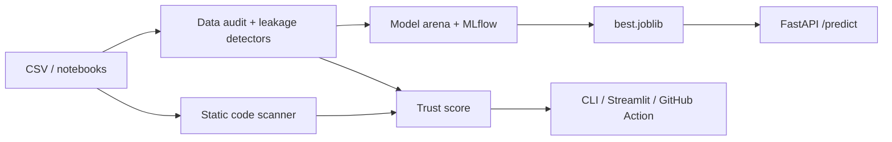

# LeakLens

[العربية](docs/README.ar.md) | [日本語](docs/README.ja.md)

[](https://github.com/eyadstein/leaklens/actions/workflows/ci.yml)
[](#trust-score-badge)
[](https://pypi.org/project/leaklens-ml/) [](https://pypi.org/project/leaklens-ml/)
[](LICENSE)

**Catch data leakage before it fools you.** Most "99% accuracy" models are leaking. LeakLens audits both your **data** and your **code**, then proves what survives by training three model families on a leak-free pipeline.

**[Website and interactive demo](https://eyadstein.github.io/leaklens/)** · **[Documentation](https://eyadstein.github.io/leaklens/docs.html)**

## What it catches

| Where | Leak |
|---|---|
| Data | Target leakage (a single feature that almost perfectly predicts the label), high-cardinality categorical target leakage, ID-like columns, train/test row overlap, feature-vector overlap with conflicting labels, case/whitespace near-duplicates, temporal leakage, entity/group overlap (`--group COL`), target-, split- and group-associated missingness (`missingness_*`, `--test`/`--group`), near-duplicate images across split folders (`leaklens images`) |
| Code (`.py`, `.ipynb`) | Scaler/encoder/imputer fitted before the split, SMOTE before the split, target/frequency encoding built from all rows, feature selection (SelectKBest, RFE, SelectFromModel) before the split, transformers fitted on test/validation data or on the full dataset after the split, chained calls like `StandardScaler().fit_transform(X)`, preprocessing or resampling done before `cross_val_score` / `GridSearchCV` (`preprocess_outside_cv`), hyperparameter tuning on the test set (`tuning_on_test_data`), tuning before the split or on the full frame (`tuning_before_split`, `tuning_on_full_data`), cross-validation on test rows (`cv_on_test_data`), repeated test-set scoring, group CV without `groups=`, shuffled splits of time-sorted data, and notebooks run out of order |

Confidence is explicit in each finding's wording: a confirmed rule (for example a search fitted on `X_test`) is reported as a high-severity leak, while a suspicious but legitimate-possible pattern (for example frequency encoding before the split) is low/medium and says what was observed. Every finding has a fix hint under `--explain`.


Every audit returns a 0-100 trust score. The CLI exits with code 1 on a high-severity leak, so it gates CI.

## Demo

```
$ leaklens demo.csv --target is_fraud --arena
LeakLens trust score: 50/100
[HIGH] target_leakage :: chargeback_flag :: alone predicts target (roc_auc=1.000)
[MEDIUM] id_like :: txn_id :: 100.0% unique values; likely an identifier

Arena ranked by pr_auc (auto-dropped: chargeback_flag, txn_id)
model roc_auc pr_auc best_f1
neural_net 0.8374 0.4219 0.4353
linear 0.8410 0.4215 0.4304
tree_ensemble 0.8242 0.3562 0.4103
```

A leaked column makes accuracy look perfect. LeakLens drops it and shows the honest numbers.

The [website](https://eyadstein.github.io/leaklens/) is a static GitHub Pages build served from `docs/`, with no bundler and no external dependencies. Its [demo](https://eyadstein.github.io/leaklens/demo.html) replays real scanner output for the checked-in examples, and is explicitly labelled **prerecorded**: GitHub Pages cannot run Python. The [live scan page](https://eyadstein.github.io/leaklens/live.html) connects to a real, separately deployed `leaklens.public_api` backend and has no simulated fallback: without a configured backend it says **No backend connected** and links to the prerecorded demo. No public backend is deployed by this repository; see [docs/LIVE_SCANNING.md](docs/LIVE_SCANNING.md) for the free Render deployment, limits, cold starts and the security model.

Regenerate the fixtures and validate every link, asset and accessibility landmark with:

```sh
python scripts/build_site.py
node --test tests/site/demo-engine.test.mjs tests/site/live-engine.test.mjs
node scripts/check_site_layout.mjs   # local headless Chrome/Edge check
```

## Python version

- **Required:** Python >=3.10 (`requires-python` in `pyproject.toml`)
- **CI-tested:** 3.10, 3.11, 3.12 (`.github/workflows/ci.yml` matrix) — **locally verified** on 3.10, 3.11, 3.12, and 3.14 (full test suite; see [docs/REALWORLD.md](docs/REALWORLD.md) for the real-world eval and [CONTRIBUTING.md](CONTRIBUTING.md) for local checks)
- 3.13 was **not** in the CI matrix at the time of this release and is **not** claimed as verified

> The `leaklens` command is provided by the PyPI package `leaklens-ml`.

## Install

Base package (no optional dependencies) — works on Windows, Linux and macOS:

```sh
python -m pip install --upgrade leaklens-ml
leaklens --version
leaklens doctor
```

On Windows, use `py -3 -m pip ...` if `python` is not on your PATH. On Linux and macOS, the same commands work with `python3`/`pip3` if your distribution does not alias `python`. If pip reports `externally-managed-environment` (PEP 668, common with Homebrew or distro Python), create a virtual environment first: `python3 -m venv .venv`, then `. .venv/bin/activate` (Windows: `.venv\Scripts\Activate.ps1`).

Windows quick-start (PowerShell, creates `.venv`, installs, verifies, prints usage — no admin needed):

```powershell
powershell -ExecutionPolicy Bypass -File scripts\install.ps1
# Optional extras:
powershell -ExecutionPolicy Bypass -File scripts\install.ps1 -Extras "arena,parquet"
```

Linux/macOS development checkout:

```sh
git clone https://github.com/eyadstein/leaklens.git
cd leaklens
python -m venv .venv
. .venv/bin/activate   # Windows: .venv\Scripts\Activate.ps1
pip install -e ".[dev,app]"
```

Verify outside the repo (clean environment):

```sh
leaklens doctor
leaklens --version
```

CSV and JSON input, dataset audit, code scanning, and `--explain` / `--intelligence` / `--ai` / `--sarif` / `--html` / `--badge` / `doctor` work with the base install.

### `leaklens doctor`

`leaklens doctor` checks the install without network access and without reading secrets: Python is >=3.10, the LeakLens version and install location, the `leaklens` entry point, core dependencies (pandas, numpy, scikit-learn), which optional extras are importable, and whether `.leaklens.toml` (validated against the configuration schema) or `pyproject.toml` (whichever it finds first) is valid TOML. Pass `leaklens doctor --config PATH` to validate a specific configuration file.

```sh
leaklens doctor             # human-readable report; exit 1 on a failed check
leaklens doctor --json      # the same report as JSON
leaklens doctor --help      # usage
```

Optional extras that are missing are listed but do not fail the check; a missing core dependency, Python <3.10, or invalid config returns exit code 1.

### Optional extras

Every optional extra declared in `pyproject.toml`:

| Extra | Purpose | Install command |
|---|---|---|
| `arena` | Model arena with MLflow tracking (`--arena`) | `pip install "leaklens-ml[arena]"` |
| `parquet` | Read `.parquet` with `pyarrow` | `pip install "leaklens-ml[parquet]"` |
| `feather` | Read `.feather` with `pyarrow` | `pip install "leaklens-ml[feather]"` |
| `excel` | Read `.xlsx` with `openpyxl` | `pip install "leaklens-ml[excel]"` |
| `images` | Near-duplicate image check (`leaklens images`) with Pillow | `pip install "leaklens-ml[images]"` |
| `app` | FastAPI service + Streamlit UI | `pip install "leaklens-ml[app]"` |
| `api` | Hardened public live-scan API (FastAPI + uvicorn, no Streamlit) | `pip install "leaklens-ml[api]"` |
| `sql` | Optional SQL lineage analysis (`--sql`) with SQLGlot | `pip install "leaklens-ml[sql]"` |
| `taintwatch` | Optional TaintWatch guard for `--llm` | `pip install "leaklens-ml[taintwatch]"` |
| `dev` | Test, lint (ruff), bandit, pip-audit, pip-licenses and the other developer tools | `pip install "leaklens-ml[dev]"` |

Development checkout:

```sh
git clone https://github.com/eyadstein/leaklens.git
cd leaklens
python -m venv .venv
. .venv/bin/activate   # Windows: .venv\Scripts\Activate.ps1
pip install -e ".[dev,app]"
```

## Quick start

```sh
leaklens train.csv --target label --test test.csv --time date
leaklens --scan notebooks/ --explain   # prints a suggested fix under each finding
leaklens --scan . --sarif leaklens.sarif   # for GitHub code scanning
leaklens train.csv --target label --test test.csv --group patient_id
leaklens train.parquet --target label --fail-under 80   # Parquet input (pip install "leaklens-ml[parquet]"); CI gate on trust score
leaklens train.json --target label   # JSON input, no extra needed
leaklens train.xlsx --target label   # Excel input (pip install "leaklens-ml[excel]")
leaklens train.feather --target label   # Feather input (pip install "leaklens-ml[feather]")
leaklens images data/train data/test   # near-duplicate images across splits (pip install "leaklens-ml[images]")
leaklens train.csv --target label --test test.csv --drift   # opt-in, diagnostic-only drift
leaklens --scan query.sql --target label --sql-dialect postgres   # needs [sql]
python examples/make_demo.py
leaklens demo.csv --target is_fraud --arena
mlflow ui --backend-store-uri sqlite:///mlflow.db
```

New to data leakage? Start with the [walkthrough notebook](examples/leak_walkthrough.ipynb): three planted leaks, an inflated score, and how LeakLens finds and fixes them.

## Supported CLI commands

### `leaklens` (dataset audit)

Audit a dataset (and optionally a held-out test split) for leakage.

```sh
leaklens train.csv --target label            # single-file audit
leaklens train.csv --test test.csv --target label
leaklens train.csv --test test.csv --target label --time date
leaklens train.csv --target label --test test.csv --group patient_id
leaklens train.csv --target label --json     # JSON output
leaklens train.csv --target label --threshold 0.95
leaklens train.csv --target label --fail-under 80   # exit 1 if trust score < 80
leaklens train.csv --target label --arena    # needs [arena]
leaklens train.csv --target label --html report.html
leaklens train.csv --target label --intelligence   # deterministic confidence + evidence clusters
leaklens train.csv --target label --intelligence --graph-out evidence.mmd
leaklens --scan src/ --graph-out evidence.json      # graph export implies intelligence
leaklens --scan src/ --graph-snapshot graph-baseline.json   # save a comparable snapshot
leaklens --scan src/ --graph-baseline graph-baseline.json   # new/unchanged/changed/resolved
leaklens train.csv --target label --ai             # experimental, offline AI hypotheses
```

| Flag | Meaning |
|---|---|
| `train` | Path to the training dataset (positional) |
| `--target` | Label column in the training data |
| `--test` | Held-out split to compare against |
| `--time` | Timestamp column for the temporal check |
| `--group` | Entity column (patient, customer...) for group leakage |
| `--threshold` | Single-feature score that counts as leakage (default 0.95) |
| `--arena` | Compare 3 model families, tracked in MLflow (needs `arena` extra) |
| `--out` | Output dir for the arena winner (default `models`) |
| `--tracking-uri` | MLflow tracking URI (default `sqlite:///mlflow.db`) |
| `--json` | Emit JSON |
| `--explain` | Print a suggested fix under each finding |
| `--intelligence` | Deterministic confidence, evidence clusters, root-cause and remediation analysis |
| `--graph-out` | Write the evidence graph to a file (implies `--intelligence`); Mermaid, DOT or JSON by extension |
| `--graph-format` | Override the graph format inferred from `--graph-out` (`mermaid`, `dot`, `json`) |
| `--graph-snapshot` | Write a validated evidence-graph snapshot for future comparisons (implies `--intelligence`) |
| `--graph-baseline` | Compare the current graph with a saved snapshot and report new/changed/resolved evidence |
| `--update-graph-snapshot` | Explicitly replace an existing `--graph-snapshot` file |
| `--fail-on-graph-new` | Opt in to exit 1 when the graph comparison finds new evidence |
| `--llm` / `--llm-provider` | Optional LLM explanations (see next section) |
| `--ai` | Add experimental, evidence-bound AI hypotheses (offline, opt-in) |
| `--ai-llm` | Rephrase the AI plan with the configured LLM; deterministic fallback |
| `--drift` | Opt-in train/test distribution-drift diagnostics (needs `--test`; diagnostic-only) |
| `--sarif` | Write SARIF 2.1.0 for GitHub code scanning |
| `--html` | Write a shareable single-file HTML report |
| `--badge` | Write a shields.io endpoint JSON with the trust score |
| `--fail-under` | Exit with code 1 if trust score is below N |
| `--version` | Print version and exit |

Unknown or extensionless input falls back to CSV. Optional formats (Parquet/Feather/Excel) raise an `ImportError` naming the extra that provides them.

With `--test`, LeakLens runs three bounded duplicate checks in order and reports at most one: exact row overlap (all shared columns, including the label), identical feature vectors with a different label (label excluded), then normalised near-duplicates (text lower-cased/stripped, numbers rounded to 4 decimals). The checks sample at most 50,000 rows for feature overlap and 20,000 for near-duplicates, so large files stay fast. They are heuristics: they report the observed counts and whether labels conflict, and in low-cardinality tabular data an identical feature vector can occur naturally, so treat a medium finding as a prompt to inspect rather than proof of leakage.

JSON findings also carry an additive `evidence` list (bounded, privacy-safe provenance for the highest-value detectors) and a stable `fingerprint`. SARIF writes the same evidence under `properties.leaklens.evidence` and the fingerprint under `partialFingerprints["leaklensFinding/v1"]`, so tracked findings keep their identity when only line numbers or messages change. Moving a file, changing the detector kind, changing the affected feature or changing a detector-supplied stable key changes the fingerprint. See [`docs/DETECTORS.md`](docs/DETECTORS.md) for the full detector contract. Existing fields, severities and the trust score are unchanged.

`--intelligence` additionally builds a deterministic evidence graph: existing findings are grouped by an inspectable anchor (feature, split or file), detector evidence is preserved and linked, and each cluster gets its own corroboration-aware confidence plus any measured impact from `--test`. The graph adds no findings and never changes the trust score or exit code. `--graph-out evidence.mmd|.dot|.json` exports the same graph for review; see [`docs/INTELLIGENCE.md`](docs/INTELLIGENCE.md) for traversal APIs, export formats, and the API opt-in (`intelligence=true` / `include_intelligence=true`).

`--graph-snapshot baseline.json` saves a versioned snapshot of the current graph, and `--graph-baseline baseline.json` compares a later scan against it. Evidence is matched by stable fingerprint, so reordering or rebuilt ids do not create false changes. The comparison reports `new`, `unchanged`, `changed`, `resolved` and `uncertain`; missing evidence is only `resolved` when both scans are complete and use the same analysis context. Snapshots are validated and written atomically, and are never overwritten without `--update-graph-snapshot`. Graph comparison is opt-in, does not change findings/scores/exit codes, and `--fail-on-graph-new` is the only new (opt-in) gate. JSON gains `graph_baseline`; SARIF gains compact per-result and run-level graph metadata; HTML gains a comparison section. A comparison describes evidence movement, not proof of leakage or remediation.

### `leaklens --scan PATH...`

Statically scan `.py` / `.ipynb` files or folders for pipeline leaks (fit before split, fit on test data, tuning on test data, target/frequency encoding before the split, feature selection, group CV without `groups=`, shuffled time-series splits, and out-of-order notebook execution). Scanned code is **never executed**.

```sh
leaklens --scan notebooks/ --explain
leaklens --scan leaklens
leaklens --scan . --sarif leaklens.sarif || true
leaklens --scan src tests --llm
leaklens --scan notebooks/ --ai          # experimental AI hypotheses (offline)
leaklens --scan warehouse/sql --sql --target label --sql-dialect bigquery   # needs [sql]
```

SQL: an explicit `.sql` file is analyzed when named on the command line; folders include `.sql` only with `--sql`. Dialects are explicit (`ansi`, `postgres`, `bigquery`, `snowflake`) and there is no silent fallback. See [SQL lineage analysis](#sql-lineage-analysis-optional).

A deliberately leaky demo covering tuning, target encoding, feature selection, group CV, and time ordering is in [`examples/advanced_leaks.py`](examples/advanced_leaks.py); run `leaklens --scan examples/advanced_leaks.py --explain` to see each finding and its fix.

Exit code is 1 when a high-severity finding is present, so it gates CI.

### `leaklens images TRAIN_DIR TEST_DIR`

Find near-duplicate images across train/test folders (64-bit dHash, `--max-distance` default 6). Needs the `images` extra.

```sh
leaklens images data/train data/test
leaklens images data/train data/test --max-distance 10 --samples 5 --json
```

### `leaklens init`

Write a commented starter `.leaklens.toml`:

```sh
leaklens init
leaklens init mydir --force   # overwrite an existing .leaklens.toml
```

It prints the pre-commit hook snippet (below).

### `leaklens workspace [DIR]`

Serve a local, read-only page for scanning a project or auditing a dataset with
visible progress and navigable results (findings grouped by evidence cluster,
source preview, HTML report). Needs the `app` extra.

```sh
leaklens workspace                 # root: current folder, http://127.0.0.1:8765/
leaklens workspace notebooks/ --port 9000 --no-open
```

Source scans cover the same files as `--scan DIR`. Dataset audits pick a file,
inspect its columns, then run the same engine as `leaklens FILE --target COL`
(target, threshold, optional held-out file, time and group columns). Both reuse
the CLI's baseline and suppression policy: choose a baseline in the page or set
`[baseline].path` in `.leaklens.toml`, and the UI shows `new`, `unchanged`,
`changed` and `suppressed` findings, suppression reasons and resolved entries.
Both scan types also have an evidence-graph view: inspect the engine's evidence
nodes and recorded relationships, filter and search them, and jump between a
finding and its evidence. The view is bounded and read-only; it never rebuilds
the graph or invents relationships.
Scans and audits stream live progress over server-sent events with automatic
fallback to polling. The history view lists retained in-memory sessions (lost on
restart, last 20 of each kind) and can reopen results, reports and graphs.
Compatible previous/current sessions can be compared using stable fingerprints:
added, unchanged, changed and no-longer-present findings are shown with policy
status and suppression preserved, while partial or cancelled scans report
inconclusive instead of resolved.
The workspace never writes a baseline. Nothing else is written to disk, no code
is executed, and one activity runs at a time. See
[docs/WORKSPACE.md](docs/WORKSPACE.md).

## Missingness audit

Missing values are not automatically a leak, so the audit only reports patterns where *why* a value is missing can carry information that is unavailable at prediction time:

- `missingness_target_signal` (medium): missingness is associated with the target (a point-biserial correlation for numeric targets, or a missing-rate difference between target classes with `z >= 3`).
- `missingness_split_shift` (medium): missingness differs substantially between the train and test splits, including a feature populated in one split and absent from the other.
- `missingness_group_signal` (low): missingness differs across `--group` entities.

Every check needs a minimum number of rows, missing values and present values, plus a minimum effect size. Insufficient samples, constant columns, entirely missing columns and missing split metadata are reported as skips rather than findings. Evidence contains only aggregate rates and counts, never raw rows or group identifiers. Statistics are deterministic, use pandas/numpy only (no SciPy), and are linear-time per column. Findings are a reason to investigate, not proof of leakage; severity never exceeds `medium`, the data and splits are never modified, and the default exit behavior is unchanged. See [`docs/MISSINGNESS_BENCHMARK.md`](docs/MISSINGNESS_BENCHMARK.md) for the labeled regression benchmark and its limits.

## SQL lineage analysis (optional)

With the optional `sql` extra (`pip install "leaklens-ml[sql]"`), LeakLens parses `.sql` files with SQLGlot and resolves column lineage through CTEs, derived tables, joins, unions and aggregate aliases. It never executes SQL, opens a database connection or reads credentials.

- `sql_target_as_feature` (high): a non-bare projection whose expression references the target **and** whose confirmed lineage includes the target column.
- `sql_future_window` (medium): a window frame ends with `FOLLOWING`, so it can read rows that are not available at prediction time.
- `sql_split_predicate_missing` (low): a configured `split_column` exists on a referenced table and no split predicate filters the query.
- `sql_unresolved_column` (low, diagnostic): lineage was ambiguous or unavailable (`SELECT *` without a schema, an unqualified column over several tables, a non-SELECT statement).
- `parse_error` (low): the declared dialect cannot parse the input.

Bare target projections, renames (`label AS outcome`) and target filters (`WHERE label = 1`) are deliberately clean. Unresolved lineage never produces a target finding; it produces the low diagnostic instead, so the analysis fails safe. Dialects are explicit (`ansi`, `postgres`, `bigquery`, `snowflake`) with no silent fallback. Source locations are `path:line`; fingerprints use structural keys, so moving a query keeps its baseline identity. Without the `sql` extra, SQL scanning raises an actionable error naming the install command.

```sh
leaklens --scan query.sql --target label --sql-dialect postgres
leaklens --scan warehouse/sql --sql --target label --sql-dialect bigquery
```

Full rules, the feasibility gate and limitations: [`docs/SQL_LINEAGE.md`](docs/SQL_LINEAGE.md). Measured synthetic corpus: [`docs/SQL_BENCHMARK.md`](docs/SQL_BENCHMARK.md).

## Distribution drift (opt-in)

`--drift` compares the training frame with `--test` and reports columns whose distribution changed. It is **off by default**, **low severity**, marked `diagnostic: true`, and **ignored by the trust score and the default exit code**. It never modifies data or splits and needs no SciPy.

| Signal | Method |
|---|---|
| Numeric columns | Two-sample Kolmogorov-Smirnov statistic |
| Categorical columns | Total-variation distance over the top-k categories |
| Every column | Absolute missingness-rate difference |

Defaults: at least 200 rows per split, a 0.20 effect floor, at most 50 columns and 20 top categories, with deterministic evenly spaced subsampling above 100,000 rows. Constant, fully missing, unsupported and target columns are skipped; no test frame gives `skipped`, a small sample gives `insufficient_data`. Evidence contains only aggregate statistics (`ks=0.62`, `tvd=0.55`, `missingness=0.41`), never raw values or categories. Drift is a reason to investigate, not proof of leakage.

```sh
leaklens train.csv --target label --test test.csv --drift
leaklens train.csv --target label --test test.csv --drift --json
```

Details and interpretation: [`docs/DRIFT.md`](docs/DRIFT.md); measured controls: [`docs/DRIFT_BENCHMARK.md`](docs/DRIFT_BENCHMARK.md).

## Pipeline and MLOps intelligence (opt-in)

`--pipeline` reads the metadata a training pipeline leaves in the repository (DVC stages and locks, serialized DAG JSON, notebook cell order, dependency declarations) and asks whether the evaluation is circular. It is **off by default**, **read-only**, and needs no orchestrator: nothing is executed and no service is contacted. `pip install "leaklens-ml[yaml]"` adds `safe_load`-only YAML parsing for DVC files; without it, directory audits skip DVC metadata and naming a DVC file raises an actionable `PipelineUnavailable`.

| Kind | Severity | Signal |
|---|---|---|
| `pipeline_split_overlap` | high | train and eval read the same data artifact, or eval reads a data artifact train produced |
| `pipeline_unresolved_lineage` | low | a declared dependency has no producing stage and no file |
| `pipeline_param_drift` | low | `dvc.lock` and the current parameter file disagree |
| `pipeline_missing_digest` | low | a locked output has no content digest |
| `pipeline_unpinned_dependency` | low | a requirements entry has no exact pin |
| `no_random_state` | low | a training stage declares model parameters but no seed |

Every pipeline finding is `diagnostic: true` and `scored: false`: it never changes the trust score, the exit code or an existing finding. Only a confirmed lineage path reaches `high`. Edge and stage output is deterministic and sorted.

```sh
leaklens --scan . --pipeline
leaklens --scan pipelines/dvc.yaml --pipeline --json
```

Rules, formats and limits: [`docs/PIPELINE.md`](docs/PIPELINE.md); measured controls: [`docs/PIPELINE_BENCHMARK.md`](docs/PIPELINE_BENCHMARK.md).

## Configuration (`.leaklens.toml`)

`leaklens init` writes a commented starter `.leaklens.toml` (one top-level key per CLI flag, plus `[baseline]`, `[[suppressions]]`, `[missingness]`, `[sql]` and `[drift]`) and prints the pre-commit snippet. Add `--force` to overwrite an existing file.

The CLI reads `./.leaklens.toml` automatically when it exists (or the file passed with `--config`). Precedence is deterministic: built-in defaults, then the configuration file, then explicit CLI flags. Unknown keys, wrong types, unsafe output paths and invalid suppression rules fail closed with exit code 2 and the file location in the message; none of them silently change a scan. Output paths (`sarif`, `html`, `badge`, `[baseline].path`) must stay inside the configuration directory. The file cannot execute code, load plugins or access the network.

```toml
target = "label"
test = "test.csv"          # resolved relative to this file
scan = ["notebooks", "src"]
fail_under = 80

[baseline]
path = "leaklens-baseline.json"
fail_on_new = true         # opt-in CI failure for new findings

[[suppressions]]
fingerprint = "64-lowercase-hex-characters"
reason = "accepted: the column is recorded before prediction"
expires = "2027-01-01"

[missingness]
enabled = true
min_rows = 200

[sql]
enabled = false            # --sql: also scan .sql files (needs the sql extra)
dialect = "ansi"           # ansi, postgres, bigquery, snowflake
split_column = "split"     # optional: flag queries without a split predicate

[sql.schema.orders]        # optional column types for lineage resolution
id = "INT"
amount = "DOUBLE"
label = "INT"
split = "TEXT"

[drift]
enabled = false            # --drift: opt-in train/test drift diagnostics
min_rows = 200
min_effect = 0.20
```

Full schema, defaults and error behavior: [`docs/CONFIGURATION.md`](docs/CONFIGURATION.md). Baseline and suppression workflow: [`docs/BASELINES.md`](docs/BASELINES.md).

## Baselines and suppressions

A **baseline** records the stable fingerprints of findings you have already reviewed. Later runs report each finding as `new`, `unchanged`, `changed` (same identity, different severity) or `resolved` (recorded but no longer present), so CI only needs to look at what moved.

```sh
leaklens train.csv --target label --write-baseline --baseline leaklens-baseline.json
leaklens train.csv --target label --baseline leaklens-baseline.json --fail-on-new
leaklens train.csv --target label --baseline leaklens-baseline.json --update-baseline
```

A baseline is never overwritten implicitly: a second `--write-baseline` exits 2 and `--update-baseline` is the explicit replace. The file is written atomically and contains only fingerprints and finding metadata (no rows, feature values or source). A baseline written with a different fingerprint schema is refused rather than compared.

A **suppression** accepts one exact fingerprint with a required reason and an optional ISO expiration date. There are no wildcards, so a rule cannot hide future unrelated findings. Suppressed findings stay in JSON/SARIF/HTML with `status: "suppressed"` and their original severity and evidence; they stop counting toward the trust score and the default exit gate. Expired rules and rules that match nothing are reported as diagnostics and are never applied. Malformed rules abort the run (exit 2).

A **resolved** finding is the opposite of suppression: the baseline recorded it but the current scan no longer produces it. Resolved findings are listed separately (`resolved` in JSON) and are not suppressions.

The default exit behavior is unchanged: exit 1 for a high-severity active finding or a trust score below `--fail-under`. Only `--fail-on-new` (or `[baseline].fail_on_new`) adds a new CI failure mode, and it is opt-in.


## Optional LLM explanations

LLM explanations are disabled unless you pass `--llm`. LeakLens sends the selected findings' severity, kind, file name and line, and diagnostic detail; details can include short code expressions from scanned files. It does not send complete source files, notebooks, or dataset rows. The default provider is local Ollama. If you choose `--llm-provider openai-compatible` or configure a remote base URL, these finding details are sent to that host. Provider URLs must use HTTP or HTTPS, redirects are refused, and an API key is not sent over plain HTTP except to `localhost` or `127.0.0.1`. Explanations are limited to the 10 highest-severity findings by default; use `--llm-max-findings N` to change that limit.

```sh
ollama pull qwen2.5:7b
leaklens --scan notebooks/ --llm
```

To use an OpenAI-compatible API, configure its endpoint and key. The request leaves your machine:

```sh
export LEAKLENS_LLM_BASE_URL=https://api.example.com/v1
export LEAKLENS_LLM_API_KEY=...
export LEAKLENS_LLM_MODEL=your-model
leaklens --scan notebooks/ --llm --llm-provider openai-compatible
```

You can also pass `--llm-base-url` and `--llm-model` on the command line. The API key is read only from `LEAKLENS_LLM_API_KEY`.

### Custom prompt templates

By default, LeakLens uses the prompt template stored in `leaklens/prompts/explain.txt`. You can override it with a custom template file using `--llm-prompt-template` or the `LEAKLENS_LLM_PROMPT_TEMPLATE` environment variable:

```sh
leaklens --scan notebooks/ --llm --llm-prompt-template my_template.txt
```

Templates support the placeholders `{severity}`, `{kind}`, `{location}`, `{location_label}`, and `{detail}`. LeakLens will also automatically load a project-level template from `.leaklens/prompt.txt` if present; that file must be a real file inside the working directory. Missing, unreadable, empty or oversized templates (over 64 KiB) stop the run with an error instead of falling back to the default.

## Experimental AI intelligence

LeakLens has an **optional, offline, experimental AI layer** that adds evidence-bound hypotheses and a root-cause remediation plan on top of the deterministic detectors. It is off by default and available in the base install: no GPU, network, paid service or credentials are required for the core layer.

```sh
leaklens --scan notebooks/ --ai          # hypotheses for code
leaklens train.csv --target label --ai   # hypotheses for dataset metadata
leaklens --scan src --ai-llm             # optional LLM rephrasing, with fallback
```

It combines deterministic semantic rules (pipeline order, future information, target-proxy names, identifier names, shared keys) with a small in-memory CPU model trained on grouped, labelled code patterns. Every hypothesis carries inspectable evidence and a limitation; nothing is executed.

**Deterministic findings remain authoritative.** AI proposals are marked experimental, capped at medium severity, and never change a finding, its severity, the trust score or the exit code. Dataset analysis receives column metadata only — never rows or values. Code and column names are treated as untrusted: instruction-like text is reported as an `info` notice, not followed.

`--ai` adds an `ai` object to `--json`, an *AI intelligence (experimental)* section to `--html`, and is also exposed by the Python API (`leaklens.ai`) and the public live-scan API (`include_ai=true`). The website's live page has an explicit opt-in checkbox and renders AI output separately.

Measured precision, recall, F1, false-positive rate, false positives, misses and limitations are in [docs/AI_BENCHMARK.md](docs/AI_BENCHMARK.md) and explained in [docs/AI_INTELLIGENCE.md](docs/AI_INTELLIGENCE.md). The independent check is [docs/AI_REALWORLD.md](docs/AI_REALWORLD.md): 48 reviewed units from 12 public repositories, measured at accuracy 0.833, precision 0.767, recall 0.958, F1 0.852 and FPR 0.292, with every mistake listed. That is the Phase 6 record at threshold 0.50; the shipped `leaklens-ai-p7` model has **no second independent holdout**. No H2 corpus exists (0 of the required 48 units), so [docs/AI_REALWORLD_H2.md](docs/AI_REALWORLD_H2.md) publishes the shortfall instead of a number. Those are real measurements, **not** a production-accuracy claim, and they are lower than the authored locked test. They are not claimed as an improvement over the deterministic scanner. `--ai-llm` sends only sanitized group metadata to the configured LLM provider, never raw code or dataset rows, and falls back to the deterministic plan if the provider fails or the reply is unsafe.

## Model arena

Auto-drops leaking and ID columns, then trains linear, gradient-boosted tree and neural-net models inside leak-safe pipelines (imputation, scaling and encoding are fitted on training data only). Runs are tracked in local MLflow (SQLite) and the winner is saved to `models/best.joblib`. Add `--time COL` for a temporal split.

## API and UI

```sh
uvicorn leaklens.api:app --port 8000 # docs at /docs
streamlit run leaklens/ui.py
```

Endpoints: `GET /health`, `POST /audit`, `POST /scan`, `POST /predict`.

> `POST /predict` never accepts a model path from the request. The server loads one operator-chosen artifact at startup: `LEAKLENS_MODEL_PATH` (default `models/best.joblib`). Any other `model_path` in the body is rejected with 422 before the filesystem is touched. `joblib` uses pickle, which can execute arbitrary code while loading; only point the server at a model you built or otherwise trust, and do not expose the API to untrusted users or networks. See [SECURITY.md](SECURITY.md).

To serve a different artifact, pick it on the server instead of in the request:

```sh
LEAKLENS_MODEL_PATH=models/churn-v2.joblib uvicorn leaklens.api:app --port 8000
curl -s localhost:8000/predict -H 'content-type: application/json' \
  -d '{"rows": [{"tenure": 12, "plan": "pro"}]}'
```

The response reports the model family (`"model"`) and task, never the filesystem path.


### Upload and archive limits

The API and the Streamlit CSV uploaders are meant for local or trusted use and enforce the same dataset limits:

- **8 MiB** maximum per uploaded file, and **50,000 rows** maximum.
- ZIP/gzip containers (including `.xlsx`, which is a ZIP archive) are inspected before parsing: total decompressed size must stay at or below **256 MiB**, ZIP entries with absolute or traversal paths are rejected, and nested gzip is limited to 5 layers.
- `POST /scan` rejects source text larger than 8 MiB.

The CLI reads files from disk, so it has no 8 MiB/50k-row upload cap, but the same 256 MiB decompressed-container check applies. Compressed files are not an additional input format: LeakLens does not decompress arbitrary `.zip`/`.gz` files into a dataset. The container checks protect the formats it does read (for example `.xlsx`).

### Public live-scan API (untrusted uploads)

The static website’s live page talks to a separate, hardened app built for untrusted uploads. It has no `/predict`, no model loading and no persistent storage:

```sh
pip install "leaklens-ml[api]"
uvicorn leaklens.public_api:app --host 127.0.0.1 --port 8000
python scripts/smoke_public_api.py          # real HTTP smoke test
```

`GET /health`, `GET /capabilities`, `POST /inspect`, `POST /audit` and `POST /scan` are the complete surface. Defaults are 4 MiB per file, 5,000 rows, 200 columns, 750k cells, one concurrent scan, a 30-second scan budget, 20 POSTs per client per minute, and CSV/JSON only; every limit is configurable by environment variable. Requests are content-sniffed (not trusted by filename or MIME type), parsed in memory, bounded before detection and never written to disk. `POST /audit` and `POST /scan` accept `include_ai=true` for the optional experimental AI layer; the response adds an `ai` object and leaves the deterministic score and findings unchanged. They also accept `include_intelligence=true` for the deterministic evidence graph; the response adds an `intelligence` object (evidence, clusters, links) and the HTML report gains its cluster and link tables, while the default payload, score, findings and exit behavior stay unchanged.

This repository **does not deploy a public backend**. The GitHub Pages live page therefore starts disconnected. A free Render web service is documented in [docs/LIVE_SCANNING.md](docs/LIVE_SCANNING.md) together with verified limits (512 MB, 0.1 CPU, spins down after 15 minutes, ~1 minute cold start, ephemeral disk) and `render.yaml` + `Dockerfile.api`. Hugging Face Docker Spaces, Fly.io and Koyeb were checked and are not free for this use case.

## Docker

> Docker build/run below is **documented but not verified executed** in this environment (Docker Engine was unavailable on the development machine). Commands are verified against the actual `Dockerfile` and `docker-compose.yml` in the repo root; run them where the daemon is healthy.

The image is `python:3.11-slim`, installs `.[arena,app]`, exposes 8000/8501, and defaults to `uvicorn leaklens.api:app --host 0.0.0.0 --port 8000`.

Build and run (Compose):

```sh
docker compose up --build
```

- API: http://localhost:8000/docs
- UI: http://localhost:8501
- `./models` is mounted into both containers at `/app/models`

Build and run (plain Docker, API only):

```sh
docker build -t leaklens .
docker run --rm -p 8000:8000 -v ./models:/app/models leaklens
```

To run the UI container alone, override the API default command:

```sh
docker run --rm -p 8501:8501 leaklens streamlit run /app/leaklens/ui.py --server.port=8501 --server.address=0.0.0.0
```

For the hardened public app, build the smaller, non-root `Dockerfile.api` instead:

```sh
docker build -f Dockerfile.api -t leaklens-api .
docker run --rm -p 8000:8000 leaklens-api
```

## GitHub Action

```yaml
- uses: actions/checkout@v7
- uses: eyadstein/leaklens@main
  with:
    path: notebooks
```

## HTML report

```sh
leaklens demo.csv --target is_fraud --arena --html report.html
```

A single self-contained file with the trust score, findings and arena table. Easy to attach to a PR or share with your team.
The findings section includes a color-coded severity legend explaining high, medium and low leakage risks, even when no findings are present.

## GitHub code scanning

```yaml
permissions:
  contents: read
  security-events: write
steps:
  - uses: actions/checkout@v7
  - run: pip install leaklens-ml
  - run: leaklens --scan . --sarif leaklens.sarif || true
  - uses: github/codeql-action/upload-sarif@v4
    with:
      sarif_file: leaklens.sarif
```

Findings then appear in the repository's Security tab and as PR annotations.

## SBOM and security automation

The release workflow builds the wheel and sdist, installs the wheel, and writes a CycloneDX 1.5 SBOM to `sbom/sbom.json` with `scripts/generate_sbom.py`. The SBOM is kept outside `dist/` so it cannot be picked up by the PyPI publisher. Both the Python packages and the SBOM are uploaded as workflow artifacts; the wheel and sdist are then published to PyPI.

```sh
python scripts/generate_sbom.py              # dist/sbom.json
python scripts/generate_sbom.py out/sbom.json
```

The generator reads runtime dependencies and optional extras from `pyproject.toml`, records installed versions when available, and excludes the `dev` extra. It needs Python 3.10+ (with `tomli` on 3.10) and does not require `cyclonedx-py`.

CI runs `bandit`, `pip-audit`, and `pip-licenses` on every push and pull request. The separate CodeQL workflow runs `security-extended` Python analysis and uploads results to GitHub code scanning.

## Pre-commit hook

```yaml
repos:
  - repo: https://github.com/eyadstein/leaklens
    rev: main
    hooks:
      - id: leaklens
```

Blocks a commit when a notebook or script fits a transformer before the split.

`leaklens init` writes a commented starter `.leaklens.toml` (one key per CLI flag) and prints this snippet. Add `--force` to overwrite an existing file.

## Trust score badge

```sh
leaklens --scan . --badge badge.json
```

Commit `badge.json`, then point a shields.io endpoint badge at its raw URL (as at the top of this file).

## Architecture



The long-term design (multi-modal engines, shared evidence core, phase plan) is documented
separately and is **not implemented**: [FUTURE_VISION.md](docs/FUTURE_VISION.md),
[FUTURE_ARCHITECTURE.md](docs/FUTURE_ARCHITECTURE.md),
[AI_ML_EXPANSION_ROADMAP.md](docs/AI_ML_EXPANSION_ROADMAP.md),
[ARCHITECTURE_DECISIONS.md](docs/ARCHITECTURE_DECISIONS.md), with supporting research in
[AI_ML_ECOSYSTEM_RESEARCH.md](docs/AI_ML_ECOSYSTEM_RESEARCH.md),
[ARTIFACT_SECURITY_STRATEGY.md](docs/ARTIFACT_SECURITY_STRATEGY.md) and
[WORKSPACE_DESIGN_VISION.md](docs/WORKSPACE_DESIGN_VISION.md).

## How the Trust Score Is Calculated

LeakLens starts with a trust score of 100 and deducts points for each finding based on its severity.

| Severity | Penalty |
|---|---:|
| High | 35 points |
| Medium | 15 points |
| Low | 5 points |

The final score is calculated by subtracting the total penalties from 100. The score cannot fall below 0.

**Example:** If a dataset has one high-severity finding, one medium-severity finding, and one low-severity finding, the total penalty is 35 + 15 + 5 = 55. The final trust score is 100 - 55 = **45/100**.

## Roadmap

Full plan with phases and exit criteria: [ROADMAP.md](ROADMAP.md). Open tasks are in [Issues](https://github.com/eyadstein/leaklens/issues).

- [x] Core detectors, static scanner, model arena, API, UI
- [x] Docker, GitHub Action, badge, CI
- [x] Group/entity leakage detector
- [x] PyPI packaging + release workflow (PyPI name `leaklens-ml`, command stays `leaklens`; create a GitHub release to publish)

## Leakage study

In a non-random sample of 1,725 public notebooks that split their data, **38%** fit a preprocessing step before the split or on test data (static heuristic, not a verdict on any notebook). Details and caveats: [docs/STUDY.md](docs/STUDY.md). Reproduce it with `python scripts/study.py` (needs the `gh` CLI).

## Validated on real notebooks

Five public notebooks were read by hand against the scanner output. Details, counts and limits are in [docs/VALIDATION.md](docs/VALIDATION.md). The sample is tiny, so treat it as a sanity check.

## Real-world notebook validation (60 notebooks, 8 reviewed labels)

The corpus under `realworld/` holds 60 public notebooks (see [realworld/README.md](realworld/README.md)). Only **8** have definitive reviewed labels — 5 `confirmed_leakage` and 3 `legitimate` — so only those contribute to precision, recall and F1. The other 52 (2 `potential_leakage` + 50 `uncertain`) stay visible but are excluded from scoring. Result: precision/recall/F1 1.00 on the reviewed 8. That is a smoke check on a tiny, non-random sample, **not** a population accuracy estimate. Full methodology: [docs/REALWORLD.md](docs/REALWORLD.md).

## Accuracy and security

The code scanner is checked against a labeled synthetic regression benchmark on every CI run (`python -m leaklens.bench`, results in [docs/BENCHMARK.md](docs/BENCHMARK.md)). Dataset detectors have a separate synthetic benchmark with per-case runtime (`python -m leaklens.bench_data`, results in [docs/DATA_BENCHMARK.md](docs/DATA_BENCHMARK.md)). Both are hand-written and shaped around supported rules — treat them as regression guards, not real-world accuracy claims. The real-world corpus is kept separate from those synthetic benchmarks (different directory, different scoring). Scanner runtime measurements, the bounded source cache and the measured decision against parallel scanning are in [docs/PERFORMANCE.md](docs/PERFORMANCE.md). Report vulnerabilities as described in [SECURITY.md](SECURITY.md).

## Contributing

See [CONTRIBUTING.md](CONTRIBUTING.md). Starter tasks are labeled good first issue.

Every PR must pass:

```sh
python -m pytest -q
leaklens --scan leaklens
python -m leaklens.bench
```

## Contributors

Thanks to @jay23606 (Parquet input), @slopggobblercobbler81 (`--fail-under`), @tyza66 (Excel, JSON and Feather input), @rahul05ranjan (`random_state` reproducibility check), @have-you-tried-restarting (severity summary), @Rashmi-R444 (trust score docs), @Thecoolss (benchmark snippets), @ElDShell (Arabic README), @Aaqibhafeezkhan (colored severity labels and `CITATION.cff`), @Cami0111 (leak walkthrough notebook) and @rahul-jain-dev (`--version`), @Vamsi-2581 (Add opt-in LLM explanations for findings).

MIT licensed.
