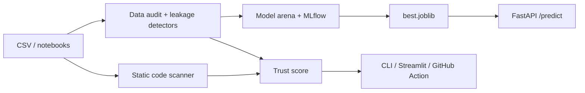

# LeakLens

[](https://github.com/eyadstein/leaklens/actions/workflows/ci.yml)
[](#trust-score-badge)
[](https://pypi.org/project/leaklens-ml/) [](https://pypi.org/project/leaklens-ml/)
[](LICENSE)

**Catch data leakage before it fools you.** Most "99% accuracy" models are leaking. LeakLens audits both your **data** and your **code**, then proves what survives by training three model families on a leak-free pipeline.

**[Live demo report](https://eyadstein.github.io/leaklens/)**

## What it catches
| Where | Leak |
|---|---|
| Data | Target leakage (a single feature that almost perfectly predicts the label), ID-like columns, train/test row overlap, temporal leakage, entity/group overlap (`--group COL`) |
| Code (`.py`, `.ipynb`) | Scaler/encoder/imputer fitted before the split, SMOTE before the split, transformers fitted on test/validation data or on the full dataset after the split, chained calls like `StandardScaler().fit_transform(X)` |

Every audit returns a 0-100 trust score. The CLI exits with code 1 on a high-severity leak, so it gates CI.

## Demo

$ leaklens demo.csv --target is_fraud --arena
LeakLens trust score: 50/100
[HIGH] target_leakage :: chargeback_flag :: alone predicts target (roc_auc=1.000)
[MEDIUM] id_like :: txn_id :: 100.0% unique values; likely an identifier

Arena ranked by pr_auc (auto-dropped: chargeback_flag, txn_id)
model roc_auc pr_auc best_f1
neural_net 0.8374 0.4219 0.4353
linear 0.8410 0.4215 0.4304
tree_ensemble 0.8242 0.3562 0.4103

A leaked column makes accuracy look perfect. LeakLens drops it and shows the honest numbers.

## Install

pip install leaklens-ml

## Quick start

pip install -e “.[dev,app]”
leaklens train.csv --target label --test test.csv --time date
leaklens --scan notebooks/ --explain   # prints a suggested fix under each finding
leaklens --scan notebooks/ --llm   # explicitly sends finding details to local Ollama for an explanation and patch suggestion
leaklens --scan . --sarif leaklens.sarif   # for GitHub code scanning
leaklens train.csv --target label --test test.csv --group patient_id
leaklens train.parquet --target label --fail-under 80   # Parquet input (pip install leaklens-ml[parquet]); CI gate on trust score
python examples/make_demo.py
leaklens demo.csv --target is_fraud --arena
mlflow ui --backend-store-uri sqlite:///mlflow.db


## Optional LLM explanations

LLM explanations are disabled by default. With `--llm`, LeakLens sends only each finding's severity, kind, column, and diagnostic detail to the selected provider; it does not send the scanned source files or dataset rows. The default provider is local Ollama:

```sh
ollama pull qwen2.5:7b
leaklens --scan notebooks/ --llm
```

To use an OpenAI-compatible API, select it explicitly and configure its endpoint and key (the request then leaves your machine):

```sh
export LEAKLENS_LLM_BASE_URL=https://api.example.com/v1
export LEAKLENS_LLM_API_KEY=...
export LEAKLENS_LLM_MODEL=your-model
leaklens --scan notebooks/ --llm --llm-provider openai-compatible
```

You can also pass `--llm-base-url` and `--llm-model` on the command line. The API key is read only from `LEAKLENS_LLM_API_KEY`.


## Model arena
Auto-drops leaking and ID columns, then trains linear, gradient-boosted tree and neural-net models inside leak-safe pipelines (imputation, scaling and encoding are fitted on training data only). Runs are tracked in local MLflow (SQLite) and the winner is saved to `models/best.joblib`. Add `--time COL` for a temporal split.

## API and UI

uvicorn leaklens.api:app --port 8000 # docs at /docs
streamlit run leaklens/ui.py

Endpoints: `GET /health`, `POST /audit`, `POST /scan`, `POST /predict`.

## Docker

docker compose up --build

API on http://localhost:8000/docs, UI on http://localhost:8501.

## GitHub Action
```yaml
- uses: actions/checkout@v4
- uses: eyadstein/leaklens@main
  with:
    path: notebooks
```

## HTML report

leaklens demo.csv --target is_fraud --arena --html report.html

A single self-contained file with the trust score, findings and arena table. Easy to attach to a PR or share with your team.

## GitHub code scanning
```yaml
permissions:
  security-events: write
steps:
  - uses: actions/checkout@v4
  - run: pip install leaklens-ml
  - run: leaklens --scan . --sarif leaklens.sarif || true
  - uses: github/codeql-action/upload-sarif@v3
    with:
      sarif_file: leaklens.sarif
```
Findings then appear in the repository's Security tab and as PR annotations.

## Pre-commit hook
```yaml
repos:
  - repo: https://github.com/eyadstein/leaklens
    rev: main
    hooks:
      - id: leaklens
```
Blocks a commit when a notebook or script fits a transformer before the split.

## Trust score badge

leaklens --scan . --badge badge.json

Commit `badge.json`, then point a shields.io endpoint badge at its raw URL (as at the top of this file).

## Architecture


## Roadmap
Full plan with phases and exit criteria: [ROADMAP.md](ROADMAP.md). Open tasks are in [Issues](https://github.com/eyadstein/leaklens/issues).

- [x] Core detectors, static scanner, model arena, API, UI
- [x] Docker, GitHub Action, badge, CI
- [x] Group/entity leakage detector
- [x] PyPI packaging + release workflow (PyPI name `leaklens-ml`, command stays `leaklens`; create a GitHub release to publish)

## Leakage study
In a non-random sample of 1,725 public notebooks that split their data, **38%** fit a preprocessing step before the split or on test data (static heuristic, not a verdict on any notebook). Details and caveats: [docs/STUDY.md](docs/STUDY.md). Reproduce it with `python scripts/study.py` (needs the `gh` CLI).

## Accuracy and security
The code scanner is checked against a labeled regression benchmark on every CI run (`python -m leaklens.bench`, results in [docs/BENCHMARK.md](docs/BENCHMARK.md)). It is small and hand-written, so treat it as a regression guard, not a real-world accuracy claim. Report vulnerabilities as described in [SECURITY.md](SECURITY.md).

## Contributing
See [CONTRIBUTING.md](CONTRIBUTING.md). Starter tasks are labeled good first issue.

## Contributors
Thanks to @jay23606 (Parquet input) and @slopggobblercobbler81 (--fail-under).

MIT licensed.