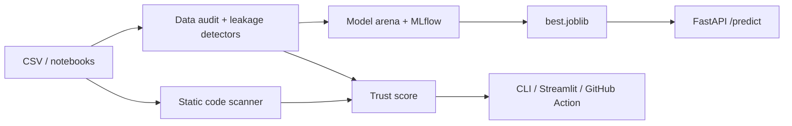

# LeakLens

[العربية](docs/README.ar.md)

[](https://github.com/eyadstein/leaklens/actions/workflows/ci.yml)
[](#trust-score-badge)
[](https://pypi.org/project/leaklens-ml/) [](https://pypi.org/project/leaklens-ml/)
[](LICENSE)

**Catch data leakage before it fools you.** Most "99% accuracy" models are leaking. LeakLens audits both your **data** and your **code**, then proves what survives by training three model families on a leak-free pipeline.

**[Live demo report](https://eyadstein.github.io/leaklens/)**

## What it catches

| Where | Leak |
|---|---|
| Data | Target leakage (a single feature that almost perfectly predicts the label), high-cardinality categorical target leakage, ID-like columns, train/test row overlap, temporal leakage, entity/group overlap (`--group COL`), near-duplicate images across split folders (`leaklens images`) |
| Code (`.py`, `.ipynb`) | Scaler/encoder/imputer fitted before the split, SMOTE before the split, transformers fitted on test/validation data or on the full dataset after the split, chained calls like `StandardScaler().fit_transform(X)`, preprocessing or resampling done before `cross_val_score` / `GridSearchCV` (`preprocess_outside_cv`), hyperparameter tuning on the test set (`tuning_on_test_data`) |

Every audit returns a 0-100 trust score. The CLI exits with code 1 on a high-severity leak, so it gates CI.

## Demo

```
$ leaklens demo.csv --target is_fraud --arena
LeakLens trust score: 50/100
[HIGH] target_leakage :: chargeback_flag :: alone predicts target (roc_auc=1.000)
[MEDIUM] id_like :: txn_id :: 100.0% unique values; likely an identifier

Arena ranked by pr_auc (auto-dropped: chargeback_flag, txn_id)
model roc_auc pr_auc best_f1
neural_net 0.8374 0.4219 0.4353
linear 0.8410 0.4215 0.4304
tree_ensemble 0.8242 0.3562 0.4103
```

A leaked column makes accuracy look perfect. LeakLens drops it and shows the honest numbers.

## Python version

- **Required:** Python >=3.10 (`requires-python` in `pyproject.toml`)
- **CI-tested:** 3.10, 3.11, 3.12 (`.github/workflows/ci.yml` matrix) — **locally verified** on 3.10, 3.11, 3.12, and 3.14 (full test suite; see [docs/REALWORLD.md](docs/REALWORLD.md) for the real-world eval and [CONTRIBUTING.md](CONTRIBUTING.md) for local checks)
- 3.13 was **not** in the CI matrix at the time of this release and is **not** claimed as verified

> The `leaklens` command is provided by the PyPI package `leaklens-ml`.

## Install

Base package (no optional dependencies):

```sh
pip install leaklens-ml
```

CSV and JSON input, dataset audit, code scanning, and `--explain` / `--intelligence` / `--sarif` / `--html` / `--badge` work with the base install.

### Optional extras

Every optional extra declared in `pyproject.toml`:

| Extra | Purpose | Install command |
|---|---|---|
| `arena` | Model arena with MLflow tracking (`--arena`) | `pip install "leaklens-ml[arena]"` |
| `parquet` | Read `.parquet` with `pyarrow` | `pip install "leaklens-ml[parquet]"` |
| `feather` | Read `.feather` with `pyarrow` | `pip install "leaklens-ml[feather]"` |
| `excel` | Read `.xlsx` with `openpyxl` | `pip install "leaklens-ml[excel]"` |
| `images` | Near-duplicate image check (`leaklens images`) with Pillow | `pip install "leaklens-ml[images]"` |
| `app` | FastAPI service + Streamlit UI | `pip install "leaklens-ml[app]"` |
| `taintwatch` | Optional TaintWatch guard for `--llm` | `pip install "leaklens-ml[taintwatch]"` |
| `dev` | Test, bandit, pip-audit, and the above dev tools | `pip install "leaklens-ml[dev]"` |

Development checkout:

```sh
git clone https://github.com/eyadstein/leaklens.git
cd leaklens
python -m venv .venv
. .venv/bin/activate   # Windows: .venv\Scripts\Activate.ps1
pip install -e ".[dev,app]"
```

## Quick start

```sh
leaklens train.csv --target label --test test.csv --time date
leaklens --scan notebooks/ --explain   # prints a suggested fix under each finding
leaklens --scan . --sarif leaklens.sarif   # for GitHub code scanning
leaklens train.csv --target label --test test.csv --group patient_id
leaklens train.parquet --target label --fail-under 80   # Parquet input (pip install "leaklens-ml[parquet]"); CI gate on trust score
leaklens train.json --target label   # JSON input, no extra needed
leaklens train.xlsx --target label   # Excel input (pip install "leaklens-ml[excel]")
leaklens train.feather --target label   # Feather input (pip install "leaklens-ml[feather]")
leaklens images data/train data/test   # near-duplicate images across splits (pip install "leaklens-ml[images]")
python examples/make_demo.py
leaklens demo.csv --target is_fraud --arena
mlflow ui --backend-store-uri sqlite:///mlflow.db
```

New to data leakage? Start with the [walkthrough notebook](examples/leak_walkthrough.ipynb): three planted leaks, an inflated score, and how LeakLens finds and fixes them.

## Supported CLI commands

### `leaklens` (dataset audit)

Audit a dataset (and optionally a held-out test split) for leakage.

```sh
leaklens train.csv --target label            # single-file audit
leaklens train.csv --test test.csv --target label
leaklens train.csv --test test.csv --target label --time date
leaklens train.csv --target label --test test.csv --group patient_id
leaklens train.csv --target label --json     # JSON output
leaklens train.csv --target label --threshold 0.95
leaklens train.csv --target label --fail-under 80   # exit 1 if trust score < 80
leaklens train.csv --target label --arena    # needs [arena]
leaklens train.csv --target label --html report.html
leaklens train.csv --target label --intelligence   # deterministic confidence + root cause
```

| Flag | Meaning |
|---|---|
| `train` | Path to the training dataset (positional) |
| `--target` | Label column in the training data |
| `--test` | Held-out split to compare against |
| `--time` | Timestamp column for the temporal check |
| `--group` | Entity column (patient, customer...) for group leakage |
| `--threshold` | Single-feature score that counts as leakage (default 0.95) |
| `--arena` | Compare 3 model families, tracked in MLflow (needs `arena` extra) |
| `--out` | Output dir for the arena winner (default `models`) |
| `--tracking-uri` | MLflow tracking URI (default `sqlite:///mlflow.db`) |
| `--json` | Emit JSON |
| `--explain` | Print a suggested fix under each finding |
| `--intelligence` | Deterministic confidence, root-cause, and remediation analysis |
| `--llm` / `--llm-provider` | Optional LLM explanations (see next section) |
| `--sarif` | Write SARIF 2.1.0 for GitHub code scanning |
| `--html` | Write a shareable single-file HTML report |
| `--badge` | Write a shields.io endpoint JSON with the trust score |
| `--fail-under` | Exit with code 1 if trust score is below N |
| `--version` | Print version and exit |

Unknown or extensionless input falls back to CSV. Optional formats (Parquet/Feather/Excel) raise an `ImportError` naming the extra that provides them.

### `leaklens --scan PATH...`

Statically scan `.py` / `.ipynb` files or folders for pipeline leaks (fit before split, fit on test data, tuning on test data, etc.). Scanned code is **never executed**.

```sh
leaklens --scan notebooks/ --explain
leaklens --scan leaklens
leaklens --scan . --sarif leaklens.sarif || true
leaklens --scan src tests --llm
```

Exit code is 1 when a high-severity finding is present, so it gates CI.

### `leaklens images TRAIN_DIR TEST_DIR`

Find near-duplicate images across train/test folders (64-bit dHash, `--max-distance` default 6). Needs the `images` extra.

```sh
leaklens images data/train data/test
leaklens images data/train data/test --max-distance 10 --samples 5 --json
```

### `leaklens init`

Write a commented starter `.leaklens.toml`:

```sh
leaklens init
leaklens init mydir --force   # overwrite an existing .leaklens.toml
```

It prints the pre-commit hook snippet (below).

## Configuration (`.leaklens.toml`)

`leaklens init` writes a commented starter `.leaklens.toml` (one key per CLI flag) and prints the pre-commit snippet. Add `--force` to overwrite an existing file.

> The CLI does not read `.leaklens.toml` yet — it is a documentation starter. Pass the same values as CLI flags until config is read.

## Optional LLM explanations

LLM explanations are disabled unless you pass `--llm`. LeakLens sends the selected findings' severity, kind, file name and line, and diagnostic detail; details can include short code expressions from scanned files. It does not send complete source files, notebooks, or dataset rows. The default provider is local Ollama. If you choose `--llm-provider openai-compatible` or configure a remote base URL, these finding details are sent to that host. Provider URLs must use HTTP or HTTPS, redirects are refused, and an API key is not sent over plain HTTP except to `localhost` or `127.0.0.1`. Explanations are limited to the 10 highest-severity findings by default; use `--llm-max-findings N` to change that limit.

```sh
ollama pull qwen2.5:7b
leaklens --scan notebooks/ --llm
```

To use an OpenAI-compatible API, configure its endpoint and key. The request leaves your machine:

```sh
export LEAKLENS_LLM_BASE_URL=https://api.example.com/v1
export LEAKLENS_LLM_API_KEY=...
export LEAKLENS_LLM_MODEL=your-model
leaklens --scan notebooks/ --llm --llm-provider openai-compatible
```

You can also pass `--llm-base-url` and `--llm-model` on the command line. The API key is read only from `LEAKLENS_LLM_API_KEY`.

## Model arena

Auto-drops leaking and ID columns, then trains linear, gradient-boosted tree and neural-net models inside leak-safe pipelines (imputation, scaling and encoding are fitted on training data only). Runs are tracked in local MLflow (SQLite) and the winner is saved to `models/best.joblib`. Add `--time COL` for a temporal split.

## API and UI

```sh
uvicorn leaklens.api:app --port 8000 # docs at /docs
streamlit run leaklens/ui.py
```

Endpoints: `GET /health`, `POST /audit`, `POST /scan`, `POST /predict`.

> `POST /predict` loads model files with `joblib` from a caller-supplied path. Only load models you trust and do not expose the API to untrusted users or networks. See [SECURITY.md](SECURITY.md).

## Docker

> Docker build/run below is **documented but not verified executed** in this environment (Docker Engine was unavailable on the development machine). Commands are verified against the actual `Dockerfile` and `docker-compose.yml` in the repo root; run them where the daemon is healthy.

The image is `python:3.11-slim`, installs `.[arena,app]`, exposes 8000/8501, and defaults to `uvicorn leaklens.api:app --host 0.0.0.0 --port 8000`.

Build and run (Compose):

```sh
docker compose up --build
```

- API: http://localhost:8000/docs
- UI: http://localhost:8501
- `./models` is mounted into both containers at `/app/models`

Build and run (plain Docker, API only):

```sh
docker build -t leaklens .
docker run --rm -p 8000:8000 -v ./models:/app/models leaklens
```

To run the UI container alone, override the API default command:

```sh
docker run --rm -p 8501:8501 leaklens streamlit run /app/leaklens/ui.py --server.port=8501 --server.address=0.0.0.0
```

## GitHub Action

```yaml
- uses: actions/checkout@v4
- uses: eyadstein/leaklens@main
  with:
    path: notebooks
```

## HTML report

```sh
leaklens demo.csv --target is_fraud --arena --html report.html
```

A single self-contained file with the trust score, findings and arena table. Easy to attach to a PR or share with your team.
The findings section includes a color-coded severity legend explaining high, medium and low leakage risks, even when no findings are present.

## GitHub code scanning

```yaml
permissions:
  security-events: write
steps:
  - uses: actions/checkout@v4
  - run: pip install leaklens-ml
  - run: leaklens --scan . --sarif leaklens.sarif || true
  - uses: github/codeql-action/upload-sarif@v3
    with:
      sarif_file: leaklens.sarif
```

Findings then appear in the repository's Security tab and as PR annotations.

## Pre-commit hook

```yaml
repos:
  - repo: https://github.com/eyadstein/leaklens
    rev: main
    hooks:
      - id: leaklens
```

Blocks a commit when a notebook or script fits a transformer before the split.

`leaklens init` writes a commented starter `.leaklens.toml` (one key per CLI flag) and prints this snippet. Add `--force` to overwrite an existing file.

## Trust score badge

```sh
leaklens --scan . --badge badge.json
```

Commit `badge.json`, then point a shields.io endpoint badge at its raw URL (as at the top of this file).

## Architecture



## How the Trust Score Is Calculated

LeakLens starts with a trust score of 100 and deducts points for each finding based on its severity.

| Severity | Penalty |
|---|---:|
| High | 35 points |
| Medium | 15 points |
| Low | 5 points |

The final score is calculated by subtracting the total penalties from 100. The score cannot fall below 0.

**Example:** If a dataset has one high-severity finding, one medium-severity finding, and one low-severity finding, the total penalty is 35 + 15 + 5 = 55. The final trust score is 100 - 55 = **45/100**.

## Roadmap

Full plan with phases and exit criteria: [ROADMAP.md](ROADMAP.md). Open tasks are in [Issues](https://github.com/eyadstein/leaklens/issues).

- [x] Core detectors, static scanner, model arena, API, UI
- [x] Docker, GitHub Action, badge, CI
- [x] Group/entity leakage detector
- [x] PyPI packaging + release workflow (PyPI name `leaklens-ml`, command stays `leaklens`; create a GitHub release to publish)

## Leakage study

In a non-random sample of 1,725 public notebooks that split their data, **38%** fit a preprocessing step before the split or on test data (static heuristic, not a verdict on any notebook). Details and caveats: [docs/STUDY.md](docs/STUDY.md). Reproduce it with `python scripts/study.py` (needs the `gh` CLI).

## Validated on real notebooks

Five public notebooks were read by hand against the scanner output. Details, counts and limits are in [docs/VALIDATION.md](docs/VALIDATION.md). The sample is tiny, so treat it as a sanity check.

## Real-world notebook validation (60 notebooks, 8 reviewed labels)

The corpus under `realworld/` holds 60 public notebooks (see [realworld/README.md](realworld/README.md)). Only **8** have definitive reviewed labels — 5 `confirmed_leakage` and 3 `legitimate` — so only those contribute to precision, recall and F1. The other 52 (2 `potential_leakage` + 50 `uncertain`) stay visible but are excluded from scoring. Result: precision/recall/F1 1.00 on the reviewed 8. That is a smoke check on a tiny, non-random sample, **not** a population accuracy estimate. Full methodology: [docs/REALWORLD.md](docs/REALWORLD.md).

## Accuracy and security

The code scanner is checked against a labeled synthetic regression benchmark on every CI run (`python -m leaklens.bench`, results in [docs/BENCHMARK.md](docs/BENCHMARK.md)). It is hand-written and shaped around supported scanner rules — treat it as a regression guard, not a real-world accuracy claim. The real-world corpus is kept separate from that synthetic benchmark (different directory, different scoring). Report vulnerabilities as described in [SECURITY.md](SECURITY.md).

## Contributing

See [CONTRIBUTING.md](CONTRIBUTING.md). Starter tasks are labeled good first issue.

Every PR must pass:

```sh
python -m pytest -q
leaklens --scan leaklens
python -m leaklens.bench
```

## Contributors

Thanks to @jay23606 (Parquet input), @slopggobblercobbler81 (`--fail-under`), @tyza66 (Excel, JSON and Feather input), @rahul05ranjan (`random_state` reproducibility check), @have-you-tried-restarting (severity summary), @Rashmi-R444 (trust score docs), @Thecoolss (benchmark snippets), @ElDShell (Arabic README), @Aaqibhafeezkhan (colored severity labels and `CITATION.cff`), @Cami0111 (leak walkthrough notebook) and @rahul-jain-dev (`--version`), @Vamsi-2581 (Add opt-in LLM explanations for findings).

MIT licensed.
