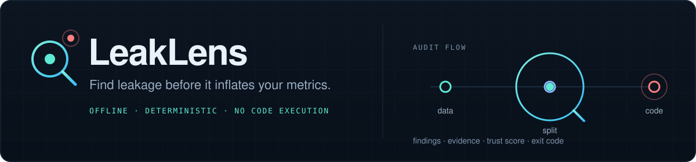
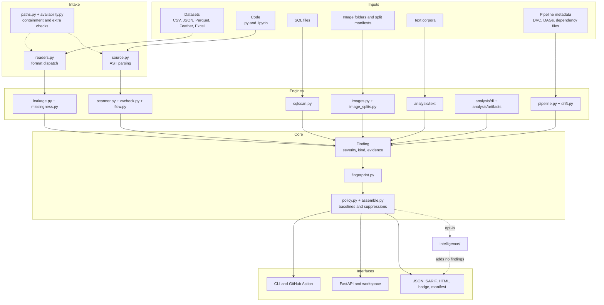
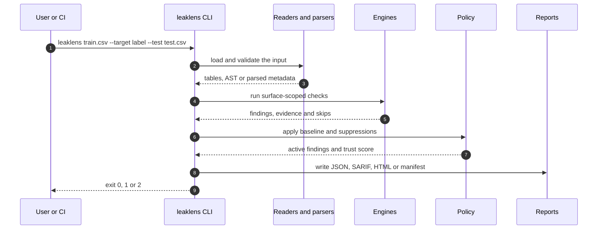
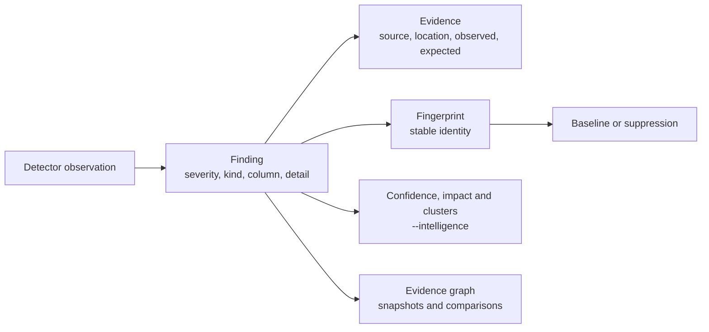

<p align="center">
  
</p>

# LeakLens

[العربية](docs/README.ar.md) | [日本語](docs/README.ja.md)

[](https://github.com/eyadstein/leaklens/actions/workflows/ci.yml)
[](#findings-and-evidence)
[](https://pypi.org/project/leaklens-ml/) [](https://pypi.org/project/leaklens-ml/)
[](LICENSE)

**Find data leakage before it inflates your metrics.** LeakLens audits the three places leakage hides — datasets, train/test splits and the code that builds the model — with optional engines for SQL, images, text, deep learning and pipeline metadata. It then reports what is left after the leak is removed. Detection is deterministic, local and CPU-first: the scanner parses code without executing it, and no dataset row leaves your machine.

[Documentation](https://eyadstein.github.io/leaklens/docs.html) · [Website and demo](https://eyadstein.github.io/leaklens/) · [Changelog](CHANGELOG.md) · [Support](SUPPORT.md) · [Issues](https://github.com/eyadstein/leaklens/issues)

## Contents

- [Why leakage matters](#why-leakage-matters)
- [Quick start](#quick-start)
- [See it catch a leak](#see-it-catch-a-leak)
- [What it detects](#what-it-detects)
- [Architecture](#architecture)
- [Audit lifecycle](#audit-lifecycle)
- [Findings and evidence](#findings-and-evidence)
- [Installation](#installation)
- [Command line](#command-line)
- [GitHub Action](#github-action)
- [Python API](#python-api)
- [Configuration and policy](#configuration-and-policy)
- [Built-in vs optional](#built-in-vs-optional)
- [Reports and outputs](#reports-and-outputs)
- [Benchmarks](#benchmarks)
- [Limitations](#limitations)
- [Security and privacy](#security-and-privacy)
- [Contributing](#contributing)
- [Documentation and roadmap](#documentation-and-roadmap)
- [License](#license)

## Why leakage matters

Leakage is information available during training that will not exist at prediction time. It makes cross-validation look excellent and production look broken. The usual shapes are familiar:

- the label, or a value derived from it, is present as a feature;
- a scaler, encoder, imputer, resampler or feature selector is fitted before the split;
- the same rows, entities or time periods appear in both train and test.

A leak does not announce itself. It looks like a strong score, a clean notebook and a model that quietly fails after deployment. LeakLens reports the observation and the evidence behind it, with a severity and a stable identity, so a team can review the finding instead of trusting an aggregate number.

## Quick start

Install the CLI (Python 3.10 or newer, no optional extras required), then scan a codebase or notebook folder:

```sh
python -m pip install --upgrade leaklens-ml
leaklens --scan .
```

Audit a dataset, optionally against a held-out split and a time column:

```sh
leaklens train.csv --target label
leaklens train.csv --test test.csv --target label --time date
```

A clean run prints `LeakLens trust score: 100/100` and exits `0`. A high-severity finding, a score below `--fail-under`, or a new finding under the opt-in `--fail-on-new` exits `1`; invalid arguments or configuration exit `2`. A `--scan` path that does not exist is invalid input, so it exits `2` instead of reporting a clean scan. That single contract makes the same command usable locally and in CI.

## See it catch a leak

The repository generates `demo.csv`, a synthetic fraud dataset with one planted leak:

```sh
git clone https://github.com/eyadstein/leaklens.git
cd leaklens
python -m pip install leaklens-ml
python examples/make_demo.py
leaklens demo.csv --target is_fraud
```

```text
LeakLens trust score: 50/100
[HIGH] target_leakage :: chargeback_flag :: alone predicts target (roc_auc=1.000)
[MEDIUM] id_like :: txn_id :: 100.0% unique values; one value per row
1 high, 1 medium
```

`chargeback_flag` is the label copied into a feature, so accuracy looks perfect until the column is removed. `demo.csv` is generated and not committed; the [walkthrough notebook](examples/leak_walkthrough.ipynb) plants three leaks and fixes them step by step, and [examples/advanced_leaks.py](examples/advanced_leaks.py) covers tuning, target encoding, feature selection, grouped CV and temporal ordering.

## What it detects

| Surface | Checks |
|---|---|
| Datasets (CSV, JSON) | single-feature target leakage, high-cardinality categorical target leakage, identifier-like columns, group/entity risk (`--group`) |
| Splits (`--test`) | exact row overlap, identical feature vectors with conflicting labels, case/whitespace near-duplicates, temporal overlap, entity overlap |
| Missingness | missing values associated with the target, the split or the group, when the association is strong enough to carry information ([details](docs/MISSINGNESS.md)) |
| Code (`.py`, `.ipynb`) | preprocessing, SMOTE, target/frequency encoding and feature selection before the split; fit on test data; tuning on test data or before the split; CV on test rows or without `groups=`; shuffled time-series splits; out-of-order notebook cells; future-looking target shifts and rolling windows |
| Images (optional) | near-duplicate images across train/test folders, exact and perceptual clusters |
| Declared image splits | COCO, YOLO and VOC split declarations compared for overlap (`leaklens splits`) |
| SQL (optional) | target used as a feature through confirmed lineage, future window frames, queries with no split predicate |
| Text (optional) | train/eval duplicates, evaluation contamination, RAG index wiring, caller-supplied embedding similarity |
| Deep learning (optional) | split overlap, training-protocol mismatches, unsafe checkpoint formats, missing seeds |
| Pipeline metadata (optional) | DVC and serialized pipeline lineage, parameter drift, missing digests, unpinned dependencies |

Findings state what was observed, not what must be true: a confirmed rule (a search fitted on `X_test`) is high severity, while a suspicious but legitimate-possible pattern (frequency encoding before the split) is low or medium and says why it was flagged. Every kind, its severity and its scored status are listed in [docs/DETECTORS.md](docs/DETECTORS.md).

## Architecture

LeakLens is a set of surface-scoped engines around one finding model. Intake normalizes an input, one engine audits that surface, and the resulting finding carries its own evidence and identity. Reports, policy and entry points consume the same assembled result. Nothing in the base install contacts a network or executes scanned code.



**How to read it.** Intake is deliberately thin: `readers.py` maps a suffix to a pandas reader, `source.py` parses Python and notebook source with `ast`, `paths.py` refuses unsafe paths, and `availability.py` turns a missing optional dependency into a clear error instead of an import at startup. Each engine emits `Finding` objects only for its own surface. The core adds evidence, a fingerprint and policy; `assemble.py` builds the payload every interface serializes. `intelligence/` is opt-in analysis on top of existing findings — it never invents a detector result.

## Audit lifecycle



The lifecycle is intentionally boring: nothing is trained, no notebook is run and no database is opened. Optional engines are inserted at the same engine step, and diagnostic engines are marked so policy and the exit gate ignore them unless you explicitly opt in with `--fail-on-findings` (text and deep learning) or `--fail-on-graph-new` (graph comparison).

## Findings and evidence

LeakLens starts at 100 and deducts points for each active finding, floored at 0:

| Severity | Penalty |
|---|---:|
| high | 35 |
| medium | 15 |
| low | 5 |



Evidence is bounded provenance, not a data dump: entries record a source, a location, what was observed and what was expected, when the detector can supply them. The fingerprint survives line moves and message edits, so baselines and suppressions keep their identity; changing the detector, the affected feature or a detector-supplied stable key changes it. A suppression accepts exactly one fingerprint, requires a reason, and labels a finding without changing its severity or evidence. Suppressed findings stop counting toward the score and the default gate. Baselines label later runs `new`, `unchanged`, `changed` or `resolved` and are never overwritten implicitly.

JSON reports carry `$schema`; `leaklens schema` prints the contract. Details: [docs/REPORT_SCHEMA.md](docs/REPORT_SCHEMA.md), [docs/BASELINES.md](docs/BASELINES.md) and [docs/DETECTORS.md](docs/DETECTORS.md).

## Installation

The PyPI package is `leaklens-ml`; the installed command is `leaklens`. The floor is Python 3.10 (`requires-python`), and CI runs 3.10, 3.11, 3.12 and 3.14 on Linux. Python 3.13 is outside the matrix and is not claimed as verified. The package is pure Python and installs on Windows, Linux and macOS. On Windows use `py -3 -m pip ...` if `python` is not on PATH; if pip reports `externally-managed-environment`, create a virtual environment first.

Optional extras:

| Extra | Adds |
|---|---|
| `arena` | model arena: drops flagged columns, trains three model families in leak-safe pipelines, tracked in MLflow (`--arena`) |
| `parquet`, `feather` | `.parquet` and `.feather` input through `pyarrow` |
| `excel` | `.xlsx` input through `openpyxl` |
| `images` | near-duplicate image check (`leaklens images`) through Pillow |
| `app` | FastAPI service and Streamlit UI |
| `api` | hardened public live-scan API (no Streamlit) |
| `sql` | SQL lineage analysis through SQLGlot |
| `yaml` | YAML pipeline and training configs |
| `taintwatch` | optional information-flow guard for `--llm` |

```sh
python -m pip install "leaklens-ml[parquet,images]"
```

`leaklens doctor` checks the interpreter, install location, entry point, core dependencies, extras and configuration validity without network access; pass `--json` for machine-readable output. An unsupported dataset suffix falls back to CSV. An optional format or engine that is not installed raises an `ImportError` naming the extra that provides it.

## Command line

| Command | Purpose |
|---|---|
| `leaklens FILE --target COL` | audit a dataset (CSV/JSON/JSONL built in) |
| `leaklens --scan PATH...` | statically scan `.py`/`.ipynb` files or folders |
| `leaklens splits DATASET` | audit declared COCO, YOLO or VOC split files |
| `leaklens images TRAIN TEST` | find near-duplicate images across splits |
| `leaklens text TRAIN TEST` | compare text corpora for contamination |
| `leaklens dl DIR` | audit deep-learning code, configs and artifacts |
| `leaklens workspace [DIR]` | serve the local interactive workspace |
| `leaklens verify MANIFEST` | verify an audit manifest offline |
| `leaklens init` | write a starter `.leaklens.toml` and print the pre-commit snippet |
| `leaklens doctor`, `leaklens schema` | check the install, print the report JSON Schema |

```sh
leaklens train.csv --target label --test test.csv --json
leaklens --scan notebooks/ --explain
leaklens --scan . --sarif leaklens.sarif
leaklens --scan . --intelligence --graph-out evidence.mmd
```

`leaklens --help` lists every flag and default; [docs/CONFIGURATION.md](docs/CONFIGURATION.md) lists the same options as configuration keys.

## GitHub Action

The Action installs the CLI and runs `leaklens --scan` on a file or folder. It does not run a dataset audit; use a `run:` step for that.

| Input | Required | Default | Purpose |
|---|---|---|---|
| `path` | optional | `.` | file or folder to scan |
| `fail-under` | optional | unset | minimum trust score (0-100); when set, the step also fails on a score below it |

```yaml
name: leakage
on: [push, pull_request]
jobs:
  leaklens:
    runs-on: ubuntu-latest
    steps:
      - uses: actions/checkout@v7
      - uses: eyadstein/leaklens@v0.14.0
        with:
          path: .
```

The step fails when the scan exits `1`: a high-severity finding, or a trust score below `fail-under` when that input is set. Diagnostic findings never fail the step. The `fail-under` input was added after `v0.13.0`, so a workflow that sets it must pin `v0.14.0` or newer:

```yaml
      - uses: eyadstein/leaklens@v0.14.0
        with:
          path: .
          fail-under: 80
```

Pin a tag or a full commit SHA for reproducible CI. `@main` tracks the default branch and therefore unreleased changes.

## Python API

The library exposes the same engines the CLI uses:

```python
import pandas as pd

from leaklens.audit import audit
from leaklens.leakage import scan, score
from leaklens.scanner import scan_path

findings = scan(pd.read_csv("train.csv"), target="label")
print(score(findings), [(f.severity, f.kind, f.column) for f in findings])

for finding in scan_path("src"):
    print(finding.kind, finding.column, finding.detail)

print(audit(pd.read_csv("train.csv"), "label")["cardinality"])
```

`leaklens.audit.audit(df, target)` returns a dataset profile: rows, columns, duplicate rows, cardinality, null rates and the target distribution. The JSON report schema, not Python signatures, is the stable contract for downstream integrations.

## Configuration and policy

`leaklens init` writes a commented `.leaklens.toml`. LeakLens reads `./.leaklens.toml` automatically, or the file passed with `--config`. Precedence is defaults, then config, then explicit CLI flags. Unknown keys, wrong types and unsafe output paths exit `2` instead of silently changing a scan.

```toml
target = "label"
fail_under = 80

[baseline]
path = "leaklens-baseline.json"
fail_on_new = true

[[suppressions]]
fingerprint = "64-lowercase-hex-characters"
reason = "accepted: the column is recorded before prediction"
```

Optional engine sections (`[missingness]`, `[sql]`, `[drift]`, `[graph]`) tune thresholds and outputs. Output paths must stay inside the config directory. Details: [docs/CONFIGURATION.md](docs/CONFIGURATION.md) and [docs/BASELINES.md](docs/BASELINES.md).

## Built-in vs optional

The base install covers CSV/JSON/JSONL datasets, code scanning, split checks and missingness. Everything else is opt-in and never required for the basic workflow.

| Capability | Entry point | Needs | Gate behavior |
|---|---|---|---|
| Dataset audit, code scan, split checks, missingness, declared-split audit | `leaklens`, `--scan`, `--test`, `--group`, `leaklens splits` | base install | exit 1 on a high-severity finding |
| Drift, pipeline metadata, text, deep learning, AI hypotheses | `--drift`, `--pipeline`, `leaklens text`, `leaklens dl`, `--ai` | base (`[yaml]` for DVC/YAML) | diagnostic: score and exit unchanged (`--fail-on-findings` for text and deep learning) |
| Image near-duplicates | `leaklens images` | `[images]` | exit 1 on a high-severity finding |
| SQL lineage | `--sql` | `[sql]` | exit 1 on a high-severity finding |
| Model arena | `--arena` | `[arena]` | writes `models/best.joblib` |
| API, UI, workspace | `uvicorn`, `streamlit`, `leaklens workspace` | `[app]` | not a scan gate |
| Public live-scan API | `uvicorn leaklens.public_api:app` | `[api]` | not a scan gate |
| LLM explanations | `--llm` | local Ollama by default | never changes findings, score or exit |

If an optional dependency is missing, the command raises an `ImportError` that names the extra, and `leaklens doctor` lists which extras are importable. The base install remains fully usable. Scanning is offline and CPU-first by default; only an explicitly configured remote `--llm` provider, an install command or an MLflow run you start uses the network.

## Reports and outputs

| Flag | Output |
|---|---|
| `--json` | machine-readable report on stdout |
| `--sarif FILE` | SARIF 2.1.0 with evidence and fingerprints |
| `--html FILE` | single self-contained report with a severity legend |
| `--badge FILE` | shields.io endpoint JSON with the trust score |
| `--manifest FILE` | unsigned, offline-verifiable audit manifest (`leaklens verify`) |
| `--intelligence` | deterministic confidence, evidence clusters and root-cause analysis |
| `--graph-out FILE` | evidence graph as Mermaid (`.mmd`), DOT (`.dot`) or JSON |
| `--graph-snapshot` / `--graph-baseline` | save and compare evidence across scans |

The evidence graph groups existing findings by an inspectable anchor and links detector evidence; it adds no findings and never changes the score or exit code. Comparisons report `new`, `unchanged`, `changed`, `resolved` and `uncertain`. See [docs/INTELLIGENCE.md](docs/INTELLIGENCE.md) and [docs/AUDIT_MANIFEST.md](docs/AUDIT_MANIFEST.md).

For GitHub code scanning:

```yaml
permissions:
  contents: read
  security-events: write
steps:
  - uses: actions/checkout@v7
  - run: pip install leaklens-ml
  - run: leaklens --scan . --sarif leaklens.sarif || true
  - uses: github/codeql-action/upload-sarif@v4
    with:
      sarif_file: leaklens.sarif
```

To publish a trust badge, run `leaklens --scan . --badge badge.json`, commit the file, and point a shields.io endpoint badge at its raw URL, as at the top of this file. The checked-in [badge.json](badge.json) records the repository's own self-scan.

## Benchmarks

- The code scanner is checked against 117 hand-written regression cases (63 leaky, 54 clean) with 0 false positives and 0 false negatives: `python -m leaklens.bench`, results in [docs/BENCHMARK.md](docs/BENCHMARK.md).
- The same run also scores 32 advanced detection cases added after the original regression baseline; they ship in the published 0.14.0 release.
- Dataset detectors have 12 synthetic cases (`python -m leaklens.bench_data`, [docs/DATA_BENCHMARK.md](docs/DATA_BENCHMARK.md)); missingness, drift, pipeline, text, deep learning, vision, SQL and AI each have their own labeled benchmark under `docs/`.
- A static sample of 1,725 public notebooks that split their data found that 38% fit a preprocessing step before the split or on test data ([docs/STUDY.md](docs/STUDY.md)).
- The real-world corpus holds 60 public notebooks, but only 8 have reviewed labels; on those 8 the scanner scores precision/recall/F1 1.00 ([docs/REALWORLD.md](docs/REALWORLD.md)). That is a smoke check on a tiny, non-random sample, not a population accuracy estimate.
- The independent AI check measures accuracy 0.833, precision 0.767, recall 0.958 and FPR 0.292 on 48 reviewed units, with every mistake listed ([docs/AI_REALWORLD.md](docs/AI_REALWORLD.md)); the shipped model has no second independent holdout, and the missing H2 corpus is published as a shortfall rather than a number ([docs/AI_REALWORLD_H2.md](docs/AI_REALWORLD_H2.md)).

All benchmarks are hand-written regression guards shaped around supported rules. They are not real-world accuracy claims, and no benchmark number here is a production guarantee. Scanner runtime measurements and the source-cache decision are in [docs/PERFORMANCE.md](docs/PERFORMANCE.md).

## Limitations

- Detection is heuristic and static. LeakLens does not execute scanned code, run notebooks, connect to a database or perform complete interprocedural dataflow analysis; obfuscated or dynamically constructed patterns can be missed.
- A finding is evidence to inspect, not proof of leakage. An identical feature vector or a group overlap can occur naturally; read the detail and the suggested test before acting.
- Every kind is scoped to the surface that emits it: a code rule does not audit a CSV, and a dataset detector does not read your notebook. Supported formats differ per command.
- Feature-overlap and near-duplicate checks sample at most 50,000 and 20,000 rows, so very large files are bounded rather than exhaustive.
- Diagnostic engines (drift, pipeline, text, deep learning, AI, monitoring intake) never change the trust score or exit code, and AI hypotheses are capped at medium severity and remain experimental.
- Missingness findings cap at medium severity and never modify data or splits.
- Image hashing has documented blind spots (colour-only differences, crops beyond 5%, letterboxing), and declared-split checks compare file bytes only, not perceptual similarity.
- Python 3.13 is outside the CI matrix and is not claimed as verified.

## Security and privacy

- Scanning is local and offline by default. Dataset contents stay on your machine; nothing is uploaded and no service is contacted.
- The code scanner, deep-learning audit and pipeline audit parse files without executing them. They never import torch/TensorFlow, never unpickle a checkpoint and never extract an archive.
- `--llm` is opt-in. It sends finding metadata only, and a remote OpenAI-compatible provider receives that metadata only after you configure it. Provider URLs must use HTTP(S), redirects are refused, and API keys are not sent over plain HTTP to non-local hosts.
- `POST /predict` trusts an operator-chosen pickle; treat the FastAPI app as local and trusted. The public API is the hardened surface for untrusted uploads.
- Report vulnerabilities privately as described in [SECURITY.md](SECURITY.md). CI runs bandit, pip-audit, pip-licenses and CodeQL; the release workflow publishes a CycloneDX SBOM outside `dist/` (`python scripts/generate_sbom.py` writes `sbom/sbom.json`).

## Contributing

```sh
git clone https://github.com/eyadstein/leaklens.git
cd leaklens
python -m venv .venv
. .venv/bin/activate   # Windows: .venv\Scripts\Activate.ps1
pip install -e ".[dev,app]"
```

Every pull request must pass the checks CI runs; the short version:

```sh
pytest -q
ruff check leaklens tests scripts
ruff format --check leaklens tests scripts
leaklens --scan leaklens
python -m leaklens.bench
python -m leaklens.bench_data
```

Add a test for every new detector or fix, and keep a new detector in `leaklens/leakage.py` (data) or `leaklens/scanner.py` (code). See [CONTRIBUTING.md](CONTRIBUTING.md) and [CODE_OF_CONDUCT.md](CODE_OF_CONDUCT.md). Issues labeled **good first issue** are the easiest way in, and the [contributors graph](https://github.com/eyadstein/leaklens/graphs/contributors) records everyone who has contributed.

Pre-commit hook:

```yaml
repos:
  - repo: https://github.com/eyadstein/leaklens
    rev: v0.14.0
    hooks:
      - id: leaklens
```

`leaklens init` prints this snippet. `rev` pins the latest published release, so the hook is reproducible; move it to a newer tag deliberately when you upgrade.

## Documentation and roadmap

The latest published release is **0.14.0**. Release history, and the changes
prepared for the next version, live in [CHANGELOG.md](CHANGELOG.md), not in
this file.

Implemented: dataset, split and code detectors; missingness; model arena; API and workspace; HTML, SARIF, JSON and badge reports; baselines and suppressions; the evidence graph and investigation plans; group leakage; image clustering and declared-split audits; and the opt-in SQL, text, deep-learning, drift, pipeline and AI engines.

Planned work and open design questions are tracked in [ROADMAP.md](ROADMAP.md), the longer-term [AI/ML expansion roadmap](docs/AI_ML_EXPANSION_ROADMAP.md) and [Issues](https://github.com/eyadstein/leaklens/issues). Proposed items there are not commitments. The full documentation index is the [docs site](https://eyadstein.github.io/leaklens/docs.html).

Adoption is measured, not assumed: the baseline and growth strategy are in [docs/ADOPTION.md](docs/ADOPTION.md), and the real-world corpus method is in [docs/REALWORLD_EXPANSION.md](docs/REALWORLD_EXPANSION.md).

## License

MIT licensed; see [LICENSE](LICENSE). Citation metadata is in [CITATION.cff](CITATION.cff).
