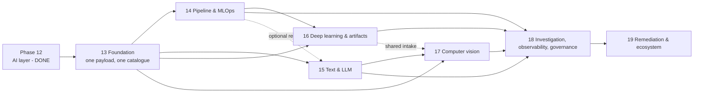

# AI/ML expansion roadmap

**Status:** proposal. Only Phase 12 is delivered history. Everything from Phase 13 onward is
unscheduled design.
**Companions:** [FUTURE_ARCHITECTURE.md](FUTURE_ARCHITECTURE.md) (how),
[FUTURE_VISION.md](FUTURE_VISION.md) (why), [AI_ROADMAP.md](AI_ROADMAP.md) (Phase 12 detail),
[ARCHITECTURE_DECISIONS.md](ARCHITECTURE_DECISIONS.md) (decision log).

Ordering rule for everything below: **contracts before engines, evidence before breadth, breadth
before agents, agents before remediation.** Each phase is independently shippable and independently
revertible, and inherits the invariants in [FUTURE_ARCHITECTURE.md](FUTURE_ARCHITECTURE.md) §1.

---

## 0. Completed history: Phase 12

Phase 12 (M1–M8) is closed at `717398c` and is not re-planned here. Its record — root-cause maps,
reproducible artifact, confidence semantics, evidence anchoring, the H2 **shortfall**, false-positive
reduction, selective reporting, opt-in workspace surface — lives in
[AI_ROADMAP.md](AI_ROADMAP.md#5-milestones), [AI_INTELLIGENCE.md](AI_INTELLIGENCE.md) and
[AI_REALWORLD_H2.md](AI_REALWORLD_H2.md).

Two consequences for the future roadmap:

- Phase 12 gets **no extension milestones**. Its largest open item is an H2 corpus that does not
  exist; inventing more AI work before that evidence exists would repeat the mistake the H2 document
  was written to prevent.
- Any further learned or LLM work belongs to **Phase 18**, behind the same invariants: hypotheses
  only, `medium` cap, explicit basis, no effect on score or exit code.

---

## 1. Phase dependency graph

Hard edges are prerequisites. Dotted edges are reuse, not dependency.

Why the boundaries sit there:

- **13 first, alone.** It changes no detector and adds no domain, but every later phase needs one
  payload builder and a catalogue that can say "scored / diagnostic / needs an extra". Without it,
  each phase re-invents status handling — the exact duplication this mission exists to prevent.
- **14 before 16.** Deep-learning auditing needs the pipeline/lineage vocabulary (which stage
  produced which split) before it can judge a training loop.
- **15 before 18, not before 16.** Text is cheap and independent; it does not block DL.
- **17 last among engines.** It carries the heaviest optional dependencies, reuses `near_duplicate.py`
  from Phase 15, and has the least certain value (see the perceptual-hash experiment in
  [FUTURE_ARCHITECTURE.md](FUTURE_ARCHITECTURE.md) §16).
- **18 then 19.** Investigation is only credible when there are several engines' evidence to
  investigate; remediation is only safe when investigation can explain its own proposals.

---

## 2. Phase 13 — Foundation: one payload, one catalogue, explicit direction

**Objective.** Make the existing architecture honest enough to grow: a single result assembly, a
detector catalogue that expresses optionality and scoring status, one-directional module
dependencies, and frozen public identifiers.

**User problem.** Today a new check must be wired into three surfaces, a skipped engine is invisible,
and nothing prevents a coupling regression. Users see none of this directly; they feel it as
inconsistent results between CLI, HTML and workspace, and as silent gaps.

**Scope.** No new detection. Refactoring and contracts only.

**Architecture involved.** §5 (core), §6 (extension mechanism), §7 (dependency rules),
§14 (evolution strategy) of [FUTURE_ARCHITECTURE.md](FUTURE_ARCHITECTURE.md).

**New modules and directories.**

- `leaklens/assemble.py` — one payload builder used by `cli`, `api`, `public_api` and `workspace`
  (`ui` consumes the payload; it does not build one).
- `leaklens/source.py` — the scanner constants and AST helpers `cvcheck`/`flow` actually import,
  re-exported by `scanner.py` (ADR-019). Not a `CodeSource` type; that one is AI-owned.
- `leaklens/paths.py` — one containment helper shared by the workspace and Phase 19 remediation.
- `leaklens/availability.py` — the `EngineUnavailable` base and one extra probe (ADR-023).
- `tests/test_architecture.py`, `tests/test_public_contract.py`.
- No new package; no directory moves.

**Dependencies.** None.

**Milestones.**

| Id | Milestone | Acceptance |
|---|---|---|
| M1 | Extend `manifest.Detector` with `scored`, `requires`, `modalities`; add the `MODALITIES` vocabulary (ADR-020), the frozen `ENGINES` registry (ADR-005) and `availability.EngineUnavailable` (ADR-023); backfill every existing kind and convert `images._pil` to a typed unavailable; regenerate `docs/DETECTORS.md` | `python -m leaklens.manifest --check` in CI; every existing kind keeps its severity, advice and surface and gains an explicit `requires`/`modalities` value (no half-populated registry); a new kind without an entry fails `validate_kinds`; `SqlUnavailable` and `ImageUnavailable` subclass the base without changing their `ImportError` behaviour; no engine defines a local modality list; a test maps legacy `evidence.SOURCES` `data` to the manifest's `dataset` |
| M2 | Extract `assemble.py`; route `cli`, `api`, `public_api` and `workspace` through it | The finding/evidence/policy/intelligence sections are byte-identical to today (golden JSON); the workspace envelope (`scan_id`, `state`, `duration_ms`) is explicitly excluded; CLI/HTML/API/workspace agree on findings |
| M3 | Extract `source.py`; make `cvcheck`/`flow` import it instead of `scanner` | Import graph has no mutual engine dependency; `from leaklens.scanner import SKIP, FUNCS, ...` still works through the re-export; `source.py` imports no `ai` module |
| M4 | Remove the `ai/artifact` → `ai/learned` import; document the benchmark-case dependency as benchmark-only | No `ai` module imports another `ai` module in both directions; cold-load parity unchanged |
| M5 | Add the allowed-import matrix test (function-local imports count) | A deliberately wrong import fails the test with a readable message; the allowlist of existing surface→engine imports only shrinks, and every entry names its removal phase |
| M6 | Freeze `SURFACES`, `ENGINES` ids, and one fingerprint per surface | Renaming a surface or engine id fails a test; golden fingerprints match committed values |
| M7 | **Security gate (blocking):** triage and remediate the 20 open CodeQL alerts per [ARTIFACT_SECURITY_STRATEGY.md](ARTIFACT_SECURITY_STRATEGY.md) §2.2; extract `paths.py` and route `WorkspaceManager.resolve` through it | Every alert has a recorded disposition; no request-time deserialization of a request-selected file; generic error bodies; containment regression tests for `..`, separators, drives, UNC and symlinks; UNC/device paths outside the root are refused before resolution (a UNC workspace root still works); no suppression without a linked analysis |
| M8 | Release allowlist in `validate_release.py`; pin GitHub Actions to commit SHAs | An unexpected file in the wheel fails validation; every `uses:` is SHA-pinned |
| M9 | Make every failure predicate ignore `diagnostic=True` (`cli.py` gate, `--fail-on-new`), matching `leakage.score()` | A high diagnostic exits 0; a high non-diagnostic still exits 1; existing behaviour is unchanged because no high diagnostic ships today |

**Tests.** Payload parity (golden), import matrix, catalogue validation, façade re-export coverage,
fingerprint goldens, existing suite unchanged.

**Benchmarks.** No new benchmark. `python -m leaklens.bench`, `bench_data`, `bench_ai` digests must
be unchanged, which is the strongest evidence that nothing behavioural moved.

**Acceptance criteria for the phase.**

1. Every existing test passes without modification (except added tests).
2. CLI, public API and workspace produce the same payload for the same input, proven by a test.
3. `docs/DETECTORS.md` is generated and CI-checked.
4. No public identifier changed: finding kinds, surfaces, engine ids, fingerprint format, JSON
   fields, SARIF properties.
5. No new dependency.
6. M7 (security gate) is closed: every alert disposition is written, `paths.py` is the only
   containment helper, and the regression tests pass.
7. M8 is closed: the wheel allowlist fails on an unexpected file and every action is SHA-pinned.
8. M9 is closed: a high diagnostic does not fail the gate, and a high non-diagnostic still does.

**Risks.** A payload refactor is where subtle output changes hide (key order, `None` handling,
error text). Mitigation: goldens from the current build, plus a "diff two real scans" test with a
real-world notebook corpus. Risk of monkeypatch breakage: tests patch
`leaklens.public_api.run_code_job`; keep those names as thin delegations.

**Non-goals.** No new detectors, no package moves, no typed `AuditResult`, no plugin system.

**Expected outcome.** A foundation where adding an engine is a five-file change, and where a
regression in dependency direction or public identifiers fails CI immediately.

**Complexity.** Small-to-medium. Mostly mechanical, but touches the three surfaces and the test
suite; estimate one focused release cycle.

---

## 3. Phase 14 — Pipeline and MLOps intelligence

**Objective.** Audit pipeline-level correctness: which transformation produced the feature that
reached the model, whether train and eval derive from disjoint data, and whether the run is
reproducible from its own metadata.

**User problem.** A model card says "trained on v3, evaluated on v4". Nothing checks whether v4 is a
re-split of v3. Pipelines pass tests, lineage graphs look valid, and the evaluation is still
circular. This is the most common real-world failure and no mainstream tool checks it.

**Scope.** Pipeline graph construction from repo artifacts (notebooks, SQL, DVC stages, serialized
DAG JSON, MLflow runs), feature-level lineage, split-disjointness checks, reproducibility checks.
Read-only; no orchestration.

**Architecture involved.** New engine package; `integrations/` adapters; the root
`lineage.LineageEdge` contract; `assemble` hook; detector catalogue entries.

**New modules and directories.**

- `analysis/pipeline/` — `graph.py` (stage graph), `lineage.py` (feature-level edges and
  resolution), `dag_files.py` (JSON DAG exports, DVC files), `checks.py` (the detectors).
- `integrations/` — `dvc.py`, `mlflow.py`, `openlineage.py`; `feast.py` only when M8 lands.
- `leaklens/lineage.py` — the **new** dependency-free `LineageEdge` contract (see
  [ARCHITECTURE_DECISIONS.md](ARCHITECTURE_DECISIONS.md) ADR-021); it is not the existing
  evidence-to-evidence `EvidenceLink`, and it is a root primitive so engines may construct it.
- `tests/test_pipeline_*.py`, `leaklens/bench_pipeline.py` + `docs/PIPELINE_BENCHMARK.md`.

**Dependencies.** Phase 13. Optional extras: `yaml = ["PyYAML>=6"]` for DVC files, loaded with
`safe_load` only and degrading to a skip when absent (a YAML loader is a trust boundary, not a
convenience); MLflow reads local files without importing MLflow; OpenLineage reads JSONL.

**Milestones.**

| Id | Milestone | Acceptance |
|---|---|---|
| M1 | Stage graph from repo artifacts (notebook order, `.dvc`, `dvc.yaml`, serialized DAG JSON) | A 3-stage synthetic pipeline yields the expected DAG; unresolved edges are labelled unresolved |
| M2 | `LineageEdge` contract + `sqlscan` column-map export | Edges are `(stage, column, transform, locator, confidence)`; `scan_sql` exposes its resolved column map once instead of being re-parsed; ambiguous lineage stays low-severity diagnostic |
| M3 | Train/eval split disjointness check across stages | Same-input feeding both sides is a `high` finding with the artifact path and stage ids as evidence |
| M4 | Reproducibility checks owned here once (unpinned deps, missing seeds, non-deterministic ops, missing artifact digests), extending the shipped `no_random_state` kind rather than duplicating it | Each check has a labelled case and a benchmark entry; Phase 16 reuses this, it does not add a second reproducibility family; shared kinds carry framework-neutral advice, not the sklearn-only text |
| M5 | `integrations/dvc.py` and `integrations/mlflow.py` (read-only) | Reading a real local `mlruns/` and a real `.dvc` stage graph produces findings without importing either library |
| M6 | Lineage view payload + workspace view | A DOM-level test asserts that unresolved edges carry a distinct label and legend entry (not a colour-only difference); no graph database introduced |
| M7 | Pipeline benchmark corpus | ≥20 labelled synthetic pipelines with precision/recall published, misses listed |
| M8 | `integrations/openlineage.py`, then `feast.py` | Each milestone is its own review: JSONL events and a registry export are parsed read-only; neither engine runs the external system |

**Tests.** Synthetic pipelines (good and leaking), malformed DVC files, ambiguous lineage,
integration fixtures read from disk, cross-platform path handling.

**Benchmarks.** `python -m leaklens.bench_pipeline` → `docs/PIPELINE_BENCHMARK.md`, in the same
"regression guard, not accuracy claim" framing as the existing benchmarks.

**Acceptance criteria.**

1. A confirmed lineage path is the only way to a `high` severity; unresolved stays low/diagnostic.
2. Lineage edges are deterministic and stable across runs (sorted).
3. No orchestration system is executed or contacted.
4. All new findings ship `scored=False` initially, with the graduation decision recorded.
5. Reading a malformed external metadata file degrades to a skip.

**Risks.** Lineage inflation (every column "related"); DVC/DAG format drift; privacy (pipeline
metadata may name internal systems). Mitigation: unresolved-by-default, explicit evidence,
benchmark on false-positive rate, and no network.

**Non-goals.** No experiment tracking, no DAG editor, no cluster connectors, no Airflow deployment,
no graph database.

**Expected outcome.** LeakLens can answer "is this evaluation pipeline circular?" with evidence,
which is the capability the ecosystem research found missing across its purposeful sample.

**Complexity.** Large. New domain, new lineage resolution, new integrations, new benchmark.

---

## 4. Phase 15 — Text and LLM intelligence

**Objective.** Detect text-level evaluation contamination and retrieval leakage with fully
deterministic primitives first, optional embeddings second.

**User problem.** Instruction-tuning sets contain benchmark items; eval questions appear in the
training corpus; RAG evaluation retrieves the test document itself and scores perfectly. Today a
model can look excellent because its eval set was memorised.

**Scope.** Exact and near-duplicate text overlap across declared splits; benchmark-contamination
checks against known public eval sets (hashes only, no copied corpora); instruction/response
leakage; RAG chunk overlap and retrieval-path leakage; wiring-level static analysis of LangChain /
LlamaIndex style pipelines.

**Architecture involved.** New engine package; intake for text corpora (files, JSONL, parquet);
optional embedding integration, never an extra; evidence records carrying matching spans (never raw
document text in reports).

**New modules and directories.**

- `leaklens/near_duplicate.py` — the shared primitive (`bucket → threshold → stable cluster key`),
  shipped with Phase 15 and reused by `images.image_overlap` and `analysis/vision` (ADR-022). It
  lives at package root because `analysis/` is forbidden to import `intelligence/` and a
  `analysis/cluster` package would exist for one function.
- `analysis/text/` — `normalize.py`, `dedup.py` (exact + shingle/MinHash over the primitive),
  `contamination.py`, `rag.py` (static wiring + chunk overlap).
- `integrations/hf.py` — local snapshot reader (Phase 15).
- `leaklens/bench_text.py` + `docs/TEXT_BENCHMARK.md`; adversarial corpus for prompt injection.

**Dependencies.** Phase 13. Optional: none for the deterministic path. Embeddings are an optional
*integration* (user-supplied model), never an extra.

**Milestones.**

| Id | Milestone | Acceptance |
|---|---|---|
| M1 | Text ingestion + normalisation (Unicode, whitespace, encoding) with limits; local HF snapshot reader (`integrations/hf.py`) | Documented normalisation; deterministic hash of normalised text; a local snapshot parquet/Arrow is read without importing `datasets` |
| M2 | Exact duplicate overlap across declared splits | Labelled cases; evidence carries counts and hashed spans only |
| M3 | `near_duplicate.py` primitive + shingle/MinHash overlap | Published precision/recall on the text benchmark; runtime and memory recorded in the benchmark document, not used as a pass/fail gate (runner-dependent) |
| M4 | Benchmark-contamination check against user-supplied eval fingerprints | Matching is hash-only; no eval corpus ships in the package |
| M5 | RAG wiring analysis (loader → splitter → index → retriever) and chunk overlap | A synthetic RAG repo with a shared index produces a `high` finding; a clean repo produces none |
| M6 | Optional embedding similarity (opt-in, pinned model id, labelled non-reproducible) | Never default; report states the model identity and that results are not reproducible across model versions |

**Tests.** Unicode and encoding edge cases, duplicate families, near-duplicate paraphrases,
adversarial "almost identical" negatives, prompt-injection documents, empty/short documents.

**Benchmarks.** `bench_text` with exact/near-duplicate recall and FPR; runtime per 10k documents;
memory ceiling.

**Acceptance criteria.**

1. Deterministic path (M1–M5) needs no model, no network and no GPU.
2. Evidence never contains full document text; spans and hashes only.
3. Prompt-injection text cannot change findings or score.
4. Near-duplicate recall and false-positive rate are published, with the misses listed.

**Risks.** False positives on boilerplate (licences, headers) — mitigate with boilerplate
suppression and a documented minimum-length rule; MinHash parameter sensitivity — published
parameters and a benchmark; privacy of text evidence.

**Non-goals.** No LLM-based judging in the deterministic path, no leaderboard scoring, no corpus
redistribution, no model serving.

**Expected outcome.** LeakLens answers the question the LLM ecosystem research found nobody answers:
was this eval set contaminated?

**Complexity.** Medium-to-large.

---

## 5. Phase 16 — Deep learning and artifact auditing

**Objective.** Audit training pipelines and model artifacts statically: what the configuration
claims, what the checkpoint proves, and whether the evaluation split was disjoint.

**User problem.** A deep-learning repo reports a validation score; the validation set was a random
split of augmented data, the checkpoint was fine-tuned on the test set, or the run cannot be
reproduced because the seed, precision or distributed setup was never recorded. Nothing checks.

**Scope.** Static analysis of PyTorch/Lightning/Keras training code and configs; checkpoint metadata
parsing (never executing); train/eval split provenance; reproducibility configuration; mixed
precision and distributed-config sanity; optimizer/scheduler/early-stopping consistency with the
claimed protocol.

**Architecture involved.** Two engine packages (training and artifacts); the serialized-artifact
policy from [ARTIFACT_SECURITY_STRATEGY.md](ARTIFACT_SECURITY_STRATEGY.md) §4; pipeline lineage from
Phase 14 for split provenance.

**New modules and directories.**

- `analysis/dl/` — `config.py`, `checkpoints.py`, `training.py`.
- `analysis/artifacts/` — `formats.py`, `safetensors.py`, `pickle_guard.py`; `onnx.py` only at M6.
- `docs/DL_AUDIT.md`; `leaklens/bench_dl.py` + `docs/DL_BENCHMARK.md`.

**Dependencies.** Phase 13; Phase 14 for split provenance *and* reproducibility — Phase 16 consumes
the reproducibility family, it does not define a second one. No torch/TensorFlow requirement — audit
without the framework installed.

**Milestones.**

| Id | Milestone | Acceptance |
|---|---|---|
| M1 | Training-code signals (seeds, determinism flags, precision, distributed config, early stopping) | Labelled repository cases; findings are static claims with file/line evidence |
| M2 | Checkpoint metadata parsing without execution, per security milestone M-S2 | `safetensors` header and JSON metadata parsed; `pickle`/`.pt` refused with a finding; an AST check over `leaklens/**/*.py` (docs and tests excluded) resolves both `import torch` and `from torch import load` forms and finds no `torch.load`/`load` call; a known-unreachable alias is a test fixture, not an excuse |
| M3 | Split provenance for DL (same file, overlapping indices, augmented duplicates) | A synthetic repo that validates on training augmentations produces a `high` finding |
| M4 | DL reproducibility *configuration* only: precision mode, distributed topology, requirement pins | Each check extends a Phase 14 reproducibility kind; this phase adds no new family and no second report format |
| M5 | Framework adapters (PyTorch/Lightning/Keras config shapes) | Unknown frameworks degrade to a skip, never a crash |
| M6 | `onnx.py` — ONNX graph metadata and initializer inspection without a runtime | Graph inputs/outputs and opset parsed from the protobuf bytes with a size cap; no ONNX runtime installed or required |
| M7 | DL benchmark | ≥20 labelled repositories, precision/recall published, misses listed |

**Tests.** Pickle refusal matrix, truncated safetensors, malformed YAML, version-specific config
shapes, adversarial archive members.

**Benchmarks.** `bench_dl` (static cases, fast); artifact-parse timings; memory ceiling.

**Acceptance criteria.**

1. LeakLens never imports torch/TensorFlow to audit a project.
2. No serialized artifact is unpickled; refusal is a first-class finding.
3. Every claim cites file/line or checkpoint field.
4. Config shapes degrade gracefully across framework versions.

**Risks.** Framework churn; false confidence from static analysis (mitigate by labelling findings as
static evidence, never as proof of what a run did); large checkpoint headers (bounded).

**Non-goals.** No training, no inference, no checkpoint conversion, no GPU diagnostics, no
reimplementation of framework behaviour.

**Expected outcome.** Deep-learning teams get the same trust checks tabular teams already have.

**Complexity.** Medium-to-large.

---

## 6. Phase 17 — Computer vision intelligence

**Objective.** Detect image and video evaluation contamination with deterministic hashing first and
optional embeddings second, and validate annotation integrity.

**User problem.** Train and test sets share photos of the same subject, scene or capture session;
augmented copies of test images leak into training; annotation files are malformed or bbox-invalid;
video frames from one clip are split across train and test. Model scores are inflated and no tool
flags it.

**Scope.** Exact and perceptual hashing; near-duplicate clustering; declared-split disjointness
(COCO/YOLO/VOC `ImageSets`); annotation validation (bbox, masks, class mapping, image-annotation
mismatch); video frame sampling and temporal split checks; augmentation detection; class imbalance
as diagnostic context. Heavy deps optional.

**Architecture involved.** New engine package; decode budgets in the existing image intake (`images.py`); workspace image lens; optional embedding integration.

**New modules and directories.**

- `leaklens/images.py` — **extended, not duplicated.** It already ships dHash, `nearest` and
  `image_overlap` with kind `image_overlap` and surface `image`, and it is the only image intake.
  Phase 17 adds decode budgets and the shingle/cluster helper from `near_duplicate.py` (ADR-022);
  `analysis/vision` imports it.
- `analysis/vision/` — `annotations.py`, `video.py` (two modules, so the package is admitted).
- `docs/VISION_AUDIT.md`; `leaklens/bench_vision.py` + `docs/VISION_BENCHMARK.md`.

**Dependencies.** Phase 13; Phase 15 for `near_duplicate.py`. Optional `images` extra (Pillow)
already exists; embeddings optional.

**Milestones.**

| Id | Milestone | Acceptance |
|---|---|---|
| M1 | Decode budgets in `images.py` (pixels, bytes, format allowlist) applied to every image entry point | Bomb images refused with a skip; no write to the scanned tree; the existing `image_overlap` behaviour is unchanged on non-hostile input |
| M2 | Exact + perceptual clustering, reusing `images.py` hashing and `near_duplicate.py` for bucketing | Same input → same clusters, sorted; thresholds published |
| M3 | Declared-split disjointness (COCO, YOLO, VOC `ImageSets`) | A split that reuses an image id or a hash produces a `high` finding |
| M4 | Annotation validation (bbox in range, degenerate boxes, missing labels, class mapping) | Labelled malformed fixtures produce precise findings |
| M5 | Video frame sampling + temporal split checks | Sampling statement in the payload; frames from one clip across splits flagged |
| M6 | Augmentation-leakage heuristic + optional embeddings | Embedding results labelled non-reproducible and never default |
| M7 | Vision benchmark: **generated** near-duplicate families (crop, rotate, recompress, resize, watermark) rather than a redistributed image corpus | Precision/recall published per family, misses listed; the generator ships, the images do not |

**Tests.** Decode-bomb archive, corrupt JPEG, EXIF rotation, duplicate families, annotation edge
cases, video sampling determinism.

**Benchmarks.** `bench_vision`: hashing throughput, cluster quality on generated duplicate families,
memory ceiling for a 10k-image folder.

**Acceptance criteria.**

1. Base install unaffected; vision work requires the extra.
2. No image content is retained after an audit; thumbnails are on-demand and bounded.
3. Deterministic cluster ordering and stable hashes.
4. The perceptual-hash experiment result is published before M6 is attempted.

**Risks.** Policy and privacy (biometric similarity in images) — mitigate: no face recognition, no
identity inference, subject-overlap checks only via user-declared metadata; decoder attack surface;
threshold sensitivity; heavy compute on large folders.

**Non-goals.** No face recognition or identity matching, no image search engine, no model training,
no annotation editing, no video decoding beyond sampled frames.

**Expected outcome.** The same "is this evaluation valid?" answer for vision, where contamination by
capture session is routine and unmeasured.

**Complexity.** Large.

---

## 7. Phase 18 — Investigation, observability and governance

**Objective.** Move from findings to investigations: plan an audit, gather evidence across engines,
state what is missing, and produce a governance-ready evidence pack — with an optional LLM that
narrates but never concludes.

**User problem.** A report with 40 findings does not tell a reviewer what happened or what to check
next. Separately, monitoring signals (drift, skew) exist in other tools but are never connected to
the question of whether the evaluation was valid.

**Scope.** Deterministic investigator (graph queries, test selection, missing-evidence analysis);
optional LLM narration over an already-built plan; monitoring inputs as diagnostic evidence; audit
manifest emitted by the shared assembler; cross-engine evidence comparison (the shipped two-session
workspace compare is reused, not rebuilt); provenance-labelled governance export.

**Architecture involved.** `intelligence/investigation.py` builds the plan deterministically;
`ai/reasoning.enrich_plan` adds narration only when `--ai-llm` is on; `governance/` exports;
`assemble.py` emits the manifest. The investigator is *not* an AI module: it must work with the AI
layer uninstalled.

**New modules and directories.**

- `intelligence/investigation.py` — deterministic plan builder (ADR-025); `intelligence/schemas.py`
  gains the plan dataclasses, re-exported by `ai/schemas.py`.
- `governance/` — a package from the start (`cards.py`, `export.py`), because two formats plus a
  provenance vocabulary is already more than one module; it is created in this phase, not earlier.
- `docs/INVESTIGATION.md`, `docs/GOVERNANCE.md`; `leaklens/bench_investigation.py`.
- Card *stubs* are `governance/cards.py` fields, not new top-level surfaces; there is no separate
  card package until a card has readers other than the export.

**Dependencies.** Phases 14–17 (there must be cross-domain evidence to investigate); Phase 12
confidence semantics; Phase 13 M2 for the assembler that emits the manifest.

**Milestones.**

| Id | Milestone | Acceptance |
|---|---|---|
| M1 | Deterministic investigation plan from findings + evidence graph, built in `intelligence/investigation.py`; plan types move to `intelligence/schemas.py` and are re-exported by `ai/schemas.py` (ADR-025) | Runs with the `ai` extra absent; every step cites findings/evidence ids; no step is ungrounded; `from leaklens.ai.schemas import ReasoningPlan` still works |
| M2 | Test selection (which deterministic check would discriminate) | Proposed tests map to registered detectors; none are invented |
| M3 | Missing-evidence report ("what we could not check and why") | Skips and unavailable engines are enumerated, not summarised away |
| M4 | Optional LLM narration through `reasoning.enrich_plan` with schema validation and deterministic fallback | Injection corpus cannot change findings/score; failure yields `ai_unavailable`; the plan is byte-identical with narration removed |
| M5 | Monitoring inputs as diagnostic evidence (drift/skew reports read from files) | Diagnostic only; never changes score or gate; `Finding.diagnostic=True` |
| M6 | Audit manifest emitted by `assemble.py` + offline verifier (`leaklens verify`, security milestone M-S3) | Digest-stable across identical runs; tampering detected; verification is stdlib-only |
| M7 | Governance pack in `governance/` (`asserted/measured/unknown`, per-field provenance) | No compliance claim; unknowns are explicit; JSON and Markdown export share one payload |

**Tests.** Evidence-anchoring tests for every statement, injection corpus, manifest tamper matrix,
fallback tests, cross-run comparison, accessibility checks on new workspace panels.

**Security note.** The M-S6 prompt-injection corpus ([PROMPT_INJECTION.md](PROMPT_INJECTION.md))
already ships against the existing `llm` and `ai/reasoning` prompts. M4 must reuse that corpus
when narration moves onto `investigation.py`; it is not a second deliverable, and M-S6 did not
require M1 or redesign the Phase 18 plan type.

**Benchmarks.** Investigation quality on a fixed set of audited repositories (does the plan name
the real cause?), measured and published with misses; LLM-on vs LLM-off equality of findings/score.

**Acceptance criteria.**

1. With the LLM removed, an investigation still produces a complete plan.
2. No investigation output can create, raise or score a finding.
3. The manifest verifies offline and detects modification.
4. Every governance field is labelled by provenance.

**Risks.** LLM overreach (mitigate: schema + evidence ids + fallback + tests); user expectations of
certification (mitigate: explicit non-claims); manifest scope creep into a database (refuse).

**Non-goals.** No autonomous agent with repository write access, no compliance certification, no
production monitoring service, no case-management system.

**Expected outcome.** LeakLens explains an audit the way a senior reviewer would, with every claim
attached to evidence and every gap named.

**Complexity.** Large.

---

## 8. Phase 19 — Remediation and ecosystem

**Objective.** Turn findings into reviewable proposals: a patch, a split correction, a
deduplication plan, a CI change — applied only to a copy, verified by re-running the relevant
detectors.

**User problem.** "Your split leaks" is a diagnosis, not a fix. Users want the change, with its
risk, and proof that it resolves the finding without breaking anything else.

**Scope.** Remediation proposals for the finding families where a safe patch exists; apply-on-copy;
verify-by-rerun; a CI action; optional Semgrep subprocess integration (own rules); activation of
distribution-level plugins only if the triggers are met.

**Architecture involved.** `remediation/` package; workspace remediation review; optional
integration boundary. Every write resolves its destination through `paths.contain(copy_root, value)`
(the shared helper extracted in Phase 13 M7, not a workspace method), and every subprocess call
passes an argument vector — no `shell=True`, no string-built command line.

**New modules and directories.**

- `remediation/` — `patches.py`, `verify.py`.
- `.github/actions/leaklens-audit/` (composite action), `docs/REMEDIATION.md`.
- `leaklens/bench_remediation.py`.

**Dependencies.** Phase 18.

**Milestones.**

| Id | Milestone | Acceptance |
|---|---|---|
| M1 | Proposal model (patch, rationale, risk, findings resolved, review required) | Every proposal references findings and is reviewable as text/diff |
| M2 | Safe families first (split re-ordering, preprocessing-order fix, duplicate removal plan) | Proposals generated on the benchmark corpus; zero in-place writes; every destination path is canonicalised and containment-checked before any write |
| M3 | Apply-on-copy + verify-by-rerun | A proposal applied to a copy resolves its findings and introduces no new high findings; measured |
| M4 | CI composite action | Runs the CLI, uploads SARIF, honours baseline and `--fail-on-new` |
| M5 | Optional Semgrep subprocess path | Off by default; argv list, never `shell=True`; `--metrics off`; own rules; degrading to a skip when absent |
| M6 | Distribution-level plugin activation *only if triggers met* | Otherwise explicitly deferred, with the trigger conditions restated |

**Tests.** Proposal generation on labelled repos, apply/verify round-trip, refusal paths (no safe
patch), action smoke test, subprocess-absent path.

**Benchmarks.** Resolution rate (findings resolved / proposals applied), regression rate (new
findings introduced), review time proxy.

**Acceptance criteria.**

1. LeakLens never modifies an audited tree or dataset; every write targets a user-named copy.
2. Every proposal has a verification result, not just an assertion.
3. The CI action is optional and offline.
4. No new dependency enters the base install.

**Risks.** A wrong automatic fix is worse than a finding (mitigate: review-required, copy-only,
verify-by-rerun); patch generation across languages; user pressure for auto-apply (refuse).

**Non-goals.** No auto-commit, no auto-merge, no code generation into production branches, no
third-party code vendoring.

**Expected outcome.** LeakLens closes the loop from detection to verified correction without
touching user data or code.

**Complexity.** Large.

---

## 9. Cross-phase obligations

Every phase must satisfy all of these or it does not ship:

| Obligation | Evidence required |
|---|---|
| Deterministic output | Same input → byte-identical findings, ordering and fingerprints |
| Scoring integrity | `leakage.score()` untouched; new kinds `scored=False` until graduated |
| Backward compatibility | Existing kinds, surfaces, engine ids, JSON fields, SARIF, exit codes unchanged |
| Optionality | Base install imports nothing heavy; missing extra → skip with reason |
| Offline and CPU | No network in the default path; no GPU requirement |
| Evidence | Every finding has bounded, aggregate-only evidence |
| Measurement | A labelled benchmark or an explicit `no_bench_reason`, with misses published |
| Documentation | Generated detector docs, a doc page per phase, and updated navigation |
| Security | Intake budgets, parse-never-execute, adversarial tests |

---

## 10. First implementation milestone after this mission

**Ship Phase 13 M1 + M2 together, starting with M1.**

M1 first because it is a pure data change (`manifest.Detector` gains four fields, the docs are
regenerated, CI checks them) with no behavioural risk, and it immediately lets every later phase
declare `scored`, `requires` and `modalities` without inventing a convention.

M2 immediately after, in the same release, because the assembly extraction is the only structural
change that all seven phases depend on, and its findings/evidence/policy output is verifiable
byte-for-byte against today's (the workspace envelope excluded, as in the M2 acceptance).

Why not start with Phase 14 or 15: both would immediately need the catalogue fields and a second
place to register a payload contribution, which is exactly the duplication Phase 13 removes. Doing
them first would guarantee a second scoring/status convention — the failure this roadmap exists to
prevent.

**Definition of done for that first milestone:**

1. `manifest.Detector` carries `scored` (default `False`), `requires`, `modalities`; `MODALITIES`
   exists once (ADR-020), `ENGINES` holds the frozen engine ids and emitted kinds (ADR-005), and
   `availability.EngineUnavailable` is the one base error (ADR-023).
2. `docs/DETECTORS.md` regenerated; `python -m leaklens.manifest --check` runs in CI.
3. Existing kinds keep severity, advice, surface and fingerprint.
4. Findings/evidence/policy parity goldens pass through the new `assemble.py`; envelope fields that
   vary per run are excluded by name.
5. Full suite, self-scan and all benchmark digests unchanged.
