# Future architecture

**Status:** design proposal, reviewed. Nothing here is implemented unless marked *shipped*.
**Scope:** how LeakLens grows from a leakage auditor into an evaluation-integrity auditor across
tabular, code, pipeline, text, vision, deep-learning and artifact domains, without a second scoring
system, without breaking existing output, and without mandatory heavy dependencies.

Companions: [FUTURE_VISION.md](FUTURE_VISION.md),
[AI_ML_EXPANSION_ROADMAP.md](AI_ML_EXPANSION_ROADMAP.md),
[ARCHITECTURE_DECISIONS.md](ARCHITECTURE_DECISIONS.md),
[ARTIFACT_SECURITY_STRATEGY.md](ARTIFACT_SECURITY_STRATEGY.md),
[WORKSPACE_DESIGN_VISION.md](WORKSPACE_DESIGN_VISION.md).

---

## 1. Requirements

Non-negotiable (from the project's existing contracts and this mission):

1. `Finding`, `leakage.score()`, severities, fingerprints, baselines, suppressions and the exit
   gate keep their exact semantics. No second scoring path.
2. Deterministic core: same inputs, same output. Offline and CPU-only by default.
3. The base install stays light. Heavy libraries are optional and gated per engine.
4. AI stays additive: hypotheses, never findings; capped severity; explicit basis; no network in
   the default path.
5. Existing import paths, CLI flags, JSON fields, SARIF output and failure behaviour keep working.
6. New modalities contribute findings *and* evidence into the same result and report.
7. No mandatory server, database, queue or microservice.
8. Every skipped or unavailable check remains visible in the result.

Ranked quality attributes for the next three years: **correctness and stability**, then
**extensibility without duplication**, then **performance**, then **breadth**. Breadth without
stability is the failure mode this design exists to prevent.

---

## 2. Current architecture (verified)

### 2.1 Layers as they actually import

| Layer | Modules | Notes |
|---|---|---|
| Primitives | `leakage.py` (Finding, dataset detectors, `score()`), `evidence.py`, `fingerprint.py`, `manifest.py` (detector catalogue, `surface_for`, `--check`, generated `docs/DETECTORS.md`), `partition.py` | `manifest.BY_KIND` is already the detector registry; `fingerprint` derives `surface` from it |
| Analyzers | `scanner.py`, `cvcheck.py`, `flow.py`, `sqlscan.py` (lazy SQLGlot), `missingness.py`, `drift.py`, `leakage.py` dataset detectors, `audit.py`, `readers.py`, `images.py` | `images.py` is the existing precedent for a non-DataFrame modality: two folders in, PIL imported lazily, findings out |
| Aggregation | `policy.py` (baseline + suppression), `baseline.py`, `suppression.py`, `config.py`, `assemble` (today: inline in `public_api.py`), `upload_guard.py`, `ratelimit.py` | No single assembly function; payload is built in `cli.py`, `api.py`/`public_api.py` and `workspace.py` |
| Intelligence | `intelligence/` — `schemas`, `confidence`, `context`, `impact`, `provenance`, `graph_baseline`, `orchestrator` | Deterministic evidence graph, cluster confidence, root causes |
| AI | `ai/` — `schemas`, `semantics`, `features`, `learned`, `artifact`, `reasoning`, `analysis`, `profiling`, `realworld`, `corpus*` | Hypothesis-only, opt-in, schema `1.2` |
| Surfaces | `cli.py`, `report.py`, `sarif.py`, `api.py`, `ui.py`, `workspace.py`, `workspace_ui.py`, **`public_api.py`** | `public_api.py` imports FastAPI at module level and imports `report.render`: it is a surface, not an assembler |
| Evaluation | 9 `bench*.py` modules, `realworld_eval.py`, `ai/profiling.py`, `ai/realworld.py` | Documented CI commands; do not relocate |
| Adapters | `arena.py` (MLflow), `llm.py` (Ollama) | Both optional |

### 2.2 What is healthy

- Dependency direction is mostly right: analyzers never import surfaces; `ai/*` imports the
  deterministic core; `ai` never imports a surface.
- One finding type, one score, one evidence schema. New detectors already have to register in
  `manifest.py` and pass `validate_kinds`.
- Optionality already works in practice (`readers` raises `ImportError` naming the extra,
  `sqlscan.SqlUnavailable`, `images` lazy-imports Pillow).
- Findings carry fingerprints, evidence and provenance, which is what makes growth into new
  modalities cheap: the hard contract already exists.

### 2.3 What is wrong (and proves the need for a foundation phase)

1. **Mutual dependencies, deferred by function-local imports.** `scanner` ↔ `cvcheck` and
   `scanner` ↔ `flow` (each side imports the other; one side defers). `ai/artifact` ↔ `ai/learned`
   and `fingerprint` ↔ `leakage` are type-checking or function-local only. No cycle breaks the
   import at runtime, but the direction is not enforced, so it drifts.
2. **Three assemblies of one payload.** `cli.py`, `public_api.py` and `workspace.py` each build the
   report dictionary that `report.render()` accepts. A new engine would have to be added three
   times.
3. **The registry exists but is under-specified.** `manifest.Detector` records kind, severity,
   advice and benchmark coverage — but not whether a detector is scored or diagnostic, which extra
   it needs, or which modality it belongs to.
4. **`public_api.py` mixes two jobs**: HTTP surface (FastAPI, upload limits, rate limiting) and
   engine assembly (run a job, build the payload).
5. **Non-DataFrame modalities have no shared input type.** `images.py` proves it is possible, but
   each new one would re-derive validation, split mapping and limits.
6. **Nothing measures engine cost or coverage** in the result: skipped checks exist for
   missingness, not for "SQLGlot absent" or "Pillow absent".

---

## 3. Architecture alternatives

### A. Conservative evolution

Add `vision.py`, `text.py`, `mlops.py`, `dl.py` beside the existing analyzers; put new tabular and
code checks inside `leakage.py` and `scanner.py`; keep AI as is.

- **Pros:** smallest possible diff per feature; no new concepts; tests untouched.
- **Cons:** the two hottest analyzers grow without bound; payload assembly stays triplicated; the
  registry cannot express optionality or scoring status, so each engine invents its own skip
  convention; heavy vision/text code would sit in the base import path unless every new file
  hand-rolls lazy imports; `leakage.score()` would accumulate modality branches.
- **Verdict:** rejected. It optimises the first month and loses the third year, and it contradicts
  requirement 7's spirit (grow without a monolith) at zero benefit.

### B. Modular engines on shared evidence infrastructure — **recommended**

Keep today's primitives where they are (they *are* the shared core), and grow sideways into
packages that only appear when an engine lands:

- Primitives stay: `leakage.py`, `evidence.py`, `fingerprint.py`, `manifest.py`, `partition.py`.
- One new assembly function replaces the three payload builders (in a new `assemble.py`).
- `manifest.Detector` gains `scored`, `requires`, `modalities`; `manifest.ENGINES` gains one row per
  engine with a frozen `engine_id` and the kinds it emits.
- Engines arrive as packages under `analysis/` (`pipeline/` in Phase 14, `text/` in 15, `dl/` and
  `artifacts/` in 16, `vision/` in 17), each with its own input adapter and optional-dependency
  gate, each contributing findings and evidence only.
- Adapters that read external metadata arrive under `integrations/` (`dvc.py`, `mlflow.py`,
  `openlineage.py`; `feast.py` only when Phase 14 M8 lands) and produce *inputs*, never findings.
- `intelligence/`, `ai/` and every surface keep their current role.
- Mutual dependencies are made one-directional by extracting the shared source model into
  `source.py` (imported by `scanner`, `cvcheck`, `flow`), not by moving everything.

- **Pros:** every addition is local and revertible; the scoring path is untouched; the registry
  already exists and is extended instead of duplicated; optional dependencies stay per engine;
  compatibility is preserved because no existing module is relocated.
- **Cons:** one new assembly function must be threaded through three surfaces (a contained,
  testable change); package boundaries are conventions until a test enforces them; a per-engine
  benchmark obligation is real work and must be budgeted.

### C. Independent engines as separate distributions (microkernel/plugins)

Each engine ships as `leaklens-vision`, `leaklens-nlp`, discovered through entry points with a
versioned plugin ABI.

- **Pros:** strongest isolation; third-party detectors; independent releases; conflicting
  dependency versions become possible.
- **Cons:** multi-package CI and release machinery; plugin discovery must be pinned or output
  changes with the installed set; a public ABI with no external authors points the wrong way (every
  future change becomes a deprecation); it invites the service/DB sprawl this project forbids.
- **Verdict:** rejected *now*. The contract shape (manifest entry + frozen engine id + engine
  status) is adopted so C remains reachable without a rewrite.

**Activation triggers for C** (documented, not scheduled): (a) two engines need incompatible
versions of the same dependency; (b) an external maintainer ships a detector; (c) engine release
cadence must diverge from the core.

### Comparison

| Criterion | A | B | C |
|---|---|---|---|
| Compatibility risk | low | low (façades, no moves) | high |
| New-domain cost | rises per domain | constant per engine | constant but with ABI tax |
| Scoring integrity | at risk (branches in `score()`) | preserved | preserved |
| Optional-dependency isolation | per file | per engine | per distribution |
| CI/release complexity | low | low | high |
| Third-party extensibility | none | none (internal contract) | native |
| Fit today | poor after 2 domains | **good** | premature |

---

## 4. Target architecture

### 4.1 Rings

```mermaid
flowchart TD
  subgraph S[Surfaces]
    CLI[cli.py]
    REP[report.py / sarif.py]
    API[api.py / public_api.py - HTTP]
    WS[workspace.py / workspace_ui.py]
  end

  ASM[assemble.py - one payload builder]

  subgraph I[Intelligence + AI]
    INT[intelligence/ evidence graph, provenance, impact]
    AI[ai/ hypotheses, selection, investigation]
  end

  subgraph E[Engines - optional, each gated]
    TAB[tabular: leakage.py detectors]
    CODE[code: scanner / cvcheck / flow / sqlscan]
    PIPE[analysis/pipeline]
    TEXT[analysis/text]
    DL[analysis/dl + analysis/artifacts]
    VIS[analysis/vision]
  end

  subgraph P[Primitives + catalogue]
    F[Finding + leakage.score]
    EV[evidence / fingerprint / partition]
    MAN[manifest - detector catalogue]
    POL[policy / baseline / suppression / config]
  end

  ING[readers.py + upload_guard.py - intake]
  ADPT[integrations/ - dvc, mlflow, openlineage &#40;+feast later&#41;]
  RES[findings + evidence + skips]

  CLI --> ASM
  REP --> ASM
  API --> ASM
  WS --> ASM
  ASM --> INT
  ASM --> AI
  ASM --> POL
  PIPE --> RES
  TEXT --> RES
  DL --> RES
  VIS --> RES
  TAB --> RES
  CODE --> RES
  RES --> ASM
  E --> P
  E --> ING
  ADPT --> ING
  I --> P
  S --> I
```



Rules, in one line each:

- Engines import primitives, intake and validated integration inputs; never `intelligence/`, never
  `ai/`, never a surface.
- `intelligence/` imports primitives and engine *outputs* (finding dicts/objects), never engine
  internals.
- `ai/` imports primitives and `intelligence/context`; never an engine.
- Surfaces import `assemble` and presentation helpers; never an engine directly. Today's direct
  surface→engine imports are grandfathered and may only shrink (§7), not removed by Phase 13 M2.
- `manifest.py` imports nothing from engines (it is data).

### 4.2 Why "rings" and not "layers"

The boundary that matters is **evidence production vs evidence interpretation**. Engines produce
findings and evidence; intelligence groups and explains; AI hypothesises; surfaces present. A new
modality plugs into the *production* side without touching the interpretation side, and the
interpretation side never needs to know what an image is.

---

## 5. Shared intelligence core

The core is what already exists, extended minimally. **No new package.** Its modules:

| Module | Responsibility | Stability |
|---|---|---|
| `leakage.py` | `Finding`, `score()` (authoritative), tabular detectors | Frozen public behaviour; detectors may be added |
| `evidence.py` | Evidence records, bounded/aggregate-only provenance | Frozen schema |
| `fingerprint.py` | Stable finding identity, `surface` from the catalogue | Frozen; golden tests |
| `manifest.py` | Detector catalogue: kind, severity, advice, benchmark, **+ scored/requires/modalities**, the `MODALITIES` vocabulary, the `SURFACES` registry (legacy `evidence.SOURCES` maps `data`→`dataset`), and the frozen `ENGINES` registry | Extended additively; `--check` in CI |
| `partition.py` | Role inference for train/test frames | Frozen |
| `policy.py`, `baseline.py`, `suppression.py`, `config.py` | Classification, comparison, config precedence | Frozen behaviour |
| `availability.py` *(new, Phase 13)* | `EngineUnavailable` base + one extra/module probe shared by every engine | New, internal |
| `paths.py` *(new, Phase 13)* | One containment helper: refuse UNC/device paths outside the root before resolution, then `is_relative_to` | New, internal |
| `lineage.py` *(new, Phase 14)* | Dependency-free `LineageEdge` contract used by engines and intelligence | New, internal |
| `near_duplicate.py` *(new, Phase 15)* | Bucket → threshold → stable cluster key, shared by text and image dedup | New, internal |
| `assemble.py` *(new, Phase 13)* | The single payload builder all surfaces call | New, internal |

### 5.1 Contracts (and what is deliberately not built)

| Contract | Exists? | Shape | Rules |
|---|---|---|---|
| Finding | shipped | `Finding(severity, kind, column, detail, evidence, fingerprint, diagnostic)` | Only `leakage.Finding`; kind must be registered in `manifest` |
| Detector metadata | shipped, extended | `Detector(kind, surface, severity, advice, benchmark, scored, requires, modalities)` | Per finding kind. `scored` says whether the kind participates in `leakage.score()`; it is not an engine flag |
| Engine registry | **new, Phase 13** | `Engine(engine_id, kinds, requires)` in `manifest.ENGINES` | One row per engine; `kinds` may overlap between engines for a shared kind. `engine_id` is a frozen literal, never derived from `__module__`. Result attribution comes from the engine that actually ran, not from the kind |
| Engine result | convention, formalised in Phase 13 | `findings: list[Finding]`, `skipped: dict[str, int]`, and one base `EngineUnavailable(ImportError)` that every engine's unavailable error subclasses | Assembly catches the base class and records `(engine_id, reason)`; `SqlUnavailable` keeps its name and simply subclasses it, so no caller or test breaks. A per-engine exception that does not subclass the base is a review failure |
| Payload | shipped as a loose dict | `report.render(payload)` input, built once in `assemble.py` | No new `AuditResult` class until a second consumer needs type safety |
| Dataset input | implicit (`read_dataset` + two paths); **one AI-owned type** | deterministic paths stay `(dataset, target, split) -> frames`; `ai/analysis.DatasetInput` remains the AI layer's opt-in input and is not promoted to a general contract | A shared `DatasetInput`/`SplitSpec` is **not** introduced until a modality needs a split declaration that paths cannot express. Promoting the AI type now would invert the dependency (`leakage` would import `ai`) |
| Modality vocabulary | **new, Phase 13** | `MODALITIES` frozenset in `manifest.py` beside `SURFACES`; `Detector.modalities` references its members | One vocabulary, one owner. Engines, report and workspace read the catalogue; no engine defines a local list. ADR-020 |
| Lineage edge | **not shipped** — the existing `EvidenceLink` links evidence to evidence | new dependency-free `leaklens/lineage.LineageEdge(stage, column, transform, locator, confidence)` in Phase 14 | ADR-021. Root module, not `intelligence/`: engines must be able to construct edges without importing `intelligence`. The names and meanings are separate on purpose: `EvidenceLink` supports an argument, `LineageEdge` asserts a data flow. Neither replaces the other |
| Recommendation | shipped in `ai/reasoning` + `intelligence/orchestrator` | text + category | Phase 19 adds *proposals* (patch + risk + verify), a different object |

Explicitly rejected as premature: `AuditRequest`, `ArtifactRef(parse_only=True)`, `DetectorSpec`
`emits`, and a `core/` package. If the first real usage of any of them appears, it gets built then.

### 5.2 What must never enter the core

Benchmark cases, training corpora (`ai/corpus*.py`), pydantic/FastAPI request models,
report/SARIF rendering helpers, engine-specific parsers, and anything that requires an optional
extra. The core must import successfully on a bare `pip install leaklens-ml`.

---

## 6. Extending with a new engine (the mechanism)

A new engine is a change to five places, in this order:

1. **Catalogue entry** in `manifest.py`: unique `kind`(s), default severity, advice key, `scored`
   (default `False`), `requires` (extra name or `None`), `modalities`, `benchmark` or
   `no_bench_reason`; plus one `ENGINES` row with the frozen `engine_id` and the kinds it emits.
2. **Engine package** under `analysis/<domain>/` with:
   - an input adapter that accepts only validated references and declares its limits,
   - detector functions returning `Finding`s with evidence,
   - one `available()` helper and one `Unavailable` exception subclassing
     `availability.EngineUnavailable` when it has an optional dependency,
   - no imports from `ai`, `intelligence` or surfaces.
3. **Assembly hook** in `assemble.py`: call the engine, map its skips and its single
   `EngineUnavailable` catch into the payload's engine-status list, keep going on failure. An engine
   that raises anything else is a bug, not a degraded mode — it surfaces as an error, not a skip.
   Status rows carry the `engine_id` of the engine that ran; a shared kind is not attributed by
   looking it up in the catalogue.
4. **Surface exposure**: findings appear automatically (same `Finding`); the workspace shows the
   engine's status row and a modality lens only if the phase defines one.
5. **Evidence**: a labelled benchmark module (or an explicit `no_bench_reason`), plus a golden test
   for any new finding kind's fingerprint.

Graduation to `scored=True` requires: a labelled benchmark, a published precision floor, a volume
statement (findings per 100 files/rows), and a review that the exit gate remains usable. A
*learned* detector may never be `scored=True`; it can only influence scoring by being re-expressed
as deterministic features that a deterministic detector evaluates.

---

## 7. Dependency rules and how they are enforced

Allowed import matrix (checked by a new `tests/test_architecture.py`, ~40 lines of AST walking —
no new dependency):

| From ↓ / may import → | primitives | intake | integrations | engines | intelligence | ai | surfaces |
|---|---|---|---|---|---|---|---|
| `availability` | ✔ (stdlib only) | ✘ | ✘ | ✘ | ✘ | ✘ | ✘ |
| `paths` | ✔ (stdlib only) | ✘ | ✘ | ✘ | ✘ | ✘ | ✘ |
| primitives (`lineage`, `near_duplicate` included) | ✔ | ✘ | ✘ | ✘ | ✘ | ✘ | ✘ |
| intake (`readers`, `upload_guard`, `images`) | ✔ | ✔ | ✘ | ✘ | ✘ | ✘ | ✘ |
| integrations (Phase 14+) | ✔ | ✔ (read-only files) | same package only | ✘ | ✘ | ✘ | ✘ |
| engines | ✔ | ✔ | ✔ (validated inputs) | same package only | ✘ | ✘ | ✘ |
| intelligence | ✔ | ✘ | ✘ | ✘ (accepts findings) | ✔ | ✘ | ✘ |
| ai | ✔ | ✘ | ✘ | ✘ | ✔ (`schemas`, `context`) | ✔ | ✘ |
| governance (Phase 18) | ✔ | ✘ | ✘ | ✘ | ✔ (reads results) | ✘ | ✘ |
| remediation (Phase 19) | ✔ | ✔ | ✘ | ✔ (calls to verify) | ✔ | ✘ | ✘ |
| surfaces | ✔ | ✔ | ✘ | ✘ (existing imports grandfathered, see below) | ✔ | ✔ | ✔ |
| `assemble` | ✔ | ✔ | ✔ (call) | ✔ (call) | ✔ | ✔ | ✘ |

Two rows exist to prevent predictable mistakes: `integrations` may **not** build engines or findings
(it supplies validated metadata; the engine decides), and `governance` may **not** import `ai` (an
export must render with the AI extra absent, and a governance field must never be AI-authored).
`images.py` is dual-role by design: it is the image intake and it ships `image_overlap`, so engines
import it through the intake row while its findings stay attributed to `leaklens.images` in
`ENGINES`. A single-file root analyzer (`scanner`, `cvcheck`, `flow`, `sqlscan`, `images`) counts as
its own package for the "same package only" rule.
`lineage.py` is a root primitive precisely because both `analysis/pipeline` and `intelligence` need
the type; putting it under `intelligence/` would force an engine to import intelligence.

**Grandfathered surface imports.** The matrix describes the target. Today `cli.py`, `api.py`,
`public_api.py`, `workspace.py` and `ui.py` import engines directly; Phase 13 M2 moves payload
*construction* into `assemble.py` and does not remove those imports. The `tests/test_architecture.py`
allowlist therefore starts with the existing surface→engine pairs, fails on any new pair, and each
entry names the phase that removes it. The check is honest from its first run instead of red by
design.

The test treats function-local imports as imports — that is the only honest measure of coupling,
and it is how the current scanner↔cvcheck mutual dependency became invisible.

Two additional guards:

- `tests/test_public_contract.py`: golden tests for `engine` ids, `SURFACES` values and a
  fingerprint per surface, so a rename cannot silently invalidate user baselines.
- `python -m leaklens.manifest --check` in CI (already exists): keeps `docs/DETECTORS.md`
  generated and the catalogue honest.

---

## 8. Optional dependency strategy

Three tiers, with a test for the boundary:

| Tier | Content | Install | Failure mode |
|---|---|---|---|
| Base | pandas, numpy, scikit-learn, stdlib | `pip install leaklens-ml` | — |
| Extra | small, pure-Python or small-wheel libraries only: `sqlglot`, `pillow`, `openpyxl`, `pyarrow`, `fastapi`, `mlflow`, `taintwatch` | `pip install "leaklens-ml[vision]"` | `Unavailable` error → recorded skip |
| Optional integration | anything that pulls a framework runtime (torch, TensorFlow, spaCy models, vector stores, MongoDB) | user installs it themselves and points LeakLens at a documented interface | engine absent → recorded skip |

Rules:

1. The base import must never load an extra (a Phase 13 test imports every module and asserts no
   extra module is loaded).
2. A missing extra produces a *skip with a reason* in the result, not a traceback and not silence.
3. Extras stay one line in `pyproject.toml` per engine and are documented next to the engine.
4. No extra may change detector output for an audit that does not use it.
5. A heavy dependency is never an extra. It is an integration, because an extra is a promise that
   `pip install "leaklens-ml[all]"` stays sane on a CPU-only box.

---

## 9. AI architecture

Four layers, already implemented in spirit; preserved exactly:

1. **Deterministic** — rules, AST, statistics. Produces findings and evidence.
2. **Statistical** — drift, missingness, cluster confidence. Diagnostic, never gate-changing.
3. **Learned** — logistic model, calibration, selective threshold. Produces `Hypothesis` with
   `confidence_basis="calibrated_probability"` (rendered as "uncalibrated ranking score" — the
   machine value describes provenance, never a calibrated probability), `sufficiency`, capped at
   `medium`; never a finding.
4. **LLM** — optional, findings-only prompt, schema-validated, deterministic fallback. Never raw
   source or rows; never a conclusion.

Phase 18 adds **investigation**: a deterministic investigator (graph queries, test selection,
missing-evidence analysis) plus optional LLM narration. New invariants for that layer:

- Every investigation statement references evidence ids that exist in the payload.
- The investigator may *propose* a deterministic test; running it is a separate, explicit action.
- Human confirmations are session state, never written into findings or the score.
- The privacy rule is restated at the agent level: findings metadata only, never source text or
  dataset rows, no exceptions for "better explanations".

Unchanged: AI is off by default everywhere; a failure yields `ai_unavailable` with the
deterministic result intact.

---

## 10. Security architecture

Full threat model in [ARTIFACT_SECURITY_STRATEGY.md](ARTIFACT_SECURITY_STRATEGY.md). Architectural
commitments:

- **One intake boundary.** All untrusted bytes pass through `readers`/`upload_guard` (later a
  generalised intake): magic-byte checks, size/entry/pixel budgets, format allowlist, no member
  written to disk, no macro or formula evaluation.
- **Parse, never execute.** Source is parsed, models are parsed, archives are walked. No `pickle`,
  no `torch.load`, no `import` of scanned code, ever.
- **Results state what was refused.** Every limit hit becomes a visible skip.
- **AI gets metadata, not content.**
- **Workspace is local-only by default** and documented as such.

---

## 11. Performance architecture

Verified today: a bounded parse cache in `scanner` (128 entries, 2M chars); dataset audits re-read
the file; a whole-project source scan is a few seconds for ~50 files.

Design:

| Concern | Approach |
|---|---|
| Incremental analysis | Optional on-disk cache keyed by `(input digest, detector id, detector version, options digest)`. Off by default; a stale detector version never reuses an entry. |
| Memory | Per-engine budgets declared in the catalogue and enforced in the adapter (`max_rows`, `max_bytes`, `max_pixels`, `max_documents`). Defaults sized for a laptop. |
| Large datasets | Sampling with a recorded sampling statement in the payload; never silently truncate. |
| Parallelism | **Declined for the deterministic path.** Findings order and fingerprints must not depend on scheduling. If a future engine needs threads (e.g. image hashing), it must sort its output deterministically and be measured first. |
| Caching of evidence | Evidence is derived, never cached across runs; it is cheap relative to I/O. |
| Cost visibility | Each engine reports duration and counts in the payload; the workspace renders them. |

---

## 12. Testing architecture

| Layer | What it proves |
|---|---|
| Unit | Each detector's rules on authored cases (existing pattern) |
| Contract | Finding/fingerprint/engine-id/output-shape golden tests; catalogue validation |
| Architecture | Allowed-import matrix; optional-import leakage; no forbidden serialization (`pickle`, `torch.load`) |
| Integration | CLI ↔ API ↔ workspace produce the same payload for the same input |
| Cross-platform | CI on 3.10/3.11/3.12; local 3.14; path and newline behaviour |
| Real-world corpora | `realworld/` notebooks and labelled holdouts, with published misses |
| Adversarial | Hostile archives, malformed annotations, prompt-injection text, forged manifests |
| Performance | Runtime and memory budgets per engine; benchmark modules |
| Independent evaluation | Every learned component ships a labelled holdout or a documented shortfall |

New-engine definition of done includes: unit cases, one adversarial case, one golden fingerprint,
one benchmark entry (or `no_bench_reason`), and an import-boundary assertion.

---

## 13. Future folder structure

### 13.1 Current (shipped)

```
leaklens/
  __init__.py __main__.py
  leakage.py evidence.py fingerprint.py manifest.py partition.py
  scanner.py cvcheck.py flow.py sqlscan.py missingness.py drift.py images.py audit.py readers.py
  policy.py baseline.py suppression.py config.py public_api.py upload_guard.py ratelimit.py
  intelligence/  ai/  report.py sarif.py fixes.py llm.py arena.py cli.py api.py ui.py
  workspace.py workspace_ui.py
  bench*.py (9)  realworld_eval.py
```

### 13.2 Near-term (through Phase 15)

```
leaklens/
  source.py                    # Phase 13: shared scanner constants + AST helpers; re-exported by scanner
  paths.py                     # Phase 13: one containment helper (refuse out-of-root UNC/device paths pre-resolution)
  assemble.py                  # Phase 13: the single payload builder
  availability.py              # Phase 13: EngineUnavailable + one module/extra probe
  analysis/
    __init__.py                # Phase 14
    pipeline/                  # Phase 14: graph.py, lineage.py, dag_files.py, checks.py
  integrations/                # Phase 14: dvc.py, mlflow.py, openlineage.py
  lineage.py                   # Phase 14: dependency-free LineageEdge contract (ADR-021)
  near_duplicate.py            # Phase 15: shared bucket/threshold/cluster primitive
  analysis/text/               # Phase 15: normalize.py, dedup.py, contamination.py, rag.py
  ... (everything else unchanged)
```

`images.py` is the image intake and is extended in Phase 17, never copied: one hashing and decode
stack for the whole product.

### 13.3 Long-term (through Phase 19)

```
leaklens/
  # primitives - unchanged names
  leakage.py evidence.py fingerprint.py manifest.py partition.py source.py availability.py paths.py
  near_duplicate.py                       # 15: one clustering primitive for text and images
  lineage.py                              # 14: dependency-free LineageEdge contract
  # tabular + code engines - unchanged names
  scanner.py cvcheck.py flow.py sqlscan.py missingness.py drift.py images.py audit.py
  # intake, policy, assembly
  readers.py upload_guard.py policy.py baseline.py suppression.py config.py assemble.py
  analysis/
    pipeline/    graph.py lineage.py dag_files.py checks.py          # 14
    text/        normalize.py dedup.py contamination.py rag.py       # 15
    dl/          config.py checkpoints.py training.py                # 16
    artifacts/   formats.py safetensors.py pickle_guard.py onnx.py   # 16
    vision/      annotations.py video.py                             # 17 (hashing + intake stay in images.py)
  integrations/  dvc.py mlflow.py openlineage.py                     # 14
                 hf.py                                               # 15
                 feast.py                                            # 14 M8, only when it lands
  intelligence/  (existing; + investigation.py and the plan schema in 18)
  ai/            (existing; narration stays here, no investigator)
  governance/    cards.py export.py                                  # 18 (two formats, one package)
  remediation/   patches.py verify.py                                # 19
  # surfaces - unchanged names
  cli.py report.py sarif.py api.py public_api.py ui.py workspace.py workspace_ui.py
  # evaluation - unchanged names (documented CI commands, deliberately not relocated)
  bench*.py realworld_eval.py
```

**Directory admission rule:** a package is created in the same pull request as its *second* module.
Until then the module lives in the package it serves. `analysis/` therefore does not exist before
Phase 14, `integrations/` needs two adapters, and `remediation/` needs patches plus verify. There
are no placeholder directories, no `utils/`, no `common/`, no `models/`. `analysis/` is the one
namespace whose first child is itself a multi-module engine (`analysis/pipeline`, four modules); it
is not created empty. Single-file primitives stay at the package root for the same reason:
`availability.py`, `paths.py`, `near_duplicate.py`, `lineage.py` and `source.py` each would justify
a package only by being a package, which is not a reason.

### 13.4 Directory purpose and ownership

| Directory | Owner subsystem | Responsibility | Depends on | Phase |
|---|---|---|---|---|
| root primitives | core | Finding, score, evidence, fingerprint, catalogue, roles, modality vocabulary | stdlib, pandas/numpy | shipped |
| `availability.py` | core | One `EngineUnavailable` base and one extra probe | stdlib | 13 |
| `paths.py` | core | One containment helper: canonicalise, refuse out-of-root UNC/device paths before resolution, then `is_relative_to` | stdlib | 13 |
| root analyzers | tabular/code | Detection only | primitives, intake | shipped |
| `near_duplicate.py` | core | Bucket → threshold → stable cluster key for text and images | stdlib | 15 |
| `lineage.py` | core | Dependency-free `LineageEdge` contract consumed by engines and intelligence | stdlib | 14 |
| `analysis/pipeline` | pipeline | DAG/lineage construction, MLOps checks | primitives, intake, integrations | 14 |
| `integrations` | platform | Read external metadata → validated audit inputs | 3rd-party (optional), primitives | 14 |
| `analysis/text` | NLP | Text/LLM contamination and duplication | primitives, intake, `near_duplicate` | 15 |
| `analysis/dl`, `analysis/artifacts` | DL | Training/checkpoint/config auditing | primitives, intake | 16 |
| `analysis/vision` | CV | Image/video integrity; hashing and decode stay in `images.py` | primitives, intake, `images`, `near_duplicate` | 17 |
| `intelligence` | analysis | Evidence graph, provenance, impact, investigation plan builder | primitives, `lineage` | shipped (+18) |
| `ai` | AI | Hypotheses, selection, narration of an existing plan | primitives, intelligence | shipped (+18 narration only) |
| `governance` | governance | Provenance-labelled export (JSON + Markdown) | primitives, assemble payload | 18 |
| `remediation` | remediation | Patch proposals, apply-on-copy, verify | primitives, engines (call) | 19 |
| surfaces | product | Presentation and API | assemble, primitives | shipped |

---

## 14. Evolution strategy (how the migration actually happens)

**Principle: no big-bang move.** Additive first, relocation never (except one shared `source.py`
whose old names are re-exported).

Phase 13 (foundation, ~one release):

1. Add `assemble.py`; make `cli.py`, `api.py`, `public_api.py` and `workspace.py` call it. The
   finding/evidence/policy/intelligence sections are byte-identical to today (golden test); the
   workspace envelope (`scan_id`, `state`, `duration_ms`) is explicitly outside that guarantee.
2. Extend `manifest.Detector` with `scored`, `requires`, `modalities`; add the `MODALITIES` vocabulary
   and the `ENGINES` registry (frozen ids, kinds per engine); regenerate `docs/DETECTORS.md`; add
   `--check` to CI.
3. Add `source.py` (the scanner constants and AST helpers `cvcheck`/`flow` actually import) and
   re-export them from `scanner.py`; make `cvcheck`/`flow` import `source`.
4. Add `paths.py`; make `WorkspaceManager.resolve` delegate to it, with pre-resolution refusal of
   UNC/device paths outside the root and the existing containment check.
5. Move the shared constants out of `ai/learned.py` import paths so `ai/artifact` no longer
   imports it; keep the benchmark-case import function-local (it already is) and document why.
6. Add `tests/test_architecture.py` and `tests/test_public_contract.py`; the architecture test ships
   with a shrinking allowlist of the existing surface→engine imports.
7. Freeze `SURFACES`, `ENGINES` ids and one fingerprint per surface as golden values.
8. Make every failure predicate ignore `diagnostic=True` findings, matching `leakage.score()`; a high
   diagnostic must not fail the gate after this milestone.

Compatibility rules for every later phase:

- Never rename a finding `kind`; add and register new ones.
- Never change a `surface` mapping; the fingerprint depends on it.
- Never change an `engine` id string.
- Keep `python -m leaklens.bench*` modules at their current paths.
- Keep every moved function re-exported from its old module for at least one minor release.
- A new engine ships `scored=False` and graduates only with evidence.

---

## 15. Architectural trade-offs

| Trade-off | Choice | Consequence |
|---|---|---|
| Flat primitives vs a `core/` package | flat | Fewer imports change; `leakage.py` stays a big module, accepted because moving it would break every test and fixture for zero user value |
| One payload dict vs a typed `AuditResult` | dict | No new representation; type safety deferred until a second consumer exists |
| Per-engine benchmark obligation | required | Slower feature delivery, but no unmeasured detector ships |
| `scored=False` by default for new engines | conservative | New findings do not change `leakage.score()` until graduated; the gate still fails on `high` until Phase 13 M9 makes every failure predicate ignore `diagnostic`, so a high diagnostic kind cannot ship before that fix |
| No parallel scanning | deterministic | Slower on large trees; correctness and stable ordering win |
| Heavy deps as integrations, not extras | strict | Best offline story; users of vision/DL do manual installs |
| New packages only with their second module | strict | Slightly awkward intermediate PRs; no empty directories |
| AI capped at `medium`, never scored | permanent | AI cannot drive the gate; keeps the deterministic contract credible |

---

## 16. Decisions that still need an experiment

1. Does perceptual-hash-only CV deduplication reach useful recall on generated duplicate families
   (crop, rotate, recompress, resize, watermark)?
   If not, the vision phase must ship exact-hash + annotation checks first and label perceptual
   matching as experimental.
2. Does shingle/MinHash text deduplication beat normalised exact hashing on recall without an
   unacceptable false-positive rate at laptop scale?
3. Can image and document clusters be rendered inside the no-bundler workspace constraint?
4. When a graduated engine with realistic volume joins `leakage.score()`, is the trust score still
   usable on a real project? Measure before graduating the second engine.
5. Does the `source.py` extraction (constants and AST helpers, not a new `CodeSource` type) actually
   remove the scanner↔cvcheck coupling, or does `cvcheck` need a narrower input (spans + flow
   events) to stop depending on the scanner at all?
6. Is `video` a modality of its own, or `image` plus a temporal flag? The vocabulary is fixed in
   Phase 13 as a catalogue change only (ADR-020); this experiment decides the *members*, not who
   owns the list. Decide before Phase 17, not during it.

These are recorded as open in [ARCHITECTURE_DECISIONS.md](ARCHITECTURE_DECISIONS.md) rather than
decided here.
