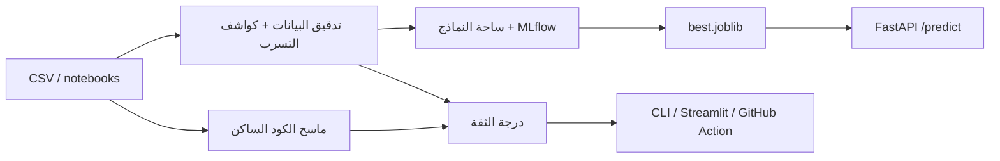

# LeakLens

[English](../README.md)

[](https://github.com/eyadstein/leaklens/actions/workflows/ci.yml)
[](#شارة-درجة-الثقة)
[](https://pypi.org/project/leaklens-ml/) [](https://pypi.org/project/leaklens-ml/)
[](../LICENSE)

**اكتشف تسرب البيانات قبل أن يخدعك.** كثير من النماذج ذات الدقة التي تبلغ «99%» تعتمد على تسرب البيانات. يدقق LeakLens في **بياناتك** و**كودك**، ثم يثبت ما يصمد فعلاً من خلال تدريب ثلاث عائلات من النماذج على خط أنابيب خالٍ من التسرب.

**[تقرير العرض التوضيحي المباشر](https://eyadstein.github.io/leaklens/)**

## ما الذي يكتشفه؟

| المكان | التسرب |
|---|---|
| البيانات | تسرب الهدف (ميزة واحدة تتنبأ بالتصنيف شبه الكامل)، الأعمدة الشبيهة بالمعرّفات، تداخل صفوف التدريب والاختبار، التسرب الزمني، تداخل الكيانات/المجموعات (`--group COL`) |
| الكود (`.py` و`.ipynb`) | تدريب أداة القياس أو الترميز أو التعويض قبل التقسيم، استخدام SMOTE قبل التقسيم، تدريب المحولات على بيانات الاختبار/التحقق أو على مجموعة البيانات كاملة بعد التقسيم، الاستدعاءات المتسلسلة مثل `StandardScaler().fit_transform(X)`، إجراء المعالجة المسبقة أو إعادة أخذ العينات قبل `cross_val_score` أو `GridSearchCV` (`preprocess_outside_cv`) |

يعيد كل تدقيق درجة ثقة من 0 إلى 100. ويخرج CLI برمز 1 عند اكتشاف تسرب عالي الخطورة، ما يجعله مناسباً لفرض التحقق في CI.

## العرض التوضيحي

```text
$ leaklens demo.csv --target is_fraud --arena
LeakLens trust score: 50/100
[HIGH] target_leakage :: chargeback_flag :: alone predicts target (roc_auc=1.000)
[MEDIUM] id_like :: txn_id :: 100.0% unique values; likely an identifier

Arena ranked by pr_auc (auto-dropped: chargeback_flag, txn_id)
model roc_auc pr_auc best_f1
neural_net 0.8374 0.4219 0.4353
linear 0.8410 0.4215 0.4304
tree_ensemble 0.8242 0.3562 0.4103
```

يجعل العمود المتسرب الدقة تبدو مثالية. يحذفه LeakLens ويعرض الأرقام الصادقة.

## التثبيت

```bash
pip install leaklens-ml
```

## البدء السريع

```bash
pip install -e ".[dev,app]"
leaklens train.csv --target label --test test.csv --time date
leaklens --scan notebooks/ --explain   # يطبع إصلاحاً مقترحاً أسفل كل نتيجة
leaklens --scan . --sarif leaklens.sarif   # لفحص الكود في GitHub
leaklens train.csv --target label --test test.csv --group patient_id
leaklens train.parquet --target label --fail-under 80   # إدخال Parquet؛ يتطلب leaklens-ml[parquet]؛ بوابة CI لدرجة الثقة
leaklens train.json --target label   # إدخال JSON، بلا متطلبات إضافية
leaklens train.xlsx --target label   # إدخال Excel؛ يتطلب leaklens-ml[excel]
leaklens train.feather --target label   # إدخال Feather؛ يتطلب leaklens-ml[feather]
python examples/make_demo.py
leaklens demo.csv --target is_fraud --arena
mlflow ui --backend-store-uri sqlite:///mlflow.db
```

## ساحة النماذج

يحذف الأعمدة المتسربة وأعمدة المعرّفات تلقائياً، ثم يدرب نماذج خطية ونماذج أشجار معززة ونماذج شبكات عصبية داخل خطوط أنابيب آمنة من التسرب (يتم تدريب التعويض والقياس والترميز على بيانات التدريب فقط). تُتتبّع عمليات التشغيل في MLflow المحلي (SQLite)، ويحفظ النموذج الفائز في `models/best.joblib`. أضف `--time COL` لاستخدام تقسيم زمني.

## واجهة API والواجهة الرسومية

```bash
uvicorn leaklens.api:app --port 8000 # التوثيق في /docs
streamlit run leaklens/ui.py
```

نقاط النهاية: `GET /health` و`POST /audit` و`POST /scan` و`POST /predict`.

## Docker

```bash
docker compose up --build
```

تتوفر API على `http://localhost:8000/docs`، والواجهة الرسومية على `http://localhost:8501`.

## إجراء GitHub

```yaml
- uses: actions/checkout@v4
- uses: eyadstein/leaklens@main
  with:
    path: notebooks
```

## تقرير HTML

```bash
leaklens demo.csv --target is_fraud --arena --html report.html
```

ينتج ملفاً واحداً مستقلاً يحتوي على درجة الثقة والنتائج وجدول الساحة. يمكن إرفاقه بسهولة بطلب دمج أو مشاركته مع فريقك.

## فحص الكود في GitHub

```yaml
permissions:
  security-events: write
steps:
  - uses: actions/checkout@v4
  - run: pip install leaklens-ml
  - run: leaklens --scan . --sarif leaklens.sarif || true
  - uses: github/codeql-action/upload-sarif@v3
    with:
      sarif_file: leaklens.sarif
```

ستظهر النتائج بعد ذلك في تبويب Security في المستودع، وكذلك كتعليقات توضيحية على طلبات الدمج.

## خطاف pre-commit

```yaml
repos:
  - repo: https://github.com/eyadstein/leaklens
    rev: main
    hooks:
      - id: leaklens
```

يمنع الخطاف إنشاء commit عندما يدرّب سكربت أو دفتر ملاحظات محولاً قبل التقسيم.

## شارة درجة الثقة

```bash
leaklens --scan . --badge badge.json
```

نفّذ commit للملف `badge.json`، ثم وجّه شارة endpoint من shields.io إلى عنوانه الخام (كما في أعلى هذا الملف).

## البنية



## خارطة الطريق

الخطة الكاملة مع مراحلها ومعايير إنجازها: [ROADMAP.md](../ROADMAP.md). المهام المفتوحة موجودة في [Issues](https://github.com/eyadstein/leaklens/issues).

- [x] الكواشف الأساسية، الماسح الساكن، ساحة النماذج، API، والواجهة الرسومية
- [x] Docker وGitHub Action والشارة وCI
- [x] كاشف تسرب المجموعة/الكيان
- [x] حزم PyPI وسير عمل الإصدار (اسم PyPI هو `leaklens-ml`، بينما يبقى الأمر `leaklens`؛ أنشئ إصداراً في GitHub للنشر)

## دراسة التسرب

في عينة غير عشوائية من 1,725 دفتر ملاحظات عاماً يقسم بياناته، قام **38%** بتدريب خطوة معالجة مسبقة قبل التقسيم أو على بيانات الاختبار (هذه إرشادات ساكنة وليست حكماً نهائياً على أي دفتر). التفاصيل والتحفظات في [STUDY.md](STUDY.md). لإعادة إنتاج الدراسة، نفّذ `python scripts/study.py` (يتطلب أداة `gh`).

## الدقة والأمان

يُختبر ماسح الكود مقابل معيار انحدار موسوم في كل تشغيل لـ CI (`python -m leaklens.bench`، والنتائج في [BENCHMARK.md](BENCHMARK.md)). الماسح صغير ومكتوب يدوياً، لذا استخدمه كحاجز لحماية الانحدار لا كادعاء بدقة واقعية. أبلغ عن الثغرات وفق ما هو موضح في [SECURITY.md](../SECURITY.md).

## المساهمة

راجع [CONTRIBUTING.md](../CONTRIBUTING.md). المهام المبدئية تحمل وسم «good first issue».

## المساهمون

شكراً لـ @jay23606 (إدخال Parquet)، و@slopggobblercobbler81 (`--fail-under`)، و@tyza66 (إدخال Excel وJSON وFeather)، و@rahul05ranjan (فحص قابلية إعادة الإنتاج باستخدام `random_state`).

مرخّص بموجب MIT.
