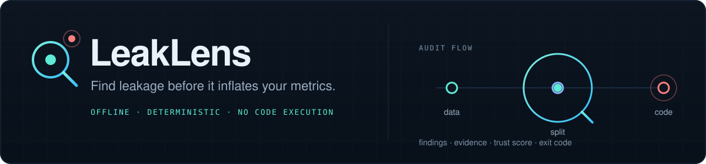
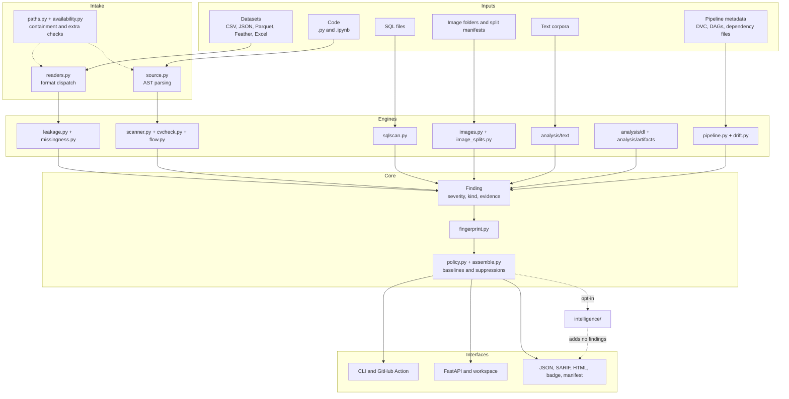
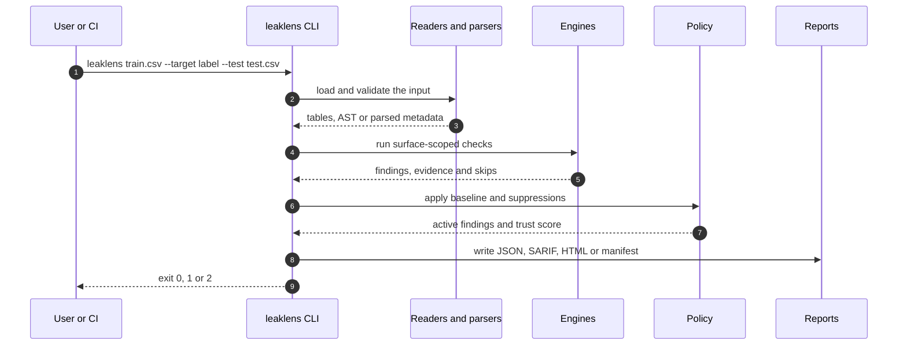
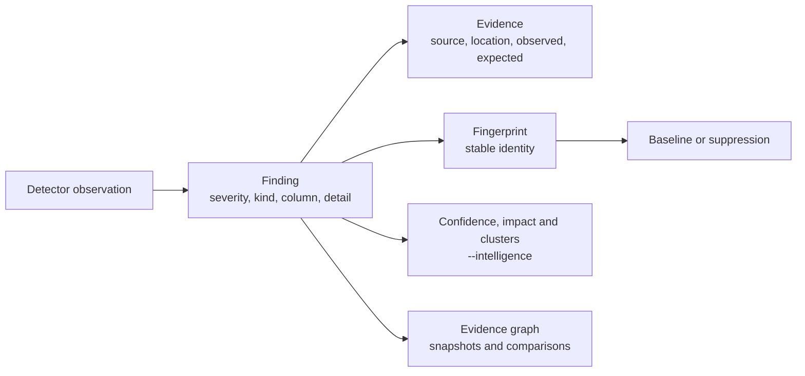

<p align="center">
  
</p>

# LeakLens

[English](../README.md) | [日本語](README.ja.md)

[](https://github.com/eyadstein/leaklens/actions/workflows/ci.yml)
[](#النتائج-والأدلة)
[](https://pypi.org/project/leaklens-ml/) [](https://pypi.org/project/leaklens-ml/)
[](../LICENSE)

**اكتشف تسرب البيانات قبل أن يضخّم مقاييسك.** يدقّق LeakLens في المواضع التي يختبئ فيها التسرب: مجموعات البيانات، وتقسيمات التدريب والاختبار، والكود الذي يبني النموذج، مع محرّكات اختيارية لـ SQL والصور والنصوص والتعلّم العميق وبيانات خط الأنابيب. الكشف حتمي ومحلي ويعمل على المعالج أولاً: يحلّل الماسح الكود دون تنفيذه، ولا تغادر أي صفوف بيانات جهازك.

[التوثيق](https://eyadstein.github.io/leaklens/docs.html) · [الموقع والعرض التوضيحي](https://eyadstein.github.io/leaklens/) · [سجل التغييرات](../CHANGELOG.md) · [المشكلات](https://github.com/eyadstein/leaklens/issues)

## المحتويات

- [لماذا يهم التسرب](#لماذا-يهم-التسرب)
- [البدء السريع](#البدء-السريع)
- [مشاهدة الكشف عن تسرب](#مشاهدة-الكشف-عن-تسرب)
- [ما الذي يكتشفه](#ما-الذي-يكتشفه)
- [البنية](#البنية)
- [دورة حياة التدقيق](#دورة-حياة-التدقيق)
- [النتائج والأدلة](#النتائج-والأدلة)
- [التثبيت](#التثبيت)
- [سطر الأوامر](#سطر-الأوامر)
- [GitHub Action](#github-action)
- [واجهة Python](#واجهة-python)
- [الإعداد والسياسة](#الإعداد-والسياسة)
- [المدمج والاختياري](#المدمج-والاختياري)
- [التقارير والمخرجات](#التقارير-والمخرجات)
- [المعايير](#المعايير)
- [القيود](#القيود)
- [الأمان والخصوصية](#الأمان-والخصوصية)
- [المساهمة](#المساهمة)
- [التوثيق وخارطة الطريق](#التوثيق-وخارطة-الطريق)
- [الرخصة](#الرخصة)

## لماذا يهم التسرب

التسرب هو معلومات تتوافر أثناء التدريب ولا تتوافر عند التنبؤ. يبدو التحقق المتقاطع ممتازاً، ويبدو الإنتاج معطلاً. والأشكال المعتادة مألوفة:

- وجود الهدف، أو قيمة مشتقة منه، كعمود في الميزات؛
- تدريب أداة قياس أو ترميز أو تعويض أو إعادة أخذ عينات أو اختيار ميزات قبل التقسيم؛
- ظهور الصفوف أو الكيانات أو الفترات الزمنية نفسها في التدريب والاختبار معاً.

لا يعلن التسرب عن نفسه؛ يظهر كدرجة قوية ودفتر ملاحظات نظيف ونموذج يفشل بهدوء بعد النشر. يعرض LeakLens الملاحظة والأدلة التي تسندها، مع درجة خطورة وبصمة ثابتة، حتى يراجع الفريق النتيجة بدلاً من الوثوق برقم مجمّع.

## البدء السريع

ثبّت أداة سطر الأوامر (Python 3.10 أو أحدث، دون حزم اختيارية)، ثم افحص قاعدة كود أو مجلد دفاتر ملاحظات:

```sh
python -m pip install --upgrade leaklens-ml
leaklens --scan .
```

دقّق مجموعة بيانات، ويمكنك مقارنتها بتقسيم اختبار محتجَز وعمود زمني:

```sh
leaklens train.csv --target label
leaklens train.csv --test test.csv --target label --time date
```

تطبع النتيجة النظيفة `LeakLens trust score: 100/100` وتخرج بالرمز `0`. أما نتيجة عالية الخطورة، أو درجة أقل من `--fail-under`، أو نتيجة جديدة عند تفعيل `--fail-on-new`، فتخرج بالرمز `1`؛ وتخرج الوسائط أو الإعدادات غير الصالحة بالرمز `2`. هذا العقد الواحد يجعل الأمر نفسه صالحاً محلياً وفي CI. مسار `--scan` غير الموجود يُعد مدخلاً غير صالح ويخرج بالرمز `2` بدلاً من الإبلاغ عن فحص نظيف.

## مشاهدة الكشف عن تسرب

يولّد المستودع `demo.csv`، مجموعة بيانات احتيال اصطناعية تحتوي على تسرب واحد مزروع:

```sh
git clone https://github.com/eyadstein/leaklens.git
cd leaklens
python -m pip install leaklens-ml
python examples/make_demo.py
leaklens demo.csv --target is_fraud
```

```text
LeakLens trust score: 50/100
[HIGH] target_leakage :: chargeback_flag :: alone predicts target (roc_auc=1.000)
[MEDIUM] id_like :: txn_id :: 100.0% unique values; one value per row
1 high, 1 medium
```

العمود `chargeback_flag` هو الهدف منسوخاً إلى ميزة، لذا تبدو الدقة مثالية حتى يُحذف العمود. يُولَّد `demo.csv` ولا يُحفظ في المستودع؛ ويزرع [دفتر الشرح](../examples/leak_walkthrough.ipynb) ثلاثة أنواع من التسرب ثم يصلحها خطوة بخطوة، ويغطي [examples/advanced_leaks.py](../examples/advanced_leaks.py) ضبط المعاملات وترميز الهدف واختيار الميزات والتحقق المتقاطع المجمّع والترتيب الزمني.

## ما الذي يكتشفه

| السطح | الفحوص |
|---|---|
| مجموعات البيانات (CSV وJSON) | تسرب الهدف من ميزة واحدة، تسرب الهدف عبر فئة عالية التعدد، أعمدة شبيهة بالمعرّفات، مخاطر الكيانات والمجموعات (`--group`) |
| التقسيمات (`--test`) | تداخل الصفوف التام، تطابق متجهات الميزات مع اختلاف الهدف، فروق قريبة في حالة الأحرف والمسافات، التداخل الزمني، تداخل الكيانات |
| القيم المفقودة | ارتباط القيم المفقودة بالهدف أو التقسيم أو المجموعة عندما يكون الارتباط قوياً بما يكفي لحمل معلومات ([التفاصيل](MISSINGNESS.md)) |
| الكود (`.py` و`.ipynb`) | المعالجة المسبقة وSMOTE وترميز الهدف والتردد واختيار الميزات قبل التقسيم؛ التدريب على بيانات الاختبار؛ ضبط المعاملات على بيانات الاختبار أو قبل التقسيم؛ التحقق المتقاطع على صفوف الاختبار أو دون `groups=`؛ خلط تقسيمات السلاسل الزمنية؛ خلايا الدفتر غير المرتبة؛ إزاحات الهدف والنوافذ المتدحرجة التي تنظر إلى المستقبل |
| الصور (اختياري) | الصور القريبة من التكرار بين مجلدات التدريب والاختبار، والعناقيد التامة والإدراكية |
| تقسيمات الصور المعلنة | تداخل COCO وYOLO وVOC المعلن (`leaklens splits`) |
| SQL (اختياري) | استخدام الهدف كميزة عبر تتبّع مصدر مؤكد، وإطارات زمنية مستقبلية، واستعلامات بلا شرط تقسيم |
| النصوص (اختياري) | تكرارات التدريب والتقييم، وتلوّث التقييم، وربط فهرس RAG، وتشابه المتجهات الذي يقدمه المستدعي |
| التعلّم العميق (اختياري) | تداخل التقسيم، وعدم تطابق بروتوكول التدريب، وصيغ نقاط الحفظ غير الآمنة، والبذور المفقودة |
| بيانات خط الأنابيب (اختياري) | تتبّع مصدر DVC وخطوط الأنابيب المتسلسلة، وانحراف المعاملات، والملخصات المفقودة، والاعتماديات غير المثبّتة |

تصف النتائج ما لوحظ، لا ما يجب أن يكون صحيحاً: القاعدة المؤكدة (بحث دُرّب على `X_test`) عالية الخطورة، بينما النمط المشبوه الذي قد يكون مشروعاً (ترميز التردد قبل التقسيم) منخفض أو متوسط ويشرح سبب الإبلاغ عنه. كل نوع ودرجة خطورته وحالته في التسجيل موثّقة في [docs/DETECTORS.md](DETECTORS.md).

## البنية

LeakLens مجموعة محرّكات مقيّدة بالسطح حول نموذج نتائج واحد. يطبّع الاستقبال المدخلات، ويدقّق محرّك واحد ذلك السطح، فتحمل النتيجة أدلتها وبصمتها. تستهلك التقارير والسياسة ونقاط الدخول النتيجة المجمّعة نفسها. ولا يتصل أي شيء في التثبيت الأساسي بالشبكة أو ينفّذ الكود المفحوص.



**كيف تقرأ المخطط.** الاستقبال رفيع عمداً: يحوّل `readers.py` اللاحقة إلى قارئ pandas، ويحلّل `source.py` مصدر Python والدفاتر باستخدام `ast`، ويرفض `paths.py` المسارات غير الآمنة، ويحوّل `availability.py` الاعتمادية الاختيارية المفقودة إلى خطأ واضح بدلاً من استيراد عند بدء التشغيل. يصدر كل محرّك كائنات `Finding` لسطحه فقط. وتضيف النواة الأدلة والبصمة والسياسة؛ ويبني `assemble.py` الحمولة التي تسلسلها كل واجهة. أما `intelligence/` فتحليل اختياري فوق النتائج القائمة، ولا يخترع نتيجة كاشف.

## دورة حياة التدقيق



الدورة بسيطة عمداً: لا تدريب ولا تشغيل لدفتر ملاحظات ولا اتصال بقاعدة بيانات. تُدرج المحرّكات الاختيارية في الخطوة نفسها، وتُوسم المحرّكات التشخيصية كي تتجاهلها السياسة وبوابة الخروج إلا إذا فعّلت `--fail-on-findings` (النصوص والتعلّم العميق) أو `--fail-on-graph-new` (مقارنة المخطط) صراحةً.

## النتائج والأدلة

يبدأ LeakLens من 100 ويخصم نقاطاً عن كل نتيجة نشطة، دون النزول تحت الصفر:

| الخطورة | الخصم |
|---|---:|
| عالية | 35 |
| متوسطة | 15 |
| منخفضة | 5 |



الأدلة تتبّع مصدر محدود، وليست تفريغاً للبيانات: تسجّل مصدراً وموقعاً وما لوحظ وما كان متوقعاً عندما يستطيع الكاشف تقديمها. تبقى البصمة صالحة عند تحرّك الأسطر وتعديل الرسائل، فتحتفظ خطوط الأساس والاستثناءات بهويتها؛ ويغيّرها تغيير الكاشف أو الميزة المتأثرة أو مفتاح ثابت يقدمه الكاشف. يقبل الاستثناء بصمة واحدة بالضبط، ويتطلب سبباً، ويوسم النتيجة دون تغيير خطورتها أو أدلتها. وتتوقف النتائج المستثناة عن احتسابها في الدرجة وفي البوابة الافتراضية. وتوسم خطوط الأساس التشغيلات اللاحقة `new` أو `unchanged` أو `changed` أو `resolved`، ولا تُستبدل ضمنياً.

تحمل تقارير JSON الحقل `$schema`، ويطبع `leaklens schema` العقد. التفاصيل: [docs/REPORT_SCHEMA.md](REPORT_SCHEMA.md) و[docs/BASELINES.md](BASELINES.md) و[docs/DETECTORS.md](DETECTORS.md).

## التثبيت

حزمة PyPI هي `leaklens-ml`، والأمر المثبّت هو `leaklens`. الحد الأدنى هو Python 3.10 (`requires-python`)، ويشغّل CI الإصدارات 3.10 و3.11 و3.12 و3.14 على Linux. الإصدار 3.13 خارج المصفوفة ولا يُدّعى التحقق منه. الحزمة Python خالصة وتُثبّت على Windows وLinux وmacOS. على Windows استخدم `py -3 -m pip ...` إذا لم يكن `python` في PATH؛ وإذا أبلغ pip عن `externally-managed-environment` فأنشئ بيئة افتراضية أولاً.

الحزم الاختيارية:

| الحزمة | ما تضيفه |
|---|---|
| `arena` | ساحة النماذج: تحذف الأعمدة الموسومة وتدرّب ثلاث عائلات نماذج في خطوط أنابيب آمنة من التسرب، مع تتبّع في MLflow (`--arena`) |
| `parquet` و`feather` | إدخال `.parquet` و`.feather` عبر `pyarrow` |
| `excel` | إدخال `.xlsx` عبر `openpyxl` |
| `images` | فحص الصور القريبة من التكرار (`leaklens images`) عبر Pillow |
| `app` | خدمة FastAPI وواجهة Streamlit |
| `api` | واجهة الفحص المباشر العامة المحصّنة (دون Streamlit) |
| `sql` | تحليل تتبّع مصدر SQL عبر SQLGlot |
| `yaml` | إعدادات خطوط أنابيب التدريب بصيغة YAML |
| `taintwatch` | حارس اختياري لتدفق المعلومات من أجل `--llm` |

```sh
python -m pip install "leaklens-ml[parquet,images]"
```

يتحقق `leaklens doctor` من المفسّر وموقع التثبيت ونقطة الدخول والاعتماديات الأساسية والحزم الاختيارية وصحة الإعداد دون اتصال بالشبكة؛ مرّر `--json` للحصول على تقرير قابل للقراءة آلياً. تعود لاحقة مجموعة بيانات غير معروفة إلى CSV. وأي صيغة أو محرّك اختياري غير مثبّت يرفع `ImportError` يسمّي الحزمة التي توفره.

## سطر الأوامر

| الأمر | الغرض |
|---|---|
| `leaklens FILE --target COL` | تدقيق مجموعة بيانات (CSV وJSON مدمجان) |
| `leaklens --scan PATH...` | فحص ساكن لملفات أو مجلدات `.py` و`.ipynb` |
| `leaklens splits DATASET` | تدقيق ملفات تقسيم COCO أو YOLO أو VOC المعلنة |
| `leaklens images TRAIN TEST` | إيجاد صور قريبة من التكرار بين التقسيمات |
| `leaklens text TRAIN TEST` | مقارنة مجموعات نصية بحثاً عن التلوّث |
| `leaklens dl DIR` | تدقيق كود التعلّم العميق وإعداداته ومخرجاته |
| `leaklens workspace [DIR]` | تشغيل مساحة العمل المحلية التفاعلية |
| `leaklens verify MANIFEST` | التحقق من بيان تدقيق دون اتصال |
| `leaklens init` | كتابة `.leaklens.toml` أولي وطباعة مقتطف pre-commit |
| `leaklens doctor` و`leaklens schema` | فحص التثبيت وطباعة مخطط JSON للتقرير |

```sh
leaklens train.csv --target label --test test.csv --json
leaklens --scan notebooks/ --explain
leaklens --scan . --sarif leaklens.sarif
leaklens --scan . --intelligence --graph-out evidence.mmd
```

يسرد `leaklens --help` كل خيار وقيمته الافتراضية؛ وتسرد [docs/CONFIGURATION.md](CONFIGURATION.md) الخيارات نفسها كمفاتيح إعداد.

## GitHub Action

يثبّت الإجراء أداة سطر الأوامر ويشغّل `leaklens --scan` على ملف أو مجلد. ولا ينفّذ تدقيق مجموعة بيانات؛ استخدم خطوة `run:` لذلك.

| المدخل | مطلوب | الافتراضي | الغرض |
|---|---|---|---|
| `path` | اختياري | `.` | الملف أو المجلد المراد فحصه |
| `fail-under` | اختياري | غير محدد | الحد الأدنى لدرجة الثقة (0-100)؛ عند تحديده تفشل الخطوة أيضاً إذا نزلت الدرجة عنه |

```yaml
name: leakage
on: [push, pull_request]
jobs:
  leaklens:
    runs-on: ubuntu-latest
    steps:
      - uses: actions/checkout@v7
      - uses: eyadstein/leaklens@v0.14.0
        with:
          path: .
```

تفشل الخطوة عندما يخرج الفحص بالرمز `1`: نتيجة عالية الخطورة، أو درجة ثقة أقل من `fail-under` عند تحديده. ولا تفشل الخطوة بسبب النتائج التشخيصية. أُضيف مدخل `fail-under` بعد الإصدار `v0.13.0`، لذا يجب على سير عمل يستخدمه أن يثبّت `v0.14.0` أو أحدث:

```yaml
      - uses: eyadstein/leaklens@v0.14.0
        with:
          path: .
          fail-under: 80
```

ثبّت وسم إصدار أو SHA كاملاً لالتزام قابل للتكرار. ويتابع `@main` الفرع الافتراضي، أي التغييرات غير المنشورة.

## واجهة Python

تعرض المكتبة المحرّكات نفسها التي تستخدمها أداة سطر الأوامر:

```python
import pandas as pd

from leaklens.audit import audit
from leaklens.leakage import scan, score
from leaklens.scanner import scan_path

findings = scan(pd.read_csv("train.csv"), target="label")
print(score(findings), [(f.severity, f.kind, f.column) for f in findings])

for finding in scan_path("src"):
    print(finding.kind, finding.column, finding.detail)

print(audit(pd.read_csv("train.csv"), "label")["cardinality"])
```

تعيد `leaklens.audit.audit(df, target)` ملفاً تعريفياً لمجموعة البيانات: الصفوف والأعمدة والصفوف المكررة والتعدد والقيم الفارغة وتوزيع الهدف. مخطط تقرير JSON، لا تواقيع Python، هو العقد المستقر للتكاملات اللاحقة.

## الإعداد والسياسة

يكتب `leaklens init` ملف `.leaklens.toml` مشروحاً. يقرأ LeakLens `./.leaklens.toml` تلقائياً، أو الملف الذي يمرره `--config`. الأولوية: القيم الافتراضية، ثم الإعداد، ثم خيارات سطر الأوامر الصريحة. المفاتيح غير المعروفة والأنواع الخاطئة ومسارات المخرجات غير الآمنة تخرج بالرمز `2` بدلاً من تغيير الفحص بصمت.

```toml
target = "label"
fail_under = 80

[baseline]
path = "leaklens-baseline.json"
fail_on_new = true

[[suppressions]]
fingerprint = "64-lowercase-hex-characters"
reason = "accepted: the column is recorded before prediction"
```

تضبط أقسام المحرّكات الاختيارية (`[missingness]` و`[sql]` و`[drift]` و`[graph]`) العتبات والمخرجات. ويجب أن تبقى مسارات المخرجات داخل مجلد الإعداد. التفاصيل: [docs/CONFIGURATION.md](CONFIGURATION.md) و[docs/BASELINES.md](BASELINES.md).

## المدمج والاختياري

يغطي التثبيت الأساسي مجموعات بيانات CSV وJSON وفحص الكود وفحوص التقسيم والقيم المفقودة. وكل ما عدا ذلك اختياري ولا يلزم لسير العمل الأساسي.

| القدرة | نقطة الدخول | تحتاج | سلوك البوابة |
|---|---|---|---|
| تدقيق مجموعات البيانات وفحص الكود وفحوص التقسيم والقيم المفقودة وتدقيق التقسيمات المعلنة | `leaklens` و`--scan` و`--test` و`--group` و`leaklens splits` | التثبيت الأساسي | الخروج بالرمز 1 عند نتيجة عالية الخطورة |
| الانحراف وبيانات خط الأنابيب والنصوص والتعلّم العميق وفرضيات AI | `--drift` و`--pipeline` و`leaklens text` و`leaklens dl` و`--ai` | الأساسي (`[yaml]` لـ DVC وYAML) | تشخيصي: الدرجة ورمز الخروج دون تغيير (`--fail-on-findings` للنصوص والتعلّم العميق) |
| الصور القريبة من التكرار | `leaklens images` | `[images]` | الخروج بالرمز 1 عند نتيجة عالية الخطورة |
| تتبّع مصدر SQL | `--sql` | `[sql]` | الخروج بالرمز 1 عند نتيجة عالية الخطورة |
| ساحة النماذج | `--arena` | `[arena]` | يكتب `models/best.joblib` |
| API والواجهة ومساحة العمل | `uvicorn` و`streamlit` و`leaklens workspace` | `[app]` | ليست بوابة فحص |
| واجهة الفحص المباشر العامة | `uvicorn leaklens.public_api:app` | `[api]` | ليست بوابة فحص |
| شروح LLM | `--llm` | Ollama محلي افتراضياً | لا تغيّر النتائج أو الدرجة أو رمز الخروج |

إذا غابت اعتمادية اختيارية، يرفع الأمر `ImportError` يسمّي الحزمة، ويسرد `leaklens doctor` الحزم القابلة للاستيراد. ويبقى التثبيت الأساسي صالحاً بالكامل. الفحص دون اتصال ويعمل على المعالج أولاً افتراضياً؛ ولا يستخدم الشبكة إلا مزوّد `--llm` بعيد يُضبط صراحةً، أو أمر تثبيت، أو تشغيل MLflow تبدأه أنت.

## التقارير والمخرجات

| الخيار | المخرج |
|---|---|
| `--json` | تقرير قابل للقراءة آلياً على stdout |
| `--sarif FILE` | SARIF 2.1.0 مع الأدلة والبصمات |
| `--html FILE` | تقرير واحد مستقل بذاته مع مفتاح للخطورة |
| `--badge FILE` | JSON لنقطة نهاية shields.io يحمل درجة الثقة |
| `--manifest FILE` | بيان تدقيق غير موقّع وقابل للتحقق دون اتصال (`leaklens verify`) |
| `--intelligence` | ثقة حتمية وعناقيد أدلة وتحليل للسبب الجذري |
| `--graph-out FILE` | مخطط أدلة بصيغة Mermaid (`.mmd`) أو DOT (`.dot`) أو JSON |
| `--graph-snapshot` / `--graph-baseline` | حفظ الأدلة ومقارنتها بين عمليات الفحص |

يجمع مخطط الأدلة النتائج القائمة تحت مرساة قابلة للفحص ويربط أدلة الكاشف؛ ولا يضيف نتائج ولا يغيّر الدرجة أو رمز الخروج. وتصنّف المقارنات النتائج `new` أو `unchanged` أو `changed` أو `resolved` أو `uncertain`. راجع [docs/INTELLIGENCE.md](INTELLIGENCE.md) و[docs/AUDIT_MANIFEST.md](AUDIT_MANIFEST.md).

لفحص الكود في GitHub:

```yaml
permissions:
  contents: read
  security-events: write
steps:
  - uses: actions/checkout@v7
  - run: pip install leaklens-ml
  - run: leaklens --scan . --sarif leaklens.sarif || true
  - uses: github/codeql-action/upload-sarif@v4
    with:
      sarif_file: leaklens.sarif
```

لنشر شارة ثقة، شغّل `leaklens --scan . --badge badge.json`، ثم احفظ الملف في المستودع، ووجّه شارة endpoint من shields.io إلى عنوانه الخام كما في أعلى هذا الملف. ويسجّل [badge.json](../badge.json) المرفق الفحص الذاتي للمستودع.

## المعايير

- يُختبر ماسح الكود مقابل 117 حالة انحدار مكتوبة يدوياً (63 مسربة و54 نظيفة) دون أي إيجابية أو سلبية خاطئة: `python -m leaklens.bench`، والنتائج في [docs/BENCHMARK.md](BENCHMARK.md).
- يشغّل الأمر نفسه أيضاً 32 حالة كشف متقدمة أُضيفت بعد خط الأساس الأصلي، وهي مشمولة في الإصدار المنشور 0.14.0.
- لكواشف مجموعات البيانات 12 حالة اصطناعية (`python -m leaklens.bench_data`، [docs/DATA_BENCHMARK.md](DATA_BENCHMARK.md))؛ ولكل من القيم المفقودة والانحراف وخط الأنابيب والنصوص والتعلّم العميق والرؤية وSQL وAI معيار موسوم خاص به تحت `docs/`.
- وجدت عينة ساكنة من 1,725 دفتر ملاحظات عاماً يقسم بياناته أن 38% منها درّبت خطوة معالجة مسبقة قبل التقسيم أو على بيانات الاختبار ([docs/STUDY.md](STUDY.md)).
- تضم مجموعة الحالات الواقعية 60 دفتر ملاحظات عاماً، لكن 8 فقط لها وسوم مراجعة؛ وعلى تلك الثمانية يحقق الماسح دقة واستدعاء وF1 بمقدار 1.00 ([docs/REALWORLD.md](REALWORLD.md)). هذا فحص سريع على عينة صغيرة غير عشوائية، وليس تقديراً لدقة المجتمع.
- يقيس فحص AI المستقل الدقة 0.833 والضبط 0.767 والاستدعاء 0.958 ومعدل الإيجابيات الكاذبة 0.292 على 48 وحدة مراجعة، مع سرد كل خطأ ([docs/AI_REALWORLD.md](AI_REALWORLD.md))؛ ولا يملك النموذج المشحون مجموعة تحقق مستقلة ثانية، وتُنشر مجموعة H2 المفقودة كنقص لا كرقم ([docs/AI_REALWORLD_H2.md](AI_REALWORLD_H2.md)).

كل المعايير حرّاس انحدار مكتوبة يدوياً ومصممة حول القواعد المدعومة. وهي ليست ادعاءات دقة واقعية، ولا يضمن أي رقم هنا نتيجة إنتاجية. وقياسات زمن تشغيل الماسح وقرار ذاكرة المصدر في [docs/PERFORMANCE.md](PERFORMANCE.md).

## القيود

- الكشف استكشافي وساكن. لا ينفّذ LeakLens الكود المفحوص ولا يشغّل الدفاتر ولا يتصل بقاعدة بيانات ولا يجري تحليلاً كاملاً لتدفق البيانات بين الإجراءات؛ وقد تفوته الأنماط المموّهة أو المبنية ديناميكياً.
- النتيجة دليل يستحق الفحص، لا إثبات للتسرب. قد يتطابق متجه ميزات أو تتداخل مجموعة طبيعياً؛ اقرأ التفصيل والاختبار المقترح قبل التصرف.
- كل نوع مقيّد بالسطح الذي يصدره: قاعدة كود لا تدقّق ملف CSV، وكاشف مجموعة بيانات لا يقرأ دفتر ملاحظاتك. والصيغ المدعومة تختلف بحسب الأمر.
- تأخذ فحوص تداخل الميزات والتكرار القريب عينات بحد أقصى 50,000 و20,000 صف، لذا تُحدّ الملفات الضخمة ولا تُفحص بالكامل.
- المحرّكات التشخيصية (الانحراف وخط الأنابيب والنصوص والتعلّم العميق وAI واستقبال المراقبة) لا تغيّر درجة الثقة أو رمز الخروج، وفرضيات AI محدودة بالخطورة المتوسطة وتبقى تجريبية.
- نتائج القيم المفقودة محدودة بالخطورة المتوسطة ولا تعدّل البيانات أو التقسيمات.
- لتجزئة الصور نقاط عمياء موثّقة (فروق اللون فقط، والقصّ بما يتجاوز 5%، والحشو)، وفحوص التقسيمات المعلنة تقارن بايتات الملفات فقط لا التشابه الإدراكي.
- الإصدار 3.13 من Python خارج مصفوفة CI ولا يُدّعى التحقق منه.

## الأمان والخصوصية

- الفحص محلي ودون اتصال افتراضياً. تبقى محتويات مجموعات البيانات على جهازك؛ ولا يُرفع شيء ولا تُستدعى أي خدمة.
- يحلّل ماسح الكود وتدقيق التعلّم العميق وتدقيق خط الأنابيب الملفات دون تنفيذها. ولا تستورد torch أو TensorFlow، ولا تفتح نقطة حفظ بـ pickle، ولا تستخرج أرشيفاً.
- `--llm` اختياري. يرسل بيانات وصفية للنتائج فقط، ولا يتلقى مزوّد OpenAI متوافق بعيد تلك البيانات إلا بعد إعداده. يجب أن تستخدم عناوين المزوّد HTTP(S)، وتُرفض إعادة التوجيه، ولا تُرسل مفاتيح API عبر HTTP صريح إلى مضيفين غير محليين.
- تعتمد `POST /predict` على ملف pickle يختاره المشغّل؛ اعتبر تطبيق FastAPI محلياً وموثوقاً. والواجهة العامة هي السطح المحصّن للتحميلات غير الموثوقة.
- أبلغ عن الثغرات بشكل خاص وفق [SECURITY.md](../SECURITY.md). يشغّل CI أدوات bandit وpip-audit وpip-licenses وCodeQL؛ وينشر سير عمل الإصدار SBOM بصيغة CycloneDX خارج `dist/` (يكتب `python scripts/generate_sbom.py` الملف `sbom/sbom.json`).

## المساهمة

```sh
git clone https://github.com/eyadstein/leaklens.git
cd leaklens
python -m venv .venv
. .venv/bin/activate   # Windows: .venv\Scripts\Activate.ps1
pip install -e ".[dev,app]"
```

يجب أن يجتاز كل طلب دمج الفحوص التي يشغّلها CI؛ النسخة المختصرة:

```sh
pytest -q
ruff check leaklens tests scripts
ruff format --check leaklens tests scripts
leaklens --scan leaklens
python -m leaklens.bench
python -m leaklens.bench_data
```

أضف اختباراً لكل كاشف أو إصلاح جديد، وضع الكاشف الجديد في `leaklens/leakage.py` (البيانات) أو `leaklens/scanner.py` (الكود). راجع [CONTRIBUTING.md](../CONTRIBUTING.md) و[CODE_OF_CONDUCT.md](../CODE_OF_CONDUCT.md). المشكلات الموسومة **good first issue** هي أسهل نقطة بداية، ويسجّل [مخطط المساهمين](https://github.com/eyadstein/leaklens/graphs/contributors) كل من ساهم.

خطاف pre-commit:

```yaml
repos:
  - repo: https://github.com/eyadstein/leaklens
    rev: v0.14.0
    hooks:
      - id: leaklens
```

يطبع `leaklens init` هذا المقتطف. يثبّت `rev` أحدث إصدار منشور، فيصبح الخطاف قابلاً للتكرار؛ وانتقل إلى وسم أحدث عمداً عند الترقية.

## التوثيق وخارطة الطريق

أحدث إصدار منشور هو **0.14.0**. سجل الإصدارات، والتغييرات المُعدّة للإصدار التالي، في [CHANGELOG.md](../CHANGELOG.md)، لا في هذا الملف.

المُنفَّذ: كواشف مجموعات البيانات والتقسيمات والكود؛ والقيم المفقودة؛ وساحة النماذج؛ وAPI ومساحة العمل؛ وتقارير HTML وSARIF وJSON والشارة؛ وخطوط الأساس والاستثناءات؛ ومخطط الأدلة وخطط التحقيق؛ وتسرب المجموعات؛ وعناقيد الصور وتدقيق التقسيمات المعلنة؛ ومحرّكات SQL والنصوص والتعلّم العميق والانحراف وخط الأنابيب وAI الاختيارية.

تُتبَّع الأعمال المخططة والأسئلة التصميمية المفتوحة في [ROADMAP.md](../ROADMAP.md)، و[خارطة توسّع AI/ML](AI_ML_EXPANSION_ROADMAP.md) الأطول أجلاً، و[المشكلات](https://github.com/eyadstein/leaklens/issues). والعناصر المقترحة هناك ليست التزامات. فهرس التوثيق الكامل هو [موقع docs](https://eyadstein.github.io/leaklens/docs.html).

## الرخصة

مرخّص بموجب MIT؛ راجع [LICENSE](../LICENSE). وبيانات الاقتباس في [CITATION.cff](../CITATION.cff).
