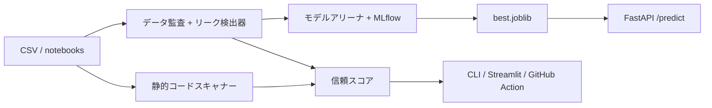

# LeakLens

[العربية](README.ar.md) | [English](../README.md)

[](https://github.com/eyadstein/leaklens/actions/workflows/ci.yml)
[](#信頼スコアバッジ)
[](https://pypi.org/project/leaklens-ml/) [](https://pypi.org/project/leaklens-ml/)
[](../LICENSE)

**データリークを検出し、モデルの評価が実態とかけ離れるのを防ぎます。**「正解率99%」のモデルの大半にはデータリークがあります。LeakLensは**データ**と**コード**の両方を監査し、リークのないパイプラインで3つのモデルファミリーを学習させ、どのような性能が残るかを示します。

**[デモレポート](https://eyadstein.github.io/leaklens/)**

## 検出できる問題
| 対象 | 検出する問題 |
|---|---|
| データ | 目的変数のリーク（ラベルをほぼ完全に予測する特徴量）、IDのようなカラム、学習用データとテスト用データの行の重複、時間的リーク、エンティティやグループの重複（`--group COL`）、分割フォルダ間の近似重複画像（`leaklens images`） |
| コード（`.py`、`.ipynb`） | データ分割前にスケーラー、エンコーダー、欠損値補完器を学習させる処理、分割前のSMOTE、テスト・検証データまたは分割後の全データで学習される変換器、`StandardScaler().fit_transform(X)`のような連結呼び出し、`cross_val_score`や`GridSearchCV`の前に行われる前処理やリサンプリング（`preprocess_outside_cv`） |

監査結果には0〜100の信頼スコアが付きます。重大度の高いリークが見つかると、CLIは終了コード1を返すため、CIのゲートとして利用できます。

## デモ

```text
$ leaklens demo.csv --target is_fraud --arena
LeakLens trust score: 50/100
[HIGH] target_leakage :: chargeback_flag :: alone predicts target (roc_auc=1.000)
[MEDIUM] id_like :: txn_id :: 100.0% unique values; likely an identifier

Arena ranked by pr_auc (auto-dropped: chargeback_flag, txn_id)
model roc_auc pr_auc best_f1
neural_net 0.8374 0.4219 0.4353
linear 0.8410 0.4215 0.4304
tree_ensemble 0.8242 0.3562 0.4103
```

リークしたカラムがあると、精度が完璧に見えてしまいます。LeakLensはそのカラムを除外し、実際の性能を示します。

## インストール

```sh
pip install leaklens-ml
```

## クイックスタート

```sh
pip install -e ".[dev,app]"
leaklens train.csv --target label --test test.csv --time date
leaklens --scan notebooks/ --explain   # 検出項目ごとに修正案を表示
leaklens --scan . --sarif leaklens.sarif   # GitHub Code Scanning用
leaklens train.csv --target label --test test.csv --group patient_id
leaklens train.parquet --target label --fail-under 80   # Parquet入力（pip install leaklens-ml[parquet]）。信頼スコアをCIのゲートにする
leaklens train.json --target label   # 追加パッケージなしでJSON入力
leaklens train.xlsx --target label   # Excel入力（pip install leaklens-ml[excel]）
leaklens train.feather --target label   # Feather入力（pip install leaklens-ml[feather]）
leaklens images data/train data/test   # 分割間の近似重複画像を検出（pip install leaklens-ml[images]）
python examples/make_demo.py
leaklens demo.csv --target is_fraud --arena
mlflow ui --backend-store-uri sqlite:///mlflow.db
```

データリークについて初めて学ぶ方は、[チュートリアルノートブック](../examples/leak_walkthrough.ipynb)をご覧ください。意図的に仕込んだ3つのリークによってスコアがどう水増しされるか、LeakLensがどう検出・修正するかを確認できます。

## オプションのLLMによる説明

LLMによる説明は、`--llm`を指定しない限り無効です。LeakLensは選択された検出項目の重大度、種類、ファイル名、行番号、診断の詳細を送信します。詳細には、スキャンしたファイルから短いコード表現が含まれることがあります。ソースファイル全体、ノートブック全体、データセットの行は送信しません。既定のプロバイダーはローカルのOllamaです。`--llm-provider openai-compatible`を選ぶか、リモートのベースURLを設定すると、検出項目の詳細がそのホストに送信されます。プロバイダーのURLにはHTTPまたはHTTPSを指定してください。リダイレクトは拒否されます。また、`localhost`または`127.0.0.1`以外には、平文HTTPでAPIキーを送信しません。説明の対象は既定で重大度の高い順に10件までです。上限を変更するには`--llm-max-findings N`を指定します。

```sh
ollama pull qwen2.5:7b
leaklens --scan notebooks/ --llm
```

OpenAI互換APIを使う場合は、エンドポイントとキーを設定します。リクエストはお使いのマシンの外部に送信されます。

```sh
export LEAKLENS_LLM_BASE_URL=https://api.example.com/v1
export LEAKLENS_LLM_API_KEY=...
export LEAKLENS_LLM_MODEL=your-model
leaklens --scan notebooks/ --llm --llm-provider openai-compatible
```

コマンドラインで`--llm-base-url`と`--llm-model`を指定することもできます。APIキーは`LEAKLENS_LLM_API_KEY`からのみ読み込みます。

## モデルアリーナ

リークしたカラムとIDカラムを自動的に除外し、リークを防ぐパイプライン内で線形モデル、勾配ブースティング木モデル、ニューラルネットワークを学習させます。補完、スケーリング、エンコードは学習用データだけで学習します。実行結果はローカルのMLflow（SQLite）に記録され、最良のモデルは`models/best.joblib`に保存されます。時間でデータを分割するには`--time COL`を指定します。

## APIとUI

```sh
uvicorn leaklens.api:app --port 8000 # ドキュメントは /docs
streamlit run leaklens/ui.py
```

エンドポイント: `GET /health`、`POST /audit`、`POST /scan`、`POST /predict`

## Docker

```sh
docker compose up --build
```

APIは http://localhost:8000/docs、UIは http://localhost:8501 で利用できます。

## GitHub Action

```yaml
- uses: actions/checkout@v4
- uses: eyadstein/leaklens@main
  with:
    path: notebooks
```

## HTMLレポート

```sh
leaklens demo.csv --target is_fraud --arena --html report.html
```

信頼スコア、検出項目、モデルアリーナの表を含む、単体で表示できるHTMLファイルを生成します。PRに添付したり、チームで共有したりできます。検出項目がない場合も含め、検出項目の欄には重大度（高・中・低）を色分けした凡例が表示されます。

## GitHub Code Scanning

```yaml
permissions:
  security-events: write
steps:
  - uses: actions/checkout@v4
  - run: pip install leaklens-ml
  - run: leaklens --scan . --sarif leaklens.sarif || true
  - uses: github/codeql-action/upload-sarif@v3
    with:
      sarif_file: leaklens.sarif
```

検出結果はリポジトリのSecurityタブと、PR上の注釈に表示されます。

## pre-commitフック

```yaml
repos:
  - repo: https://github.com/eyadstein/leaklens
    rev: main
    hooks:
      - id: leaklens
```

ノートブックやスクリプトで、データを分割する前に変換器を学習させている場合、コミットをブロックします。

`leaklens init`を実行すると、CLIフラグごとに1つのキーを記したコメント付きの`.leaklens.toml`のひな形が作成され、上記の設定例が表示されます。既存ファイルを上書きするには`--force`を指定します。

## 信頼スコアバッジ

```sh
leaklens --scan . --badge badge.json
```

`badge.json`をコミットし、そのRaw URLをShields.ioのエンドポイントバッジに設定してください（このファイルの先頭に例があります）。

## アーキテクチャ



## 信頼スコアの計算方法

LeakLensは信頼スコアを100点から始め、検出項目ごとに重大度に応じた点数を差し引きます。

| 重大度 | 減点 |
|---|---:|
| 高 | 35点 |
| 中 | 15点 |
| 低 | 5点 |

合計減点を100点から引いて最終スコアを計算します。スコアが0点を下回ることはありません。

**例:** データセットに重大度の高い検出項目が1件、中が1件、低が1件ある場合、減点の合計は35 + 15 + 5 = 55点です。最終的な信頼スコアは100 − 55 = **45/100**です。

## ロードマップ

フェーズと完了条件を含む計画は[ROADMAP.md](../ROADMAP.md)をご覧ください。未完了のタスクは[Issues](https://github.com/eyadstein/leaklens/issues)で確認できます。

- [x] 基本検出器、静的スキャナー、モデルアリーナ、API、UI
- [x] Docker、GitHub Action、バッジ、CI
- [x] グループ／エンティティのリーク検出器
- [x] PyPIパッケージとリリースワークフロー（PyPI名は`leaklens-ml`、コマンド名は`leaklens`のまま。公開するにはGitHubリリースを作成してください）

## データリーク調査

データを分割している公開ノートブック1,725件を無作為ではない方法で抽出して調査したところ、**38%**で、分割前またはテストデータ上で前処理が学習されていました（静的ヒューリスティックによる判定であり、個々のノートブックに対する断定ではありません）。詳細と注意事項は[docs/STUDY.md](STUDY.md)をご覧ください。`python scripts/study.py`で再現できます（`gh` CLIが必要です）。

## 実際のノートブックでの検証

公開ノートブック5件について、スキャナーの出力と照らし合わせながら、目視で確認しました。詳細、件数、制約は[docs/VALIDATION.md](VALIDATION.md)をご覧ください。サンプル数が少ないため、妥当性を大まかに確認するための資料としてご利用ください。

## 精度とセキュリティ

コードスキャナーは、CIの実行ごとにラベル付き回帰ベンチマークで検証されます（`python -m leaklens.bench`、結果は[docs/BENCHMARK.md](BENCHMARK.md)に記載）。ベンチマークは小規模で手作業により作成されたものです。実環境での精度を示すものではなく、回帰を防ぐためのチェックとしてご利用ください。脆弱性の報告方法は[SECURITY.md](../SECURITY.md)をご覧ください。

## コントリビューション

[CONTRIBUTING.md](../CONTRIBUTING.md)をご覧ください。初めての方に適したタスクには`good first issue`ラベルが付いています。

## コントリビューター

@jay23606（Parquet入力）、@slopggobblercobbler81（`--fail-under`）、@tyza66（Excel、JSON、Feather入力）、@rahul05ranjan（`random_state`の再現性チェック）、@have-you-tried-restarting（重大度の概要）、@Rashmi-R444（信頼スコアのドキュメント）、@Thecoolss（ベンチマークの例）、@ElDShell（アラビア語版README）、@Aaqibhafeezkhan（重大度ラベルの色分けと`CITATION.cff`）、@Cami0111（リークのチュートリアルノートブック）、@rahul-jain-dev（`--version`）、@Vamsi-2581（検出結果のオプトイン式LLM説明）に感謝します。

MIT licensed.
