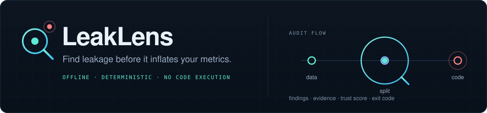
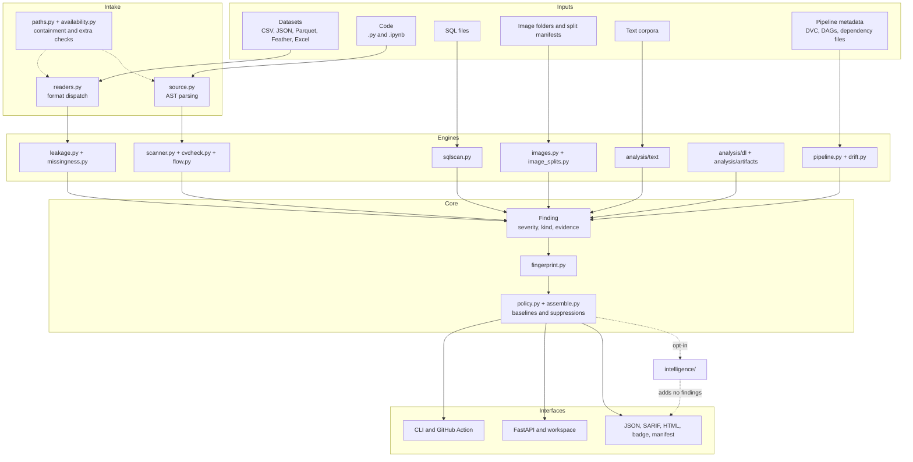
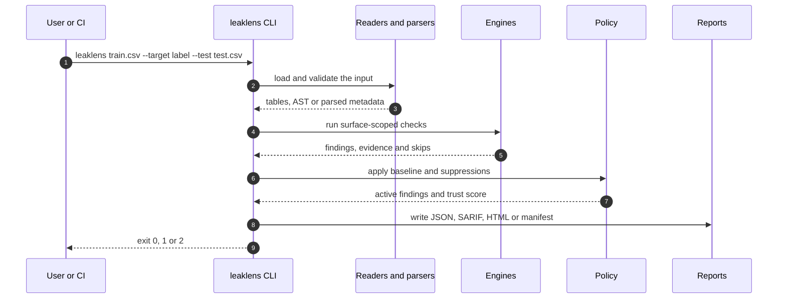
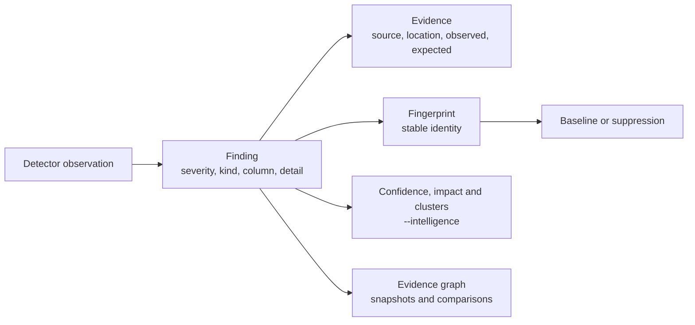

<p align="center">
  
</p>

# LeakLens

[English](../README.md) | [العربية](README.ar.md)

[](https://github.com/eyadstein/leaklens/actions/workflows/ci.yml)
[](#検出結果とエビデンス)
[](https://pypi.org/project/leaklens-ml/) [](https://pypi.org/project/leaklens-ml/)
[](../LICENSE)

**指標が膨らむ前にデータリークを見つけます。** LeakLens は、リークが潜む場所であるデータセット、学習用とテスト用の分割、モデルを構築するコードを監査します。さらに SQL、画像、テキスト、深層学習、パイプラインのメタデータ向けのオプションエンジンも備えています。検出は決定的かつローカルで、CPU を優先します。スキャナーはコードを実行せずに解析し、データセットの行がマシンの外に出ることはありません。

[ドキュメント](https://eyadstein.github.io/leaklens/docs.html) · [ウェブサイトとデモ](https://eyadstein.github.io/leaklens/) · [変更履歴](../CHANGELOG.md) · [Issues](https://github.com/eyadstein/leaklens/issues)

## 目次

- [データリークとは](#データリークとは)
- [クイックスタート](#クイックスタート)
- [リーク検出の実例](#リーク検出の実例)
- [検出できる問題](#検出できる問題)
- [アーキテクチャ](#アーキテクチャ)
- [監査ライフサイクル](#監査ライフサイクル)
- [検出結果とエビデンス](#検出結果とエビデンス)
- [インストール](#インストール)
- [コマンドライン](#コマンドライン)
- [GitHub Action](#github-action)
- [Python API](#python-api)
- [設定とポリシー](#設定とポリシー)
- [基本機能とオプション機能](#基本機能とオプション機能)
- [レポートと出力](#レポートと出力)
- [ベンチマーク](#ベンチマーク)
- [制限事項](#制限事項)
- [セキュリティとプライバシー](#セキュリティとプライバシー)
- [コントリビューション](#コントリビューション)
- [ドキュメントとロードマップ](#ドキュメントとロードマップ)
- [ライセンス](#ライセンス)

## データリークとは

データリークとは、学習時には利用できるものの、予測時には存在しない情報のことです。その結果、交差検証では優れたスコアが出るのに、本番環境では機能しなくなります。よくある形は次のとおりです。

- 目的変数、またはそこから派生した値が特徴量として含まれている。
- スケーラー、エンコーダー、補完器、リサンプラー、特徴選択が分割前に学習されている。
- 同じ行、エンティティ、期間が学習用とテスト用の両方に現れている。

リークは自ら名乗りません。高いスコア、きれいなノートブック、そしてデプロイ後に静かに失敗するモデルという形で現れます。LeakLens は観測内容とその根拠を、重大度と安定した識別子とともに報告します。チームは集計値だけを信じるのではなく、検出結果を確認できます。

## クイックスタート

CLI をインストールし（Python 3.10 以上、オプションの追加依存関係は不要）、コードベースまたはノートブックのフォルダーをスキャンします。

```sh
python -m pip install --upgrade leaklens-ml
leaklens --scan .
```

データセットを監査します。必要に応じてホールドアウト分割と時刻カラムを指定できます。

```sh
leaklens train.csv --target label
leaklens train.csv --test test.csv --target label --time date
```

クリーンな実行では `LeakLens trust score: 100/100` と表示され、終了コードは `0` です。重大度「高」の検出結果、`--fail-under` を下回るスコア、またはオプションの `--fail-on-new` を有効にしたときの新規検出結果では `1` を返します。引数や設定が不正な場合は `2` です。この単一の契約により、同じコマンドをローカルでも CI でも使えます。存在しない `--scan` パスは不正な入力であり、クリーンなスキャンとして報告せず終了コード `2` で終了します。

## リーク検出の実例

リポジトリは、リークを 1 つ仕込んだ合成不正検知データセット `demo.csv` を生成します。

```sh
git clone https://github.com/eyadstein/leaklens.git
cd leaklens
python -m pip install leaklens-ml
python examples/make_demo.py
leaklens demo.csv --target is_fraud
```

```text
LeakLens trust score: 50/100
[HIGH] target_leakage :: chargeback_flag :: alone predicts target (roc_auc=1.000)
[MEDIUM] id_like :: txn_id :: 100.0% unique values; one value per row
1 high, 1 medium
```

`chargeback_flag` は目的変数を特徴量にコピーしたもので、そのカラムを削除するまで精度は完璧に見えます。`demo.csv` は生成されるファイルであり、リポジトリには保存されません。[チュートリアルノートブック](../examples/leak_walkthrough.ipynb)では 3 つのリークを仕込んで順に修正し、[examples/advanced_leaks.py](../examples/advanced_leaks.py)ではハイパーパラメーター調整、目的変数エンコーディング、特徴選択、グループ交差検証、時系列順序を扱います。

## 検出できる問題

| 対象領域 | チェック内容 |
|---|---|
| データセット（CSV、JSON） | 単一特徴量による目的変数リーク、高カーディナリティなカテゴリ変数経由の目的変数リーク、ID のようなカラム、グループ／エンティティのリスク（`--group`） |
| 分割（`--test`） | 行の完全な重複、ラベルが異なる同一特徴ベクトル、大文字小文字や空白だけが異なる近似重複、時間的オーバーラップ、エンティティのオーバーラップ |
| 欠損値 | 目的変数、分割、グループと関連する欠損値。情報を持つといえるほど関連が強い場合のみ（[詳細](MISSINGNESS.md)） |
| コード（`.py`、`.ipynb`） | 分割前の前処理、SMOTE、目的変数／頻度エンコーディング、特徴選択。テストデータでの学習。テストデータ上または分割前のハイパーパラメーター調整。テスト行に対する交差検証、または `groups=` を指定しない交差検証。時系列データのシャッフル分割。実行順が前後したノートブックセル。未来を見る目的変数のシフトとローリングウィンドウ |
| 画像（オプション） | 学習用／テスト用フォルダー間の近似重複画像、完全一致および知覚的なクラスター |
| 宣言された画像分割 | COCO、YOLO、VOC の分割宣言の重複（`leaklens splits`） |
| SQL（オプション） | 確認済みのリネージによる目的変数の特徴量利用、未来のウィンドウフレーム、分割条件のないクエリ |
| テキスト（オプション） | 学習用／評価用の重複、評価データの汚染、RAG インデックスの配線、呼び出し側が渡す埋め込みの類似度 |
| 深層学習（オプション） | 分割の重複、学習プロトコルの不一致、安全でないチェックポイント形式、シードの欠落 |
| パイプラインのメタデータ（オプション） | DVC とシリアライズされたパイプラインのリネージ、パラメーターのドリフト、ダイジェストの欠落、バージョン未固定の依存関係 |

検出結果は「必ずそうである」ことではなく「観測した」ことを示します。確認済みのルール（`X_test` で学習した探索）は重大度「高」、正当な可能性もある疑わしいパターン（分割前の頻度エンコーディング）は「低」または「中」で、なぜ報告したかを説明します。すべての種類、重大度、スコア対象かどうかは [docs/DETECTORS.md](DETECTORS.md) にあります。

## アーキテクチャ

LeakLens は、単一の検出結果モデルを中心に、対象領域ごとに分かれたエンジンを組み合わせたものです。入力処理が入力を正規化し、1 つのエンジンがその対象領域を監査し、検出結果がエビデンスと識別子を持ちます。レポート、ポリシー、各エントリーポイントは同じ組み立て済みの結果を利用します。基本インストールではネットワークに接続せず、スキャン対象のコードも実行しません。



**図の読み方。** 入力処理は意図的に薄く保っています。`readers.py` は拡張子を pandas のリーダーに対応付け、`source.py` は `ast` で Python とノートブックのソースを解析し、`paths.py` は安全でないパスを拒否し、`availability.py` は不足しているオプション依存関係を起動時のインポートではなく明確なエラーに変えます。各エンジンは自身の対象領域についてのみ `Finding` を生成します。コアがエビデンス、フィンガープリント、ポリシーを加え、`assemble.py` がすべてのインターフェースがシリアライズするペイロードを組み立てます。`intelligence/` は既存の検出結果に対するオプションの分析であり、検出結果を新たに作ることはありません。

## 監査ライフサイクル



ライフサイクルは意図的に地味です。学習は行わず、ノートブックも実行せず、データベースにも接続しません。オプションエンジンは同じエンジン段階に挿入され、診断専用のエンジンはそのように印を付けるため、`--fail-on-findings`（テキストと深層学習）または `--fail-on-graph-new`（グラフ比較）を明示しない限り、ポリシーと終了ゲートはそれらを無視します。

## 検出結果とエビデンス

LeakLens は 100 から開始し、有効な検出結果ごとに点数を減点します（0 が下限）。

| 重大度 | 減点 |
|---|---:|
| 高 | 35 |
| 中 | 15 |
| 低 | 5 |



エビデンスはデータのダンプではなく、範囲を限定した来歴です。検出器が提供できる場合は、ソース、位置、観測値、期待値を記録します。フィンガープリントは行の移動やメッセージの編集をまたいで維持されるため、ベースラインと抑制は識別子を保ちます。検出器、対象の特徴量、検出器が提供する安定キーが変わればフィンガープリントも変わります。抑制は 1 つのフィンガープリントだけを受け付け、理由を必須とし、重大度やエビデンスを変えずに検出結果へラベルを付けます。抑制された検出結果はスコアと既定のゲートの対象外になります。ベースラインは後続の実行を `new`、`unchanged`、`changed`、`resolved` として分類し、暗黙に上書きされることはありません。

JSON レポートには `$schema` が含まれ、`leaklens schema` が契約を出力します。詳細は [docs/REPORT_SCHEMA.md](REPORT_SCHEMA.md)、[docs/BASELINES.md](BASELINES.md)、[docs/DETECTORS.md](DETECTORS.md) を参照してください。

## インストール

PyPI パッケージは `leaklens-ml`、インストールされるコマンドは `leaklens` です。下限は Python 3.10（`requires-python`）で、CI は Linux 上で 3.10、3.11、3.12、3.14 を実行します。Python 3.13 はマトリクス外であり、検証済みとはしていません。パッケージは純粋な Python で、Windows、Linux、macOS にインストールできます。Windows で `python` が PATH にない場合は `py -3 -m pip ...` を使ってください。pip が `externally-managed-environment` を報告する場合は、先に仮想環境を作成してください。

オプションの追加依存関係:

| 追加依存関係 | 追加される機能 |
|---|---|
| `arena` | モデルアリーナ。フラグ付きカラムを除外し、リークのないパイプラインで 3 つのモデルファミリーを学習し、MLflow で追跡します（`--arena`） |
| `parquet`、`feather` | `pyarrow` による `.parquet` と `.feather` の入力 |
| `excel` | `openpyxl` による `.xlsx` の入力 |
| `images` | Pillow による近似重複画像のチェック（`leaklens images`） |
| `app` | FastAPI サービスと Streamlit UI |
| `api` | 強化された公開ライブスキャン API（Streamlit なし） |
| `sql` | SQLGlot による SQL リネージ分析 |
| `yaml` | YAML 形式のパイプライン設定と学習設定 |
| `taintwatch` | `--llm` 用のオプションの情報フローガード |

```sh
python -m pip install "leaklens-ml[parquet,images]"
```

`leaklens doctor` は、ネットワークに接続せずに、インタープリター、インストール先、エントリーポイント、基本依存関係、追加依存関係、設定の有効性を確認します。機械可読な出力には `--json` を指定します。未知のデータセット拡張子は CSV として読み込まれます。インストールされていないオプション形式やエンジンは、それを提供する追加依存関係の名前を含む `ImportError` を発生させます。

## コマンドライン

| コマンド | 用途 |
|---|---|
| `leaklens FILE --target COL` | データセットを監査する（CSV／JSON は基本機能） |
| `leaklens --scan PATH...` | `.py`／`.ipynb` ファイルやフォルダーを静的にスキャンする |
| `leaklens splits DATASET` | 宣言された COCO、YOLO、VOC の分割ファイルを監査する |
| `leaklens images TRAIN TEST` | 分割間の近似重複画像を見つける |
| `leaklens text TRAIN TEST` | テキストコーパス間の汚染を比較する |
| `leaklens dl DIR` | 深層学習のコード、設定、アーティファクトを監査する |
| `leaklens workspace [DIR]` | ローカルの対話型ワークスペースを起動する |
| `leaklens verify MANIFEST` | 監査マニフェストをオフラインで検証する |
| `leaklens init` | `.leaklens.toml` のひな形を書き出し、pre-commit の設定例を表示する |
| `leaklens doctor`、`leaklens schema` | インストールを確認し、レポートの JSON Schema を出力する |

```sh
leaklens train.csv --target label --test test.csv --json
leaklens --scan notebooks/ --explain
leaklens --scan . --sarif leaklens.sarif
leaklens --scan . --intelligence --graph-out evidence.mmd
```

`leaklens --help` はすべてのフラグと既定値を一覧表示します。[docs/CONFIGURATION.md](CONFIGURATION.md) には同じオプションが設定キーとして掲載されています。

## GitHub Action

この Action は CLI をインストールし、ファイルまたはフォルダーに対して `leaklens --scan` を実行します。データセット監査は実行しません。データセット監査には `run:` ステップを使ってください。

| 入力 | 必須 | 既定値 | 用途 |
|---|---|---|---|
| `path` | 任意 | `.` | スキャンするファイルまたはフォルダー |
| `fail-under` | 任意 | 未設定 | 信頼スコアの下限（0〜100）。設定すると、スコアが下回った場合もステップが失敗します |

```yaml
name: leakage
on: [push, pull_request]
jobs:
  leaklens:
    runs-on: ubuntu-latest
    steps:
      - uses: actions/checkout@v7
      - uses: eyadstein/leaklens@v0.13.0
        with:
          path: .
```

スキャンが終了コード `1` を返すとステップは失敗します。重大度「高」の検出結果がある場合、または `fail-under` を設定していて信頼スコアがそれを下回る場合です。診断専用の検出結果でステップが失敗することはありません。リリース `v0.13.0` は `fail-under` 入力より前のため、この入力を設定するワークフローはそれを含む参照を使う必要があります。

```yaml
      - uses: eyadstein/leaklens@main
        with:
          path: .
          fail-under: 80
```

再現性のある CI にはタグまたは完全なコミット SHA を固定してください。`@main` は既定ブランチを追跡するため、未リリースの変更も含みます。

## Python API

ライブラリは CLI と同じエンジンを公開します。

```python
import pandas as pd

from leaklens.audit import audit
from leaklens.leakage import scan, score
from leaklens.scanner import scan_path

findings = scan(pd.read_csv("train.csv"), target="label")
print(score(findings), [(f.severity, f.kind, f.column) for f in findings])

for finding in scan_path("src"):
    print(finding.kind, finding.column, finding.detail)

print(audit(pd.read_csv("train.csv"), "label")["cardinality"])
```

`leaklens.audit.audit(df, target)` はデータセットのプロファイル（行数、列数、重複行、カーディナリティ、欠損率、目的変数の分布）を返します。下流の統合にとって安定した契約は Python のシグネチャではなく JSON レポートのスキーマです。

## 設定とポリシー

`leaklens init` はコメント付きの `.leaklens.toml` を書き出します。LeakLens は `./.leaklens.toml` を自動で読むか、`--config` で渡されたファイルを読みます。優先順位は、既定値、設定、明示的な CLI フラグの順です。未知のキー、誤った型、安全でない出力パスは、スキャンを暗黙に変えるのではなく終了コード `2` で失敗します。

```toml
target = "label"
fail_under = 80

[baseline]
path = "leaklens-baseline.json"
fail_on_new = true

[[suppressions]]
fingerprint = "64-lowercase-hex-characters"
reason = "accepted: the column is recorded before prediction"
```

オプションエンジンのセクション（`[missingness]`、`[sql]`、`[drift]`、`[graph]`）はしきい値と出力を調整します。出力パスは設定ディレクトリ内に留める必要があります。詳細は [docs/CONFIGURATION.md](CONFIGURATION.md) と [docs/BASELINES.md](BASELINES.md) を参照してください。

## 基本機能とオプション機能

基本インストールでは、CSV／JSON データセット、コードスキャン、分割チェック、欠損値を利用できます。それ以外はすべてオプションであり、基本的なワークフローに必須ではありません。

| 機能 | エントリーポイント | 必要なもの | ゲートの動作 |
|---|---|---|---|
| データセット監査、コードスキャン、分割チェック、欠損値、宣言された分割の監査 | `leaklens`、`--scan`、`--test`、`--group`、`leaklens splits` | 基本インストール | 重大度「高」の検出結果で終了コード 1 |
| ドリフト、パイプラインのメタデータ、テキスト、深層学習、AI 仮説 | `--drift`、`--pipeline`、`leaklens text`、`leaklens dl`、`--ai` | 基本（DVC／YAML には `[yaml]`） | 診断専用。スコアと終了コードは不変（テキストと深層学習は `--fail-on-findings`） |
| 近似重複画像 | `leaklens images` | `[images]` | 重大度「高」の検出結果で終了コード 1 |
| SQL リネージ | `--sql` | `[sql]` | 重大度「高」の検出結果で終了コード 1 |
| モデルアリーナ | `--arena` | `[arena]` | `models/best.joblib` を書き出す |
| API、UI、ワークスペース | `uvicorn`、`streamlit`、`leaklens workspace` | `[app]` | スキャンゲートではない |
| 公開ライブスキャン API | `uvicorn leaklens.public_api:app` | `[api]` | スキャンゲートではない |
| LLM による説明 | `--llm` | 既定ではローカル Ollama | 検出結果、スコア、終了コードを変えない |

オプション依存関係が不足している場合、コマンドは追加依存関係の名前を含む `ImportError` を発生させ、`leaklens doctor` がインポート可能な追加依存関係を一覧表示します。基本インストールは引き続き完全に利用できます。スキャンは既定でオフラインかつ CPU 優先です。ネットワークを使うのは、明示的に設定したリモートの `--llm` プロバイダー、インストールコマンド、または自分で開始した MLflow の実行だけです。

## レポートと出力

| フラグ | 出力 |
|---|---|
| `--json` | stdout への機械可読レポート |
| `--sarif FILE` | エビデンスとフィンガープリントを含む SARIF 2.1.0 |
| `--html FILE` | 重大度の凡例を含む、単体で完結するレポート |
| `--badge FILE` | 信頼スコアを含む shields.io エンドポイント JSON |
| `--manifest FILE` | 署名なしでオフライン検証できる監査マニフェスト（`leaklens verify`） |
| `--intelligence` | 決定的な信頼度、エビデンスクラスター、根本原因分析 |
| `--graph-out FILE` | Mermaid（`.mmd`）、DOT（`.dot`）、JSON 形式のエビデンスグラフ |
| `--graph-snapshot` / `--graph-baseline` | スキャン間でエビデンスを保存して比較する |

エビデンスグラフは既存の検出結果を検査可能なアンカーでグループ化し、検出器のエビデンスを関連付けます。新しい検出結果は追加せず、スコアや終了コードも変えません。比較では `new`、`unchanged`、`changed`、`resolved`、`uncertain` を報告します。[docs/INTELLIGENCE.md](INTELLIGENCE.md) と [docs/AUDIT_MANIFEST.md](AUDIT_MANIFEST.md) を参照してください。

GitHub のコードスキャン用:

```yaml
permissions:
  contents: read
  security-events: write
steps:
  - uses: actions/checkout@v7
  - run: pip install leaklens-ml
  - run: leaklens --scan . --sarif leaklens.sarif || true
  - uses: github/codeql-action/upload-sarif@v4
    with:
      sarif_file: leaklens.sarif
```

信頼バッジを公開するには、`leaklens --scan . --badge badge.json` を実行し、ファイルをコミットして、shields.io のエンドポイントバッジをその Raw URL に向けます（このファイルの先頭が例です）。リポジトリに含まれる [badge.json](../badge.json) は、リポジトリ自身のセルフスキャンを記録しています。

## ベンチマーク

- コードスキャナーは 117 件の手書き回帰ケース（リーク 63 件、クリーン 54 件）で確認され、偽陽性 0、偽陰性 0 です。`python -m leaklens.bench`、結果は [docs/BENCHMARK.md](BENCHMARK.md) にあります。
- 同じ実行では、`main` に存在するがまだ公開リリースに含まれていない 32 件の高度な検出ケースも評価します。最新の公開リリースは 0.13.0 です。
- データセット検出器には 12 件の合成ケースがあります（`python -m leaklens.bench_data`、[docs/DATA_BENCHMARK.md](DATA_BENCHMARK.md)）。欠損値、ドリフト、パイプライン、テキスト、深層学習、ビジョン、SQL、AI には、それぞれ `docs/` 以下にラベル付きベンチマークがあります。
- データを分割している公開ノートブック 1,725 件の静的なサンプルでは、38% が分割前またはテストデータ上で前処理を学習していました（[docs/STUDY.md](STUDY.md)）。
- 実環境コーパスには公開ノートブックが 60 件ありますが、レビュー済みラベルがあるのは 8 件だけです。その 8 件でスキャナーは適合率／再現率／F1 が 1.00 です（[docs/REALWORLD.md](REALWORLD.md)）。これは小規模で無作為ではないサンプルに対するスモークチェックであり、母集団の精度推定ではありません。
- 独立した AI チェックでは、レビュー済み 48 ユニットで精度 0.833、適合率 0.767、再現率 0.958、偽陽性率 0.292 を測定し、すべての誤りを列挙しています（[docs/AI_REALWORLD.md](AI_REALWORLD.md)）。出荷モデルには 2 つ目の独立したホールドアウトがなく、欠落している H2 コーパスは数値ではなく不足として公開されています（[docs/AI_REALWORLD_H2.md](AI_REALWORLD_H2.md)）。

すべてのベンチマークは、対応するルールに合わせて作られた手書きの回帰ガードです。実環境の精度を主張するものではなく、ここに示す数値が本番の保証になることもありません。スキャナーの実行時間測定とソースキャッシュの判断は [docs/PERFORMANCE.md](PERFORMANCE.md) にあります。

## 制限事項

- 検出はヒューリスティックで静的です。LeakLens はスキャン対象のコードを実行せず、ノートブックも実行せず、データベースにも接続せず、手続き間の完全なデータフロー分析も行いません。難読化されたパターンや動的に構築されたパターンを見逃すことがあります。
- 検出結果は確認すべきエビデンスであり、リークの証明ではありません。同一の特徴ベクトルやグループの重複は自然に起こり得ます。行動する前に詳細と推奨テストを読んでください。
- すべての種類は、それを出力する対象領域に限定されます。コードのルールが CSV を監査することはなく、データセット検出器がノートブックを読むこともありません。対応形式はコマンドごとに異なります。
- 特徴量の重複と近似重複のチェックは、最大 50,000 行と 20,000 行をサンプリングするため、非常に大きなファイルは網羅ではなく上限付きで処理されます。
- 診断専用エンジン（ドリフト、パイプライン、テキスト、深層学習、AI、モニタリング取り込み）は信頼スコアや終了コードを変えません。AI 仮説は重大度「中」までに制限され、実験的なままです。
- 欠損値の検出結果は重大度「中」までで、データや分割を変更しません。
- 画像ハッシュには文書化された盲点（色だけの違い、5% を超えるクロップ、レターボックス）があり、宣言された分割のチェックはファイルのバイト列だけを比較し、知覚的な類似性は比較しません。
- Python 3.13 は CI マトリクス外であり、検証済みとはしていません。

## セキュリティとプライバシー

- スキャンは既定でローカルかつオフラインです。データセットの内容はマシン上に残り、何もアップロードされず、どのサービスにも接続しません。
- コードスキャナー、深層学習監査、パイプライン監査はファイルを実行せずに解析します。torch／TensorFlow をインポートせず、チェックポイントを pickle で開かず、アーカイブを展開しません。
- `--llm` はオプトインです。送信するのは検出結果のメタデータだけであり、リモートの OpenAI 互換プロバイダーは設定後にのみそのメタデータを受け取ります。プロバイダーの URL は HTTP(S) でなければならず、リダイレクトは拒否され、API キーが非ローカルホストへ平文 HTTP で送られることはありません。
- `POST /predict` は運用者が選んだ pickle を信頼します。FastAPI アプリはローカルで信頼できるものとして扱ってください。信頼できないアップロード向けの強化されたサーフェスは公開 API です。
- 脆弱性は [SECURITY.md](../SECURITY.md) の手順に従って非公開で報告してください。CI は bandit、pip-audit、pip-licenses、CodeQL を実行します。リリースワークフローは `dist/` の外に CycloneDX SBOM を公開します（`python scripts/generate_sbom.py` が `sbom/sbom.json` を書き出します）。

## コントリビューション

```sh
git clone https://github.com/eyadstein/leaklens.git
cd leaklens
python -m venv .venv
. .venv/bin/activate   # Windows: .venv\Scripts\Activate.ps1
pip install -e ".[dev,app]"
```

すべてのプルリクエストは CI が実行するチェックを通過する必要があります。短縮版は次のとおりです。

```sh
pytest -q
ruff check leaklens tests scripts
ruff format --check leaklens tests scripts
leaklens --scan leaklens
python -m leaklens.bench
python -m leaklens.bench_data
```

新しい検出器や修正にはテストを追加し、新しい検出器は `leaklens/leakage.py`（データ）または `leaklens/scanner.py`（コード）に置いてください。[CONTRIBUTING.md](../CONTRIBUTING.md) と [CODE_OF_CONDUCT.md](../CODE_OF_CONDUCT.md) も参照してください。**good first issue** ラベルの付いた Issue が最も取り組みやすい入口です。これまでの貢献者は[コントリビューターグラフ](https://github.com/eyadstein/leaklens/graphs/contributors)に記録されています。

pre-commit フック:

```yaml
repos:
  - repo: https://github.com/eyadstein/leaklens
    rev: v0.13.0
    hooks:
      - id: leaklens
```

`leaklens init` はこの設定例を表示します。`rev` は最新の公開リリースを固定するため、フックは再現可能です。アップグレード時に新しいタグへ意図的に更新してください。

## ドキュメントとロードマップ

最新の公開リリースは **0.13.0** です。準備済みの `0.14.0` リリースは [CHANGELOG.md](../CHANGELOG.md) にあり、準備後にマージされた変更は「Unreleased」に記載されています。リリース履歴はこのファイルではなく、そこにあります。

実装済み: データセット、分割、コードの検出器。欠損値。モデルアリーナ。API とワークスペース。HTML、SARIF、JSON、バッジのレポート。ベースラインと抑制。エビデンスグラフと調査プラン。グループリーク。画像クラスタリングと宣言された分割の監査。そしてオプションの SQL、テキスト、深層学習、ドリフト、パイプライン、AI エンジンです。

計画中の作業と未解決の設計上の問いは、[ROADMAP.md](../ROADMAP.md)、長期的な [AI/ML 拡張ロードマップ](AI_ML_EXPANSION_ROADMAP.md)、[Issues](https://github.com/eyadstein/leaklens/issues) で追跡されています。そこに記載された提案は約束ではありません。完全なドキュメント索引は [docs サイト](https://eyadstein.github.io/leaklens/docs.html)です。

## ライセンス

MIT ライセンスです。[LICENSE](../LICENSE) を参照してください。引用情報は [CITATION.cff](../CITATION.cff) にあります。
