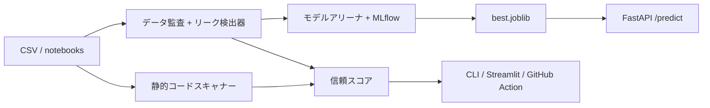

# LeakLens

[العربية](README.ar.md) | [English](../README.md)

[](https://github.com/eyadstein/leaklens/actions/workflows/ci.yml)
[](#信頼スコアバッジ)
[](https://pypi.org/project/leaklens-ml/) [](https://pypi.org/project/leaklens-ml/)
[](../LICENSE)

**データリークを検出し、モデルの評価が実態とかけ離れるのを防ぎます。**「正解率99%」のモデルの大半にはデータリークがあります。LeakLensは**データ**と**コード**の両方を監査し、リークのないパイプラインで3つのモデルファミリーを学習させ、どの程度の性能が残るかを示します。

**[ウェブサイトとインタラクティブデモ](https://eyadstein.github.io/leaklens/)** · **[ドキュメント](https://eyadstein.github.io/leaklens/docs.html)**

## 検出できる問題

| 対象 | 検出する問題 |
|---|---|
| データ | 目的変数のリーク（ラベルをほぼ完全に予測する特徴量）、カテゴリ変数の高カーディナリティを利用した目的変数リーク、IDのようなカラム、学習用データとテスト用データの行の重複、ラベルが異なる特徴ベクトルの重複、大文字小文字や空白だけが異なる近似重複、時間的リーク、エンティティやグループの重複（`--group COL`）、分割フォルダ間の近似重複画像（`leaklens images`） |
| コード（`.py`、`.ipynb`） | 分割前にスケーラー／エンコーダー／欠損値補完器を学習させる処理、分割前のSMOTE、全行から作成した目的変数エンコーディング／頻度エンコーディング、分割前の特徴選択（SelectKBest、RFE、SelectFromModel）、テスト／検証データまたは分割後の全データで学習される変換器、`StandardScaler().fit_transform(X)`のような連結呼び出し、`cross_val_score`／`GridSearchCV`の前に行われる前処理やリサンプリング（`preprocess_outside_cv`）、テストセットでのハイパーパラメーター調整（`tuning_on_test_data`）、分割前または全データでの調整（`tuning_before_split`、`tuning_on_full_data`）、テスト行に対する交差検証（`cv_on_test_data`）、`groups=`を指定しないグループ交差検証、時系列順データのシャッフル分割、実行順が前後したノートブック |

検出結果の確度は、それぞれの説明に明記されます。たとえば、`X_test`で検索処理を学習させたことが確認できた場合は重大度「高」のリークとして報告し、頻度エンコーディングを分割前に行った場合のように正当な可能性もあるパターンは重大度「低」または「中」とし、観測した内容を示します。各検出結果には`--explain`で修正のヒントが表示されます。

監査結果には0〜100の信頼スコアが付きます。重大度の高いリークが見つかると、CLIは終了コード1を返すため、CIのゲートとして利用できます。

## デモ

```text
$ leaklens demo.csv --target is_fraud --arena
LeakLens trust score: 50/100
[HIGH] target_leakage :: chargeback_flag :: alone predicts target (roc_auc=1.000)
[MEDIUM] id_like :: txn_id :: 100.0% unique values; likely an identifier

Arena ranked by pr_auc (auto-dropped: chargeback_flag, txn_id)
model roc_auc pr_auc best_f1
neural_net 0.8374 0.4219 0.4353
linear 0.8410 0.4215 0.4304
tree_ensemble 0.8242 0.3562 0.4103
```

リークしたカラムがあると、精度が完璧に見えてしまいます。LeakLensはそのカラムを除外し、実際の性能を示します。

[ウェブサイト](https://eyadstein.github.io/leaklens/)は、バンドラーを使わず、外部依存も伴わない静的なGitHub Pagesサイトで、`docs/`から配信されます。[デモ](https://eyadstein.github.io/leaklens/demo.html)では、リポジトリに含まれるサンプルの実際のスキャナー出力を再生します。GitHub PagesではPythonを実行できないため、デモは**録画済み**と明記しています。[ライブスキャンページ](https://eyadstein.github.io/leaklens/live.html)は、別途デプロイされた実際の`leaklens.public_api`バックエンドに接続し、シミュレーション用の代替動作はありません。バックエンドが設定されていない場合は**バックエンド未接続**と表示し、録画済みデモへのリンクを示します。このリポジトリでは公開バックエンドをデプロイしません。無料のRenderへのデプロイ方法、制限、コールドスタート、セキュリティモデルについては[docs/LIVE_SCANNING.md](LIVE_SCANNING.md)をご覧ください。

フィクスチャを再生成し、すべてのリンク、アセット、アクセシビリティ上のランドマークを検証するには、次を実行します。

```sh
python scripts/build_site.py
node --test tests/site/demo-engine.test.mjs tests/site/live-engine.test.mjs
node scripts/check_site_layout.mjs   # ローカルのヘッドレスChrome／Edgeで確認
```

## Pythonのバージョン

- **必須:** Python 3.10以上（`pyproject.toml`の`requires-python`）
- **CIでのテスト対象:** 3.10、3.11、3.12（`.github/workflows/ci.yml`のマトリクス）。ローカルでは3.10、3.11、3.12、3.14で全テストを確認済みです。実環境での評価は[docs/REALWORLD.md](REALWORLD.md)、ローカルでの確認方法は[CONTRIBUTING.md](../CONTRIBUTING.md)をご覧ください。
- 3.13は、このリリース時点でCIのマトリクスに含まれておらず、動作確認済みとはしていません。

> `leaklens`コマンドはPyPIパッケージ`leaklens-ml`から提供されます。

## インストール

オプション依存関係のない基本パッケージは、Windows、Linux、macOSで利用できます。

```sh
python -m pip install --upgrade leaklens-ml
leaklens --version
leaklens doctor
```

Windowsで`python`がPATHにない場合は、`py -3 -m pip ...`を使ってください。LinuxとmacOSでは、ディストリビューションが`python`を用意していない場合、同じコマンドを`python3`／`pip3`で実行できます。pipが`externally-managed-environment`（PEP 668。Homebrewやディストリビューション付属のPythonでよく発生します）と報告した場合は、先に仮想環境を作成してください。`python3 -m venv .venv`を実行し、続けて`. .venv/bin/activate`を実行します（Windowsでは`.venv\Scripts\Activate.ps1`）。

Windowsでのクイックスタート（PowerShell。`.venv`を作成し、インストール、動作確認、使い方の表示を行います。管理者権限は不要です）。

```powershell
powershell -ExecutionPolicy Bypass -File scripts\install.ps1
# オプションの追加機能:
powershell -ExecutionPolicy Bypass -File scripts\install.ps1 -Extras "arena,parquet"
```

Linux／macOSで開発用チェックアウトを作る場合:

```sh
git clone https://github.com/eyadstein/leaklens.git
cd leaklens
python -m venv .venv
. .venv/bin/activate   # Windows: .venv\Scripts\Activate.ps1
pip install -e ".[dev,app]"
```

リポジトリの外で動作を確認する（クリーンな環境）:

```sh
leaklens doctor
leaklens --version
```

CSV／JSON入力、データセット監査、コードスキャン、`--explain`／`--intelligence`／`--ai`／`--sarif`／`--html`／`--badge`／`doctor`は基本インストールで利用できます。

### `leaklens doctor`

`leaklens doctor`は、ネットワークに接続せず、機密情報も読み取らずにインストール状態を確認します。Pythonが3.10以上か、LeakLensのバージョンとインストール先、`leaklens`のエントリーポイント、基本依存関係（pandas、numpy、scikit-learn）、読み込み可能なオプション追加機能、そして`.leaklens.toml`または`pyproject.toml`（先に見つかった方）が有効なTOMLかを確認します。

```sh
leaklens doctor             # 人が読める形式のレポート。確認失敗時は終了コード1
leaklens doctor --json      # 同じレポートをJSONで出力
leaklens doctor --help      # 使い方
```

不足しているオプション追加機能は一覧に表示しますが、確認失敗にはなりません。基本依存関係の不足、Python 3.10未満、無効な設定がある場合は終了コード1を返します。

### オプション追加機能

`pyproject.toml`で宣言しているオプション追加機能:

| 追加機能 | 用途 | インストールコマンド |
|---|---|---|
| `arena` | MLflowで実行結果を追跡するモデルアリーナ（`--arena`） | `pip install "leaklens-ml[arena]"` |
| `parquet` | `pyarrow`で`.parquet`を読み込む | `pip install "leaklens-ml[parquet]"` |
| `feather` | `pyarrow`で`.feather`を読み込む | `pip install "leaklens-ml[feather]"` |
| `excel` | `openpyxl`で`.xlsx`を読み込む | `pip install "leaklens-ml[excel]"` |
| `images` | Pillowを使った近似重複画像の確認（`leaklens images`） | `pip install "leaklens-ml[images]"` |
| `app` | FastAPIサービスとStreamlit UI | `pip install "leaklens-ml[app]"` |
| `api` | 強化された公開ライブスキャンAPI（FastAPI + uvicorn、Streamlitなし） | `pip install "leaklens-ml[api]"` |
| `taintwatch` | `--llm`用のオプションのTaintWatchガード | `pip install "leaklens-ml[taintwatch]"` |
| `dev` | テスト、lint（ruff）、bandit、pip-audit、pip-licensesなどの開発ツール | `pip install "leaklens-ml[dev]"` |

開発用チェックアウト:

```sh
git clone https://github.com/eyadstein/leaklens.git
cd leaklens
python -m venv .venv
. .venv/bin/activate   # Windows: .venv\Scripts\Activate.ps1
pip install -e ".[dev,app]"
```

## クイックスタート

```sh
leaklens train.csv --target label --test test.csv --time date
leaklens --scan notebooks/ --explain   # 検出項目ごとに修正案を表示
leaklens --scan . --sarif leaklens.sarif   # GitHub Code Scanning用
leaklens train.csv --target label --test test.csv --group patient_id
leaklens train.parquet --target label --fail-under 80   # Parquet入力（pip install "leaklens-ml[parquet]"）。信頼スコアをCIのゲートにする
leaklens train.json --target label   # 追加パッケージなしでJSON入力
leaklens train.xlsx --target label   # Excel入力（pip install "leaklens-ml[excel]"）
leaklens train.feather --target label   # Feather入力（pip install "leaklens-ml[feather]"）
leaklens images data/train data/test   # 分割間の近似重複画像を検出（pip install "leaklens-ml[images]"）
python examples/make_demo.py
leaklens demo.csv --target is_fraud --arena
mlflow ui --backend-store-uri sqlite:///mlflow.db
```

データリークについて初めて学ぶ方は、[チュートリアルノートブック](../examples/leak_walkthrough.ipynb)をご覧ください。意図的に仕込んだ3つのリークによってスコアがどう水増しされるか、LeakLensがどう検出・修正するかを確認できます。

## CLIコマンド

### `leaklens`（データセット監査）

データセット（必要に応じて分離したテスト用データも含む）を監査し、リークを検出します。

```sh
leaklens train.csv --target label            # 単一ファイルの監査
leaklens train.csv --test test.csv --target label
leaklens train.csv --test test.csv --target label --time date
leaklens train.csv --target label --test test.csv --group patient_id
leaklens train.csv --target label --json     # JSON出力
leaklens train.csv --target label --threshold 0.95
leaklens train.csv --target label --fail-under 80   # 信頼スコアが80未満なら終了コード1
leaklens train.csv --target label --arena    # [arena]追加機能が必要
leaklens train.csv --target label --html report.html
leaklens train.csv --target label --intelligence   # 決定的な信頼度判定と根本原因の分析
leaklens train.csv --target label --ai             # 実験的なオフラインAI仮説
```

| フラグ | 意味 |
|---|---|
| `train` | 学習用データセットのパス（位置引数） |
| `--target` | 学習用データのラベルカラム |
| `--test` | 比較対象となるホールドアウトデータ |
| `--time` | 時間的リーク確認に使うタイムスタンプカラム |
| `--group` | グループリーク確認用のエンティティカラム（患者、顧客など） |
| `--threshold` | リークとみなす単一特徴量のスコア（既定値0.95） |
| `--arena` | 3つのモデルファミリーを比較し、MLflowで記録する（`arena`追加機能が必要） |
| `--out` | モデルアリーナの最良モデルの出力先（既定値`models`） |
| `--tracking-uri` | MLflowのトラッキングURI（既定値`sqlite:///mlflow.db`） |
| `--json` | JSONを出力 |
| `--explain` | 各検出結果の下に修正案を表示 |
| `--intelligence` | 決定的な信頼度判定、根本原因、修正方法の分析 |
| `--llm` / `--llm-provider` | オプションのLLM説明（次の節を参照） |
| `--ai` | 実験的な、根拠に基づくAI仮説を追加（オフライン、明示的な指定が必要） |
| `--ai-llm` | 設定済みLLMでAIの計画を言い換える。利用できない場合は決定的な計画にフォールバック |
| `--sarif` | GitHub Code Scanning用のSARIF 2.1.0を書き出す |
| `--html` | 共有できる単一ファイルのHTMLレポートを書き出す |
| `--badge` | 信頼スコアを含むShields.io用エンドポイントJSONを書き出す |
| `--fail-under` | 信頼スコアがN未満なら終了コード1を返す |
| `--version` | バージョンを表示して終了 |

拡張子が不明な入力、または拡張子のない入力はCSVとして読み込みます。オプション形式（Parquet／Feather／Excel）では、その形式を提供する追加機能の名前を含む`ImportError`が発生します。

`--test`を指定すると、LeakLensは次の3種類の重複確認を順に行い、最大1件を報告します。1) 共有する全カラム（ラベルを含む）が一致する行の重複、2) ラベルを除いた特徴ベクトルが一致してラベルが異なる行、3) 正規化後の近似重複（テキストは小文字化して空白を除去、数値は小数点以下4桁に丸める）。特徴量の重複確認では最大50,000行、近似重複確認では最大20,000行をサンプリングするため、大きなファイルでも高速に処理できます。これらはヒューリスティックです。観測された件数とラベルの不一致の有無を報告します。カーディナリティの低い表形式データでは特徴ベクトルの一致が自然に起こることもあるため、重大度「中」の検出はリークの証明とせず、調査のきっかけとして扱ってください。

### `leaklens --scan PATH...`

`.py`／`.ipynb`ファイルやフォルダーを静的にスキャンし、パイプラインのリーク（分割前のfit、テストデータでのfit、テストデータでの調整、分割前の目的変数／頻度エンコーディング、特徴選択、`groups=`を指定しないグループ交差検証、時系列のシャッフル分割、実行順が前後したノートブック）を検出します。スキャン対象のコードは**実行されません**。

```sh
leaklens --scan notebooks/ --explain
leaklens --scan leaklens
leaklens --scan . --sarif leaklens.sarif || true
leaklens --scan src tests --llm
leaklens --scan notebooks/ --ai          # 実験的なAI仮説（オフライン）
```

調整、目的変数エンコーディング、特徴選択、グループ交差検証、時系列順序を扱う、意図的にリークを含めたデモは[`examples/advanced_leaks.py`](../examples/advanced_leaks.py)にあります。各検出結果と修正方法を見るには、`leaklens --scan examples/advanced_leaks.py --explain`を実行してください。

重大度「高」の検出結果がある場合、終了コード1を返すため、CIのゲートとして使えます。

### `leaklens images TRAIN_DIR TEST_DIR`

学習用／テスト用フォルダー間の近似重複画像を検出します（64ビットdHash、`--max-distance`の既定値は6）。`images`追加機能が必要です。

```sh
leaklens images data/train data/test
leaklens images data/train data/test --max-distance 10 --samples 5 --json
```

### `leaklens init`

コメント付きの`.leaklens.toml`のひな形を書き出します。

```sh
leaklens init
leaklens init mydir --force   # 既存の.leaklens.tomlを上書き
```

pre-commitフックの設定例（下記）を表示します。

## 設定（`.leaklens.toml`）

`leaklens init`は、CLIフラグごとに1つのキーを記したコメント付きの`.leaklens.toml`のひな形を書き出し、pre-commitの設定例を表示します。既存ファイルを上書きするには`--force`を指定します。

> CLIはまだ`.leaklens.toml`を読み込みません。このファイルは設定例です。設定を読み込む機能が実装されるまでは、同じ値をCLIフラグに指定してください。

## オプションのLLMによる説明

LLMによる説明は、`--llm`を指定しない限り無効です。LeakLensは選択された検出結果の重大度、種類、ファイル名と行番号、診断の詳細を送信します。詳細には、スキャンしたファイルから短いコード表現が含まれることがあります。ソースファイル全体、ノートブック全体、データセットの行は送信しません。既定のプロバイダーはローカルのOllamaです。`--llm-provider openai-compatible`を選ぶか、リモートのベースURLを設定すると、検出結果の詳細がそのホストに送信されます。プロバイダーのURLにはHTTPまたはHTTPSを指定してください。リダイレクトは拒否されます。また、`localhost`または`127.0.0.1`以外には、平文HTTPでAPIキーを送信しません。説明の対象は既定で重大度の高い順に10件までです。上限を変更するには`--llm-max-findings N`を指定します。

```sh
ollama pull qwen2.5:7b
leaklens --scan notebooks/ --llm
```

OpenAI互換APIを使う場合は、エンドポイントとキーを設定します。リクエストはお使いのマシンの外部に送信されます。

```sh
export LEAKLENS_LLM_BASE_URL=https://api.example.com/v1
export LEAKLENS_LLM_API_KEY=...
export LEAKLENS_LLM_MODEL=your-model
leaklens --scan notebooks/ --llm --llm-provider openai-compatible
```

コマンドラインで`--llm-base-url`と`--llm-model`を指定することもできます。APIキーは`LEAKLENS_LLM_API_KEY`からのみ読み込みます。

## 実験的なAIインテリジェンス

LeakLensには、決定的な検出器に根拠のある仮説と根本原因に基づく修正計画を加える、**オプション、オフライン、実験段階のAIレイヤー**があります。既定では無効で、基本インストールで利用できます。中核機能にGPU、ネットワーク、有料サービス、認証情報は必要ありません。

```sh
leaklens --scan notebooks/ --ai          # コードに対する仮説
leaklens train.csv --target label --ai   # データセットのメタデータに対する仮説
leaklens --scan src --ai-llm             # オプションのLLMによる言い換え。失敗時は代替処理
```

パイプラインの順序、未来情報、目的変数の代理となる名前、識別子名、共有キーなどを扱う決定的な意味ルールと、ラベル付きコードパターンをグループ化して学習した小規模なメモリ内CPUモデルを組み合わせます。すべての仮説には、確認可能な根拠と制約が付いています。コードは実行されません。

**決定的な検出結果が引き続き優先されます。**AIの提案は実験的と表示され、重大度は「中」までに制限されます。検出結果、その重大度、信頼スコア、終了コードは変更しません。データセット分析に渡すのはカラムのメタデータだけで、行や値は渡しません。コードとカラム名は信頼できない入力として扱います。命令文のようなテキストは従わず、`info`通知として報告します。

`--ai`を指定すると、`--json`出力に`ai`オブジェクトが追加され、`--html`には*AIインテリジェンス（実験的）*の節が追加されます。Python API（`leaklens.ai`）と公開ライブスキャンAPI（`include_ai=true`）からも利用できます。ウェブサイトのライブページには明示的なオプトインのチェックボックスがあり、AIの出力は別に表示されます。

測定した適合率、再現率、F1、偽陽性率、偽陽性、見逃し、制約については[docs/AI_BENCHMARK.md](AI_BENCHMARK.md)をご覧ください。決定的なスキャナーより改善しているとは主張していません。`--ai-llm`が設定済みLLMプロバイダーに送信するのは無害化したグループメタデータだけで、生のコードやデータセットの行は送信しません。プロバイダーが失敗した場合、または安全でない応答を返した場合は、決定的な計画にフォールバックします。[設計の詳細](AI_INTELLIGENCE.md)もご覧ください。

## モデルアリーナ

リークしたカラムとIDカラムを自動的に除外し、リークを防ぐパイプライン内で線形モデル、勾配ブースティング木モデル、ニューラルネットワークを学習させます。補完、スケーリング、エンコードは学習用データだけで学習します。実行結果はローカルのMLflow（SQLite）に記録され、最良のモデルは`models/best.joblib`に保存されます。時間でデータを分割するには`--time COL`を指定します。

## APIとUI

```sh
uvicorn leaklens.api:app --port 8000 # ドキュメントは /docs
streamlit run leaklens/ui.py
```

エンドポイント: `GET /health`、`POST /audit`、`POST /scan`、`POST /predict`

> `POST /predict`は、APIの作業ディレクトリ配下にある`./models/`からのみ`joblib`でモデルファイルを読み込みます。絶対パスや、このディレクトリの外へ出るパス指定は拒否します。`joblib`はpickleを使うため、読み込み時に任意のコードが実行される可能性があります。信頼できるモデルだけを読み込み、信頼できないユーザーやネットワークにAPIを公開しないでください。[SECURITY.md](../SECURITY.md)をご覧ください。

### アップロードとアーカイブの上限

APIとStreamlitのCSVアップローダーは、ローカルまたは信頼できる環境での利用を想定し、同じデータセット上限を適用します。

- アップロードファイルは1つあたり最大**8 MiB**、最大**50,000行**です。
- ZIP／gzip形式（ZIPアーカイブである`.xlsx`を含む）は解析前に検査します。展開後の合計サイズは**256 MiB**以下でなければなりません。絶対パスや親ディレクトリへ移動するパスを含むZIPエントリーは拒否し、gzipの多重圧縮は5層までです。
- `POST /scan`は8 MiBを超えるソーステキストを拒否します。

CLIはディスク上のファイルを読むため、アップロード用の8 MiB／50,000行の上限はありませんが、展開後のサイズに対する256 MiBの検査は適用されます。圧縮ファイルは追加の入力形式ではありません。LeakLensは任意の`.zip`／`.gz`ファイルをデータセットに展開しません。このコンテナ検査は、読み込みに対応している形式（例: `.xlsx`）を保護します。

### 公開ライブスキャンAPI（信頼できないアップロード向け）

静的ウェブサイトのライブページは、信頼できないアップロード向けに作られた、別の強化済みアプリに接続します。このアプリには`/predict`、モデル読み込み、永続ストレージがありません。

```sh
pip install "leaklens-ml[api]"
uvicorn leaklens.public_api:app --host 127.0.0.1 --port 8000
python scripts/smoke_public_api.py          # 実際のHTTPスモークテスト
```

利用可能なエンドポイントは`GET /health`、`GET /capabilities`、`POST /inspect`、`POST /audit`、`POST /scan`のみです。既定値は、ファイルあたり4 MiB、5,000行、200カラム、75万セル、同時スキャン1件、スキャン時間30秒、クライアントあたり毎分20回のPOST、CSV／JSONのみです。すべての上限は環境変数で設定できます。リクエストはファイル名やMIMEタイプを信用せず、内容を検査して判別します。メモリ内で解析し、検出前にサイズを制限し、ディスクには書き込みません。`POST /audit`と`POST /scan`では`include_ai=true`を指定してオプションの実験的AIレイヤーを使えます。応答には`ai`オブジェクトが追加されますが、決定的なスコアと検出結果は変わりません。

このリポジトリは**公開バックエンドをデプロイしません**。そのためGitHub Pagesのライブページは、初期状態では接続されていません。無料のRenderウェブサービスの手順は[docs/LIVE_SCANNING.md](LIVE_SCANNING.md)にあります。確認済みの制限（512 MB、CPU 0.1個、15分後のスリープ、約1分のコールドスタート、一時ディスク）に加え、`render.yaml`と`Dockerfile.api`について説明しています。この用途で無料ではないことを確認したサービスは、Hugging Face Docker Spaces、Fly.io、Koyebです。

## Docker

> 以下のDockerのビルドおよび実行手順は、開発環境でDocker Engineが利用できなかったため、**ドキュメントとして記載されているものの、実際の実行検証は行われていません**。コマンド自体はリポジトリルートにある実際の`Dockerfile`および`docker-compose.yml`と照合して確認済みですが、実行の際はデーモンが正常に動作する環境で行ってください。

イメージは`python:3.11-slim`を使い、`.[arena,app]`をインストールし、ポート8000／8501を公開します。既定では`uvicorn leaklens.api:app --host 0.0.0.0 --port 8000`を実行します。

Composeでビルドして実行:

```sh
docker compose up --build
```

- API: http://localhost:8000/docs
- UI: http://localhost:8501
- `./models`は両方のコンテナ内の`/app/models`にマウントされます。

Docker単体でビルドして実行（APIのみ）:

```sh
docker build -t leaklens .
docker run --rm -p 8000:8000 -v ./models:/app/models leaklens
```

UIコンテナだけを実行するには、APIの既定コマンドを上書きします。

```sh
docker run --rm -p 8501:8501 leaklens streamlit run /app/leaklens/ui.py --server.port=8501 --server.address=0.0.0.0
```

強化済みの公開アプリを実行する場合は、より小さく、root以外のユーザーで動作する`Dockerfile.api`を使ってビルドします。

```sh
docker build -f Dockerfile.api -t leaklens-api .
docker run --rm -p 8000:8000 leaklens-api
```

## GitHub Action

```yaml
- uses: actions/checkout@v7
- uses: eyadstein/leaklens@main
  with:
    path: notebooks
```

## HTMLレポート

```sh
leaklens demo.csv --target is_fraud --arena --html report.html
```

信頼スコア、検出結果、モデルアリーナの表を含む、単体で表示できるHTMLファイルを生成します。PRに添付したり、チームで共有したりできます。検出結果の欄には、検出結果がない場合も含め、リークリスク（高・中・低）を色分けした凡例が表示されます。

## GitHub Code Scanning

```yaml
permissions:
  contents: read
  security-events: write
steps:
  - uses: actions/checkout@v7
  - run: pip install leaklens-ml
  - run: leaklens --scan . --sarif leaklens.sarif || true
  - uses: github/codeql-action/upload-sarif@v4
    with:
      sarif_file: leaklens.sarif
```

検出結果はリポジトリのSecurityタブと、PR上の注釈に表示されます。

## SBOMとセキュリティ自動化

リリースワークフローはwheelとsdistをビルドし、wheelをインストールしてから、`scripts/generate_sbom.py`でCycloneDX 1.5形式のSBOMを`sbom/sbom.json`に書き出します。PyPI公開処理に含まれないよう、SBOMは`dist/`の外に置きます。PythonパッケージとSBOMはどちらもワークフローの成果物としてアップロードし、その後wheelとsdistをPyPIに公開します。

```sh
python scripts/generate_sbom.py              # dist/sbom.json
python scripts/generate_sbom.py out/sbom.json
```

生成スクリプトは`pyproject.toml`から実行時依存関係とオプション追加機能を読み取り、利用可能な場合はインストール済みバージョンを記録します。また、開発用の`dev`追加機能はSBOMに含めません。Python 3.10以上が必要で、3.10では`tomli`が必要です。`cyclonedx-py`は不要です。

CIでは、pushとpull requestのたびに`bandit`、`pip-audit`、`pip-licenses`を実行します。独立したCodeQLワークフローでは、Pythonの`security-extended`解析を実行し、結果をGitHub Code Scanningにアップロードします。

## pre-commitフック

```yaml
repos:
  - repo: https://github.com/eyadstein/leaklens
    rev: main
    hooks:
      - id: leaklens
```

ノートブックやスクリプトで、データを分割する前に変換器を学習させている場合、コミットをブロックします。

`leaklens init`は、CLIフラグごとに1つのキーを記したコメント付きの`.leaklens.toml`のひな形を書き出し、この設定例を表示します。既存ファイルを上書きするには`--force`を指定します。

## 信頼スコアバッジ

```sh
leaklens --scan . --badge badge.json
```

`badge.json`をコミットし、そのRaw URLをShields.ioのエンドポイントバッジに設定してください（このファイルの先頭に例があります）。

## アーキテクチャ



## 信頼スコアの計算方法

LeakLensは信頼スコアを100点から始め、検出結果ごとに重大度に応じた点数を差し引きます。

| 重大度 | 減点 |
|---|---:|
| 高 | 35点 |
| 中 | 15点 |
| 低 | 5点 |

合計減点を100点から引いて最終スコアを計算します。スコアが0点を下回ることはありません。

**例:** データセットに重大度の高い検出結果が1件、中が1件、低が1件ある場合、減点の合計は35 + 15 + 5 = 55点です。最終的な信頼スコアは100 − 55 = **45/100**です。

## ロードマップ

フェーズと完了条件を含む計画は[ROADMAP.md](../ROADMAP.md)をご覧ください。未完了のタスクは[Issues](https://github.com/eyadstein/leaklens/issues)で確認できます。

- [x] 基本検出器、静的スキャナー、モデルアリーナ、API、UI
- [x] Docker、GitHub Action、バッジ、CI
- [x] グループ／エンティティのリーク検出器
- [x] PyPIパッケージとリリースワークフロー（PyPI名は`leaklens-ml`、コマンド名は`leaklens`のまま。公開するにはGitHubリリースを作成してください）

## データリーク調査

データを分割している公開ノートブック1,725件を無作為ではない方法で抽出して調査したところ、**38%**で、分割前またはテストデータ上で前処理が学習されていました（静的ヒューリスティックによる判定であり、個々のノートブックに対する断定ではありません）。詳細と注意事項は[docs/STUDY.md](STUDY.md)をご覧ください。`python scripts/study.py`で再現できます（`gh` CLIが必要です）。

## 実際のノートブックでの検証

公開ノートブック5件を、スキャナーの出力と照らし合わせながら目視で確認しました。詳細、件数、制約は[docs/VALIDATION.md](VALIDATION.md)をご覧ください。サンプル数が少ないため、妥当性を大まかに確認する資料としてご利用ください。

## 実環境のノートブック検証（60件、ラベルをレビュー済みのものは8件）

`realworld/`には公開ノートブック60件が含まれています（[realworld/README.md](../realworld/README.md)を参照）。確定的なラベルをレビュー済みなのは**8件**（`confirmed_leakage`が5件、`legitimate`が3件）だけで、適合率、再現率、F1の計算にはこの8件のみを使います。残りの52件（`potential_leakage`が2件、`uncertain`が50件）は一覧に残しますが、スコア計算からは除外します。レビュー済みの8件での適合率／再現率／F1は1.00です。これは規模の小さい非無作為サンプルに対するスモークテストであり、母集団における精度の推定値ではありません。方法の詳細は[docs/REALWORLD.md](REALWORLD.md)をご覧ください。

## 精度とセキュリティ

コードスキャナーは、CIの実行ごとにラベル付き合成回帰ベンチマークで検証されます（`python -m leaklens.bench`、結果は[docs/BENCHMARK.md](BENCHMARK.md)に記載）。データセット検出器には、ケースごとの実行時間を含む別の合成ベンチマークがあります（`python -m leaklens.bench_data`、結果は[docs/DATA_BENCHMARK.md](DATA_BENCHMARK.md)に記載）。どちらも人手で作成し、対応しているルールに合わせたものです。実環境での精度を示すものではなく、回帰を防ぐチェックとして扱ってください。実環境のデータセットは合成ベンチマークと分けて管理しており、ディレクトリとスコア計算も別です。脆弱性の報告方法は[SECURITY.md](../SECURITY.md)をご覧ください。

## コントリビューション

[CONTRIBUTING.md](../CONTRIBUTING.md)をご覧ください。初めての方に適したタスクには`good first issue`ラベルが付いています。

すべてのPRで、次の確認を通す必要があります。

```sh
python -m pytest -q
leaklens --scan leaklens
python -m leaklens.bench
```

## コントリビューター

@jay23606（Parquet入力）、@slopggobblercobbler81（`--fail-under`）、@tyza66（Excel、JSON、Feather入力）、@rahul05ranjan（`random_state`の再現性チェック）、@have-you-tried-restarting（重大度の概要）、@Rashmi-R444（信頼スコアのドキュメント）、@Thecoolss（ベンチマークの例）、@ElDShell（アラビア語版README）、@Aaqibhafeezkhan（重大度ラベルの色分けと`CITATION.cff`）、@Cami0111（リークのチュートリアルノートブック）、@rahul-jain-dev（`--version`）、@Vamsi-2581（検出結果のオプトイン式LLM説明）に感謝します。

MIT licensed.